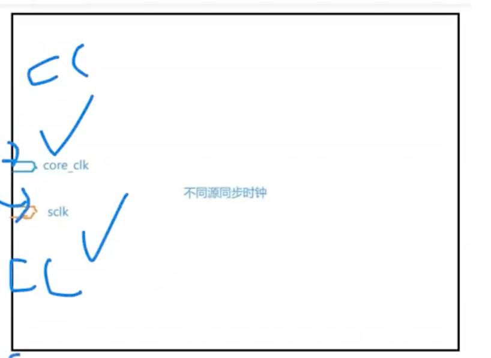
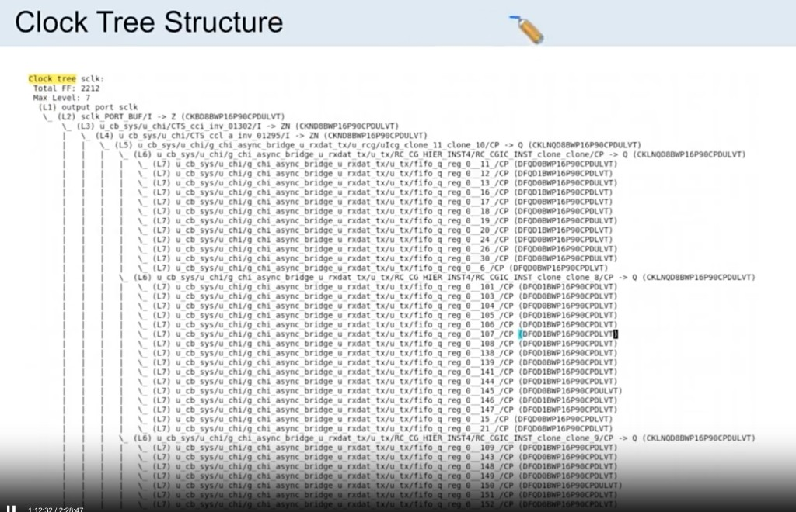

# CTS：CCOpt Mode、步骤、Log 与 Debug

> 日期：2026-10-09  
> 工艺：T12nm（12nm ARM A55）  
> 阶段：CTS（CCOpt）  
> 类型：流程口径 / 经验记录

## CCOpt Mode

```tcl
set_ccopt_mode -integration "native" \
    -cts_inverter_cells $cts_inverter_cells \
    -cts_buffer_cells $cts_buffer_cells \
    -cts_clock_gating_cells $cts_icgs \
    -cts_use_inverters true

set_ccopt_property
```

- `-integration "native"`：走 Innovus 原生 CCOpt。  
- `-cts_inverter_cells` / `-cts_buffer_cells` / `-cts_clock_gating_cells`：限定时钟树可用的 INV / BUF / ICG。  
- `-cts_use_inverters true`：允许用反相器长树。  
- `set_ccopt_property`：后续按 pin / net 设 sink type、`insertion_delay` 等属性。

## CTS 几大步骤

1. **Clustering**：按 sink 位置 / 负载聚类，决定树的扇出结构。  
2. **Balance**：按 skew group 做插入延迟均衡。  
3. **Routing Clock Net**：按 Clock NDR（Top / Trunk / Leaf）布时钟网。  
4. **Post Conditioning**：布完后的修 DRV、微调 skew / useful skew。

## CTS 结果分析

```tcl
report_ccopt_skew_groups
```

看各 skew group 的 insertion delay、skew 是否落在目标内。

## CTS Log 解析

在 CTS log 里重点搜这三类：

1. **DAG**（日志中搜索 `DAG`）：时钟时序图 / 依赖图是否按预期建出来。  
2. **Insertion delay**：树的插入延迟量级（本工艺经验见 [Clock Path / Data Path 预算](./cts-path-budget.md)）。  
3. **Skew**：组内 / 组间 skew 是否异常。

## CTS 做完要检查

1. **Clock Tree Insertion Delay**  
2. **Clock Skew**  
3. **高亮物理位置最远的 clock path**（几何最长）  
4. **高亮 clock tree 实际最长的 clock path**（延迟最长，不一定等于几何最远）

#### 高亮物理位置最远的 clock path 并报告出来

```tcl
report_clock_timing -to u_vcpu/u_cpu/u_ananke_dpu/u_dpu_dp/u_div/rem_carry_reg_17_/CP -type latency
```


几何最远 ≠ delay 最长：层、NDR、via、cell delay 都会拉开差距，两条都要看。

## Clock Tree Debug

关注这几款 cell：**ccl、ccl_a、cdb、USK**。

- **USK** 常用于 **useful skew**，插在 clock path 上。  
- 查 cell 信息：

```tcl
show_ccopt_cell_name_info
```

## Inter-Clock Balance

针对**异步、不同 `create_clock`** 的两棵树，若 Tree 长度相差较大，可用 **Inter-Clock Balance** 把两组一起拉齐。图中 `core_clk` 与 `sclk` 是不同源同步时钟，各自一棵树，再合成一个 balance 组。



```tcl
create_ccopt_skew_group -name core_clk -sources core_clk -auto_sinks
create_ccopt_skew_group -name sclk     -sources sclk     -auto_sinks
create_ccopt_skew_group -name ClockGroup000 -balance_skew_groups {core_clk sclk}
```

先各自 `auto_sinks` 成组，再用 `-balance_skew_groups` 把 `core_clk` 与 `sclk` 绑到同一个 Inter-Clock 组。

## Clock Tree Structure

**一定要看**，用来 debug 长 Tree 过程（层次、clone、落到哪些 FF）。

通过 clock tree structure 去反推 memory 摆放得合不合理，怎么去把 clock 的common path 做长



图中 `sclk` 示例：Total FF 2212、Max Level 7，从 `output port sclk` → `sclk_PORT_BUF` → INV/CKBD 逐级展开到 leaf FF。层次过深或某一支突然拉长，就从这棵结构往下追。

## 相关笔记

- [set_ccopt_property target_skew](../../tcl/ccopt-target-skew.md)
- [CTS 要点：Sink Type / SDC→CCOpt / Clock NDR / Routing](./cts.md)
- [CTS：Clock Path / Data Path 预算](./cts-path-budget.md)
- [Clock Port：位置 / NDR 2w2s / Shielding](./clock-port-mid-io.md)
- [Innovus CCOpt CTS 脚本](../../tcl/innovus-ccopt-cts.md)
