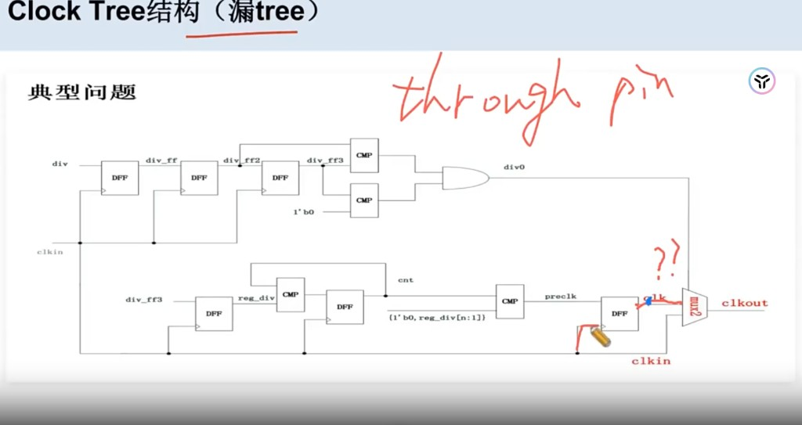
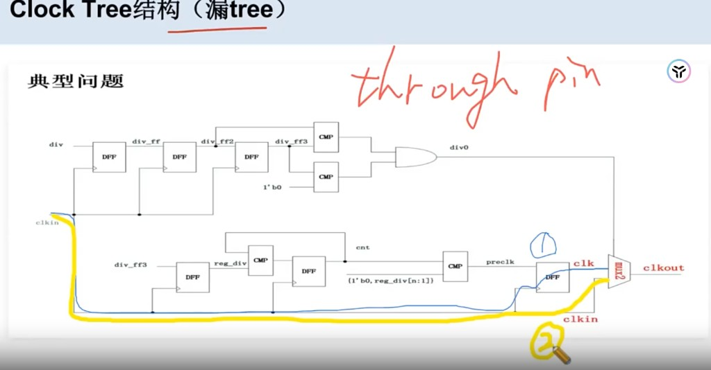
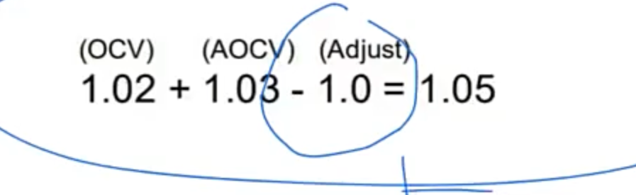

# CTS：CCOpt Mode、步骤、漏 Tree 与 Debug

> 日期：2026-10-09  
> 工艺：T12nm（12nm ARM A55）  
> 阶段：CTS（CCOpt）  
> 类型：流程口径 / 经验记录

## CCOpt Mode

```tcl
set_ccopt_mode -integration "native" \
    -cts_inverter_cells $cts_inverter_cells \
    -cts_buffer_cells $cts_buffer_cells \
    -cts_clock_gating_cells $cts_icgs \
    -cts_use_inverters true

set_ccopt_property
```

- `-integration "native"`：走 Innovus 原生 CCOpt。  
- `-cts_inverter_cells` / `-cts_buffer_cells` / `-cts_clock_gating_cells`：限定时钟树可用的 INV / BUF / ICG。  
- `-cts_use_inverters true`：允许用反相器长树。  
- `set_ccopt_property`：后续按 pin / net 设 sink type、`insertion_delay` 等属性。

## CTS 几大步骤

1. **Clustering**：按 sink 位置 / 负载聚类，决定树的扇出结构。  
2. **Balance**：按 skew group 做插入延迟均衡。  
3. **Routing Clock Net**：按 Clock NDR（Top / Trunk / Leaf）布时钟网。  
4. **Post Conditioning**：布完后的修 DRV、微调 skew / useful skew。

## 漏 Tree：在 DFF/Q 上定义 generated clock

典型场景：`clkin` 进某颗 DFF 的 CK，该 DFF 的 **Q** 再作为时钟接到 `mux2` 的一路输入；另一路则是 `clkin` 直连 `mux2`。若工具把这颗 DFF 的 Q 当成普通数据终点、**不继续当 clock 往下长**，就会出现 **漏 Tree**——DFF → mux2 这一段没有进时钟树。



**做法：** 在图中 `??`（DFF 的 Q，课件上标为 `clk`）定义 `create_generated_clock`，让时钟从 Q **through** 到 mux2，把 DFF→mux2 这段也长进 Tree：

```tcl
create_generated_clock -name clk_div2 \
  -source [get_pins div_reg/CK] \
  -divide_by 2 \
  [get_pins div_reg/Q]
```

- `-source`：源时钟边沿所在 pin（这里是分频/时钟 DFF 的 CK）。  
- `-divide_by`：按实际分频关系改（不一定是 2）。  
- 目标 pin：该 DFF 的 **Q**（下游真正当 clock 用的点）。

普通数据 DFF 的 Q **不要**建 generated clock；只有 Q 继续当时钟源（分频、再送到 mux / 别的 CK）时才需要。

### 到 mux2 的两路尽量 Balance

同一 `mux2` 上常有两路 clock 汇合（见下图标记）：

1. **路径 1**：经 DFF/Q（generated clock）进 mux  
2. **路径 2**：`clkin` 直连 mux  



两路 insertion delay 差太大时，mux 后 `clkout` 域 skew / 时序会很难看。可在 **mux2** 上配合：

- 设为 **`stop_pin`**（或按项目口径设 through / stop，见 [Clock Sink Type](./cts.md)），明确 CTS 在 mux 处如何收束 / balance  
- 或设 **`insertion_delay` 为 0**（及按需要微调正负），让两路往 mux 对齐  

```tcl
# 示例：按实际 mux 时钟相关 pin 名替换
set_ccopt_property sink_type -pin <mux2_clk_pin> stop
set_ccopt_property insertion_delay -pin <mux2_clk_pin> 0
```

先保证 Q 上 generated clock 不漏 Tree，再在 mux2 用 sink type / `insertion_delay` 把 ①② 两路拉齐。

## CTS 结果分析

```tcl
report_ccopt_skew_groups
```

看各 skew group 的 insertion delay、skew 是否落在目标内。

## CTS Log 解析

在 CTS log 里重点搜这三类：

1. **DAG**（日志中搜索 `DAG`）：时钟时序图 / 依赖图是否按预期建出来。  
2. **Insertion delay**：树的插入延迟量级（本工艺经验见 [Clock Path / Data Path 预算](./cts-path-budget.md)）。  
3. **Skew**：组内 / 组间 skew 是否异常。

## CTS 做完要检查

1. **Clock Tree Insertion Delay**  
2. **Clock Skew**  
3. **高亮物理位置最远的 clock path**（几何最长）  
4. **高亮 clock tree 实际最长的 clock path**（延迟最长，不一定等于几何最远）

#### 高亮物理位置最远的 clock path 并报告出来

```tcl
report_clock_timing -to u_vcpu/u_cpu/u_ananke_dpu/u_dpu_dp/u_div/rem_carry_reg_17_/CP -type latency
```

几何最远 ≠ delay 最长：层、NDR、via、cell delay 都会拉开差距，两条都要看。

## PostCTS 做完要检查

1. **setup 和 hold**
2. **max_cap、max_transition 等 DRV**
3. **congestion map**
4. **density map**
5. **跨不同 module 的 isolation cell**
6. **VT 比例**
7. **hold buf 数量**；整体 instance 数量相对 preCTS 增加多少
8. **跟preCTS**做对比，看看一致性

### 为什么 PostCTS 要查 density

1. **后面 ECO 还要插 buffer**（修 hold / setup / DRV），density 太满会没地可插、或硬塞导致拥塞 / 时序恶化。  
2. **density 过高 → 动态电流密、dynamic IR Drop 变大**。  
3. 做 **ARM CPU** 时 **不要把 density 推得太满**，留空位；空处可插 **decap cell** 帮电源完整性。

Signoff 侧 density 量级见 [PR 后 Density 目标](./pr-density.md)。

## Clock Tree Debug

关注这几款 cell：**ccl、ccl_a、cdb、USK**。

- **USK** 常用于 **useful skew**，插在 clock path 上。  
- 查 cell 信息：

```tcl
show_ccopt_cell_name_info
```

## Inter-Clock Balance

针对**异步、不同 `create_clock`** 的两棵树，若 Tree 长度相差较大，可用 **Inter-Clock Balance** 把两组一起拉齐。图中 `core_clk` 与 `sclk` 是不同源同步时钟，各自一棵树，再合成一个 balance 组。


```tcl
create_ccopt_skew_group -name core_clk -sources core_clk -auto_sinks
create_ccopt_skew_group -name sclk     -sources sclk     -auto_sinks
create_ccopt_skew_group -name ClockGroup000 -balance_skew_groups {core_clk sclk}
```

先各自 `auto_sinks` 成组，再用 `-balance_skew_groups` 把 `core_clk` 与 `sclk` 绑到同一个 Inter-Clock 组。

## Clock Tree Structure

**一定要看**，用来 debug 长 Tree 过程（层次、clone、落到哪些 FF）。

通过 clock tree structure 去反推 memory 摆放得合不合理，怎么去把 clock 的 common path 做长。


图中 `sclk` 示例：Total FF 2212、Max Level 7，从 `output port sclk` → `sclk_PORT_BUF` → INV/CKBD 逐级展开到 leaf FF。层次过深或某一支突然拉长，就从这棵结构往下追。

## 看 timing derate




## 相关笔记

- [set_ccopt_property target_skew](../../tcl/ccopt-target-skew.md)
- [CTS 要点：Sink Type / SDC→CCOpt / Clock NDR / Routing](./cts.md)
- [CTS：Clock Path / Data Path 预算](./cts-path-budget.md)
- [Clock Port：位置 / NDR 2w2s / Shielding](./clock-port-mid-io.md)
- [Innovus CCOpt CTS 脚本](../../tcl/innovus-ccopt-cts.md)
- [CCOpt / CTD Debug Tcl](../../tcl/ccopt-clock-tree-debug.md)
