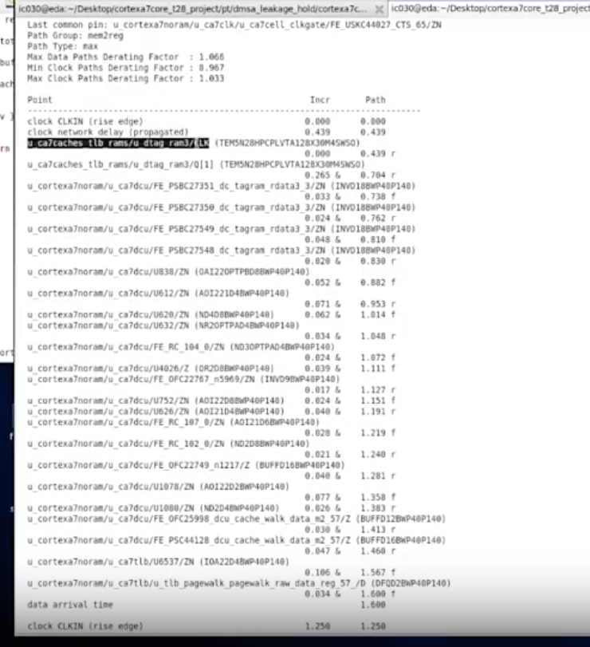
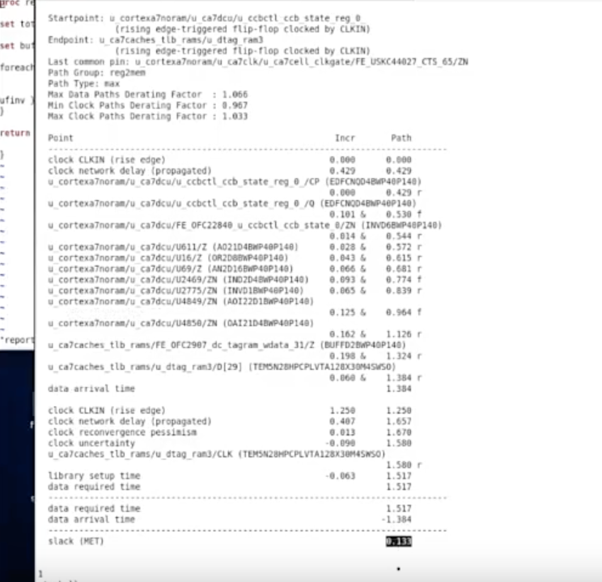
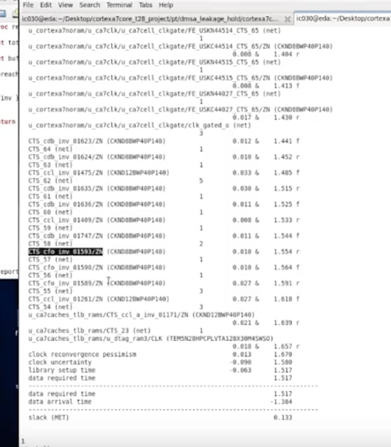
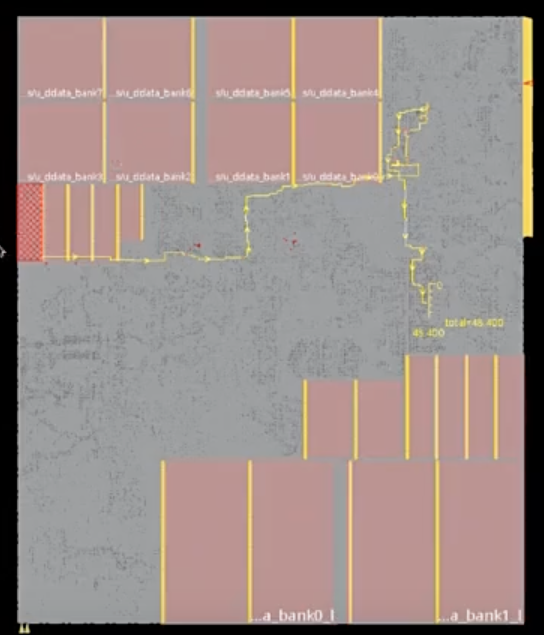
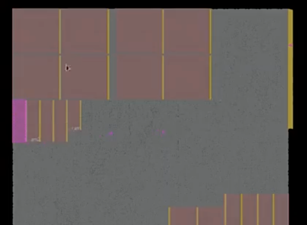

# Case：Clock Tree ECO 做短 Launch Path

> 日期：2026-10-18  
> 工艺：T28nm（Cortex-A7）  
> 阶段：PT DMSA 之后 · Clock Tree ECO  
> 类型：Debug Case

## 现象

PT 做完 **DMSA** 后，有一条 path 的 **setup 一直修不掉**，slack 约 **−60 ps**。

查过：

1. **Data path** 上没有 cell delay 特别大的点（不是驱动弱、HVT、fanout 那种单点）。  
2. 在 layout 上高亮这条 path，物理路径也对过。

所以不在 data path 上硬修，改做 **clock tree ECO**：把这条 path 的 **launch path** 做短，让数据更早发出。

Beginpoint 落在 memory `u_ca7caches_tlb_rams/u_dtag_ram3`（从该 memory 的 Q 发出的 `mem2reg`）。



## 先确认能不能做短

Launch clock 做短，会让 **以这个 memory 为捕获端** 的 path（`reg2mem`）setup 变紧。先看报到这个 beginpoint 的 slack 还有没有余量：

```tcl
# pt_shell
report_timing -to u_ca7caches_tlb_rams/u_dtag_ram3/*
```



本例 **slack = 0.133**（约 133 ps），相对要救的 −60 ps **有余量**，可以做短 launch。

| 项 | 本例 |
|------|------|
| 要修的 setup | 约 **−60 ps**（从该 memory launch 出去的 path） |
| 报到 memory 的 setup | **+133 ps**（`reg2mem`，捕获在 `u_dtag_ram3`） |
| 判断 | 133 ps > 60 ps，做短 launch 不至于把反向 path 打穿 |

## 怎么做短：找 bypass 点

把到这个 beginpoint 的 **整段 clock** 打出来，看树上哪一级可以 bypass（跳过一级 buffer/inv，缩短 insertion delay）：

```tcl
# pt_shell
report_timing -to u_ca7caches_tlb_rams/u_dtag_ram3/* -path_type full_clock
```



报告里沿 CTS cell（如 `CTS_ccl_*` / `CTS_cdb_*` / `CTS_cfo_*`）看 incremental delay，选可跳过的一级。

## Innovus 高亮 launch clock path

回到 PR，把同一条 clock 在 layout 上亮出来，对照物理位置再 bypass：

```tcl
# innovus
report_timing -to u_ca7caches_tlb_rams/u_dtag_ram3/* -path_type full_clock
set path "report_timing -to u_ca7caches_tlb_rams/u_dtag_ram3/* -path_type full_clock"
source hilite.tcl
hilitePath_1 -launch_clock_path -report_timing_args $path
```





黄线 / 高亮即 clock 从树干走到这颗 memory 的路径。确认绕远或级数偏多的那段后，做 **bypass**，再回 PT 看原来 −60 ps 的 path，以及 `reg2mem` 余量是否还有

## 如何 bypass 

看这个文档 **/Users/heytea/Desktop/ic/docs/吾爱ic知识笔记/pt/memory-hold-dmsa-clock-eco-shorten.md**


## 口径

| 步骤 | 目的 |
|------|------|
| Data path 无大 delay + layout 高亮 | 排除「组合逻辑单点太慢」，转向 clock |
| `report_timing -to <beginpoint>/*` | 看做短 launch 会伤到的捕获端还有多少 setup |
| `-path_type full_clock` | 在时钟树上找 bypass 点 |
| `hilitePath_1 -launch_clock_path` | 在 Innovus 里看这条 launch tree 的物理路径 |
| bypass | 缩短 launch insertion delay，修 setup |

## 相关笔记

- [CTS 涉及脚本](../../tcl/cts-related-scripts.md)
- [CTS：CCOpt Mode、步骤、漏 Tree 与 Debug](./cts-ccopt-mode-debug.md)
- [CTS：Clock Path / Data Path 预算](./cts-path-budget.md)
- [Hold Time Analysis](./hold-time-analysis.md)
