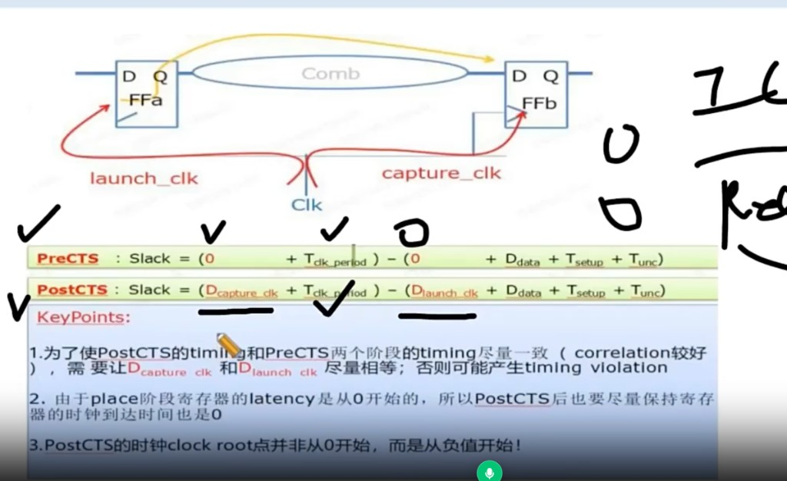

# CTS：Clock Path / Data Path 预算

> 日期：2026-10-08  
> 工艺：T12nm（12nm ARM A55）  
> 阶段：CTS  
> 类型：经验数字

## 口径

**T28nm ，signoff 的 clock path 在 150ps，data path 在 350ps。 因此在PR实现的时候会约束一点，如在cts设置 clock path为120ps**

| 路径 | 经验量级 |
|------|----------|
| Clock path | ~150 ps |
| Data path | ~350 ps |

做 CTS / 看 timing 时，可拿这对数字当本工艺的粗量级参考；具体以当时 period、corner、实际 report 为准。

## Pre-CTS / Post-CTS Slack 与相关性

- **Pre-CTS**：launch / capture 时钟 latency 按 0 理想化。  
- **Post-CTS**：代入真实的 \(D_{launch\_clk}\) / \(D_{capture\_clk}\)。  
- 要让 Post-CTS 与 Pre-CTS **correlation** 好，应尽量让两边 clock delay 接近；placement 阶段 latency 按 0 假设，Post-CTS 也尽量把寄存器处 clock 到达压近目标（必要时 clock root 可从负值起调）。
- 在 preCTS阶段 uncertainty 会留大点就是给 Capture Time 和Lanch Time 留有余量
- T_setup 指的是图中第二个 reg 的 timing arc 的delay，跟 这个reg 的 D pin 和clock pin 的transition 有关

- Hold： Capture 沿到来后 数据需要保持稳定的时间
- setup：Capture 沿到来前 数据需要保持稳定的时间

## 相关笔记

- [CTS 要点：Sink Type / SDC→CCOpt / Clock NDR / Routing](./cts.md)
- [CTS：CCOpt Mode、步骤、漏 Tree 与 Debug](./cts-ccopt-mode-debug.md)
- [Clock Port：位置 / NDR 2w2s / Shielding](./clock-port-mid-io.md)
- [Innovus CCOpt CTS 脚本](../../tcl/innovus-ccopt-cts.md)
