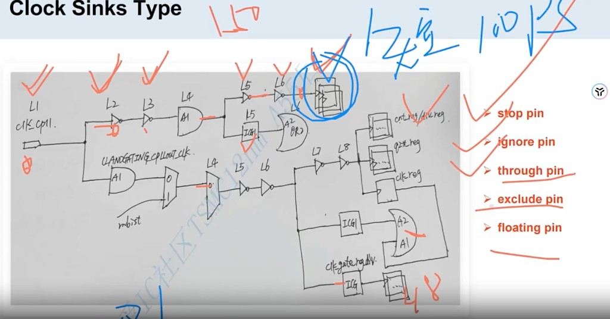
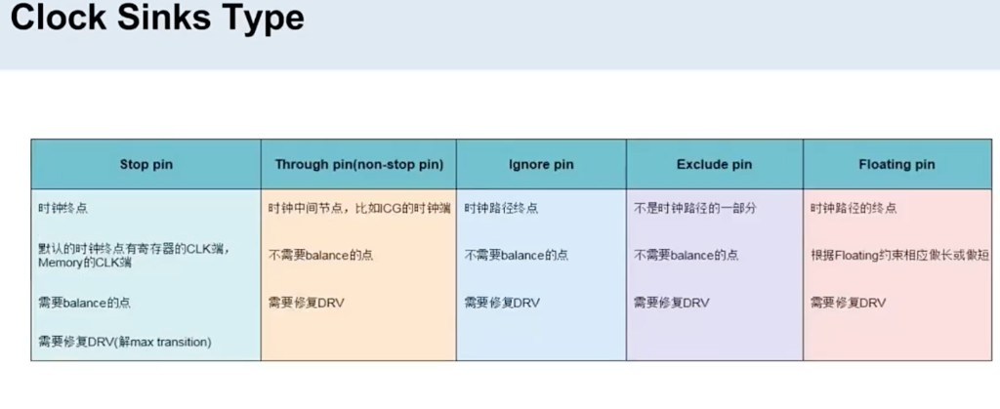
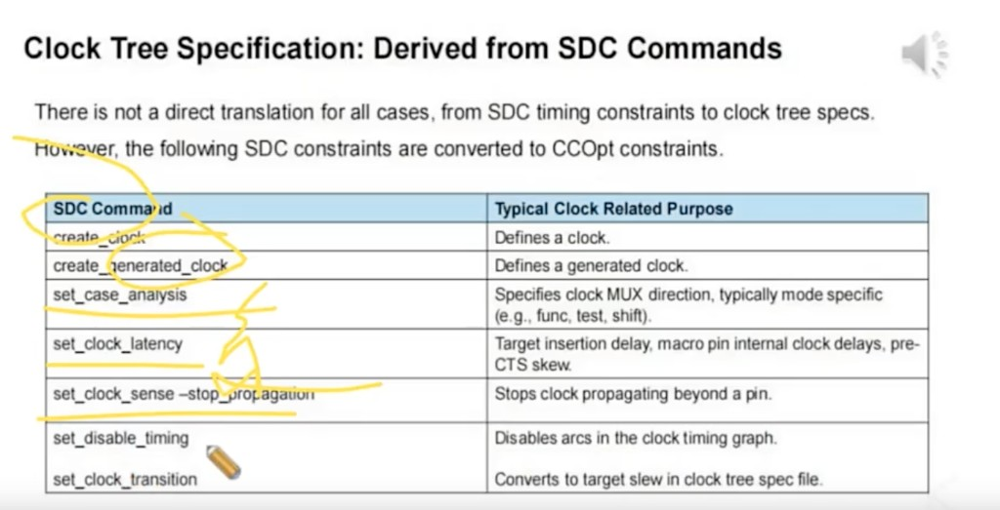
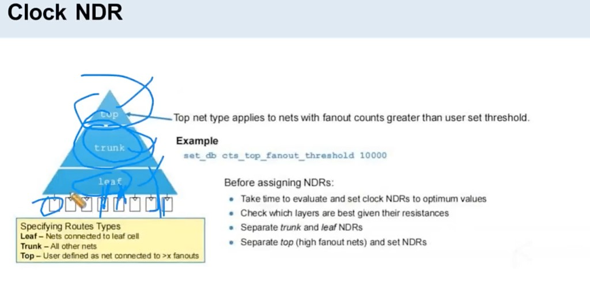
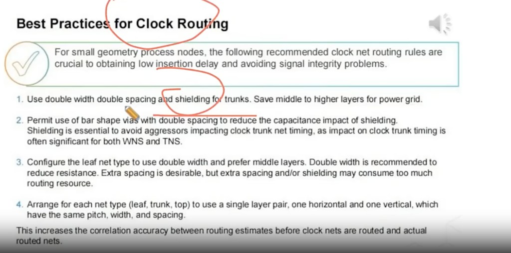

# CTS 要点：Sink Type / SDC→CCOpt / Clock NDR / Routing

> 日期：2026-10-08  
> 工艺：T12nm（12nm ARM A55）  
> 阶段：CTS（CCOpt）  
> 类型：概念口径 / 经验记录

本页汇总 CTS 常用口径：**sink 怎么分类**、**哪些 SDC 会进时钟树规格**、**Clock NDR 怎么按 Top/Trunk/Leaf 分**、**Clock Routing 最佳实践**。

## Clock Sink Type

**Q：clock sink type 有哪些？**

> **stop pin、ignore pin、through pin、exclude pin、floating pin**





| Type | 含义 | Balancing | DRV |
|------|------|-----------|-----|
| **stop pin** | 时钟终点（如寄存器 / Memory 的 CLK） | 需要 balance | 要修 max tran 等 |
| **through pin**（non-stop） | 时钟中间节点（如 ICG 的 clock 端；MUX / 与门 / 或门的时钟相关端） | 不需要 balance | 仍要修 DRV |
| **ignore pin** | 也是路径终点，但不参与 balance | 不需要 | 仍要修 DRV |
| **exclude pin** | 不视为时钟路径的一部分 | 不需要 | 仍要修 DRV |
| **floating pin** | 终点；按 Floating 约束相应做长或做短 | 按约束调整 | 仍要修 DRV |

### 查看 sink type

```tcl
get_ccopt_property <pin> sink_type
```

用来确认某个 pin 被 CCOpt 当成 stop / through / ignore / exclude / floating 中的哪一种。

### Hold：用 insertion_delay 做短 / 做长

图中最上面那条到 **3 个 reg** 的 path 若有 **hold** 问题，可以把那条 clock path **做短**：

```tcl
# 做短：insertion_delay 设为正，例如 0.1ns（100ps）
set_ccopt_property insertion_delay <那3颗reg的clock pin> 0.1
```

做长则设为负值：

```tcl
# 做长：例如 -0.1ns
set_ccopt_property insertion_delay <那3颗reg的clock pin> -0.1
```

课件手写「做短 100ps」即对应 `0.1`（单位 ns，以工具约定为准）。先查 `sink_type`，再对目标 reg 设 `insertion_delay`。

## SDC → CCOpt：Clock Tree Specification

不是每条 SDC 都会变成时钟树规格，但下面这些会自动转成 **CCOpt / clock tree spec** 相关约束（课件：**Clock Tree Specification: Derived from SDC Commands**）。



| SDC 命令 | 典型时钟相关用途 |
|----------|------------------|
| `create_clock` | 定义 clock |
| `create_generated_clock` | 定义 generated clock |
| `set_case_analysis` | 指定 clock MUX 方向（常按 mode：func / test / shift） |
| `set_clock_latency` | 目标 insertion delay、macro pin 内部 clock delay、pre-CTS skew |
| `set_clock_sense -stop_propagation` | 阻止 clock 越过某 pin 继续传播 |
| `set_disable_timing` | 关掉时钟 timing graph 上的 arc |
| `set_clock_transition` | 转成 clock tree spec 里的 target slew |

读约束做 CTS 时：先确认这些 SDC 是否齐全/合理，再对照 sink type 与 `insertion_delay` 等 CCOpt 属性。

## Clock NDR（Top / Trunk / Leaf）

时钟 net 按树层级分三类，再分别套 NDR（课件：**Clock NDR**）。



| Route type | 定义 |
|------------|------|
| **Leaf** | 直接连到 leaf cell（sink）的 net |
| **Trunk** | 既不是 Leaf、也不是 Top 的其余 clock net |
| **Top** | 用户定义：fanout 超过阈值的高扇出 net（树根附近） |

Top 的门槛示例：

```tcl
set_db cts_top_fanout_threshold 10000
```

`cts_top_fanout_threshold` 设为 10000 时，fanout 大于该值的 net 按 **Top** 处理。

### 设 NDR 前建议

- 先评估再定 clock NDR，在面积与性能之间取平衡  
- 看各层金属电阻：Top / Trunk 多用高层 / 厚金属，降 RC  
- **Trunk 与 Leaf 分开**设 NDR（Leaf 数量多、空间紧）  
- **Top（高扇出）单独**设 NDR  

与本项目 clock port 的 [NDR 2w2s / shielding](./clock-port-mid-io.md) 同一思路：入口与树干更宽更稳，靠近 sink 的 leaf 另定规则。

## Clock Routing 最佳实践

课件：**Best Practices for Clock Routing**。小尺寸工艺节点上，下面这些时钟 net 布线规则对拿到**低 insertion delay**、避免信号完整性问题很关键。



1. **Trunk 用 2w2s（double width / double spacing）并加 shielding。** 中间到更高层留给 power grid。
2. **允许 bar via + double spacing**，减轻 shielding 带来的电容。Shielding 必须有：aggressor 打到 clock trunk 上，对 **WNS / TNS** 往往都很明显。
3. **Leaf net 用 double width，并优先走中间层。** 加倍线宽是为了降电阻；额外 spacing 更好，但 extra spacing / shielding 会吃掉太多布线资源，leaf 上要克制。
4. **每种 net type（leaf / trunk / top）各用一对金属层**（一层横、一层纵），且这对层的 pitch、width、spacing 一致。这样时钟还没真正布出去时，预估走线与实际 routed net 的相关性更好。

## 相关笔记

- [CTS：Clock Path / Data Path 预算](./cts-path-budget.md)
- [CTS：CCOpt Mode、步骤、Log 与 Debug](./cts-ccopt-flow.md)
- [Clock Port：位置 / NDR 2w2s / Shielding](./clock-port-mid-io.md)
- [Innovus CCOpt CTS 脚本](../../tcl/innovus-ccopt-cts.md)
- [Placement 做什么](./placement.md)
- [Flow Checklist（PR 全流程检查表）](./flow-checklist.md) —— CTS / postCTS 列的检查项
