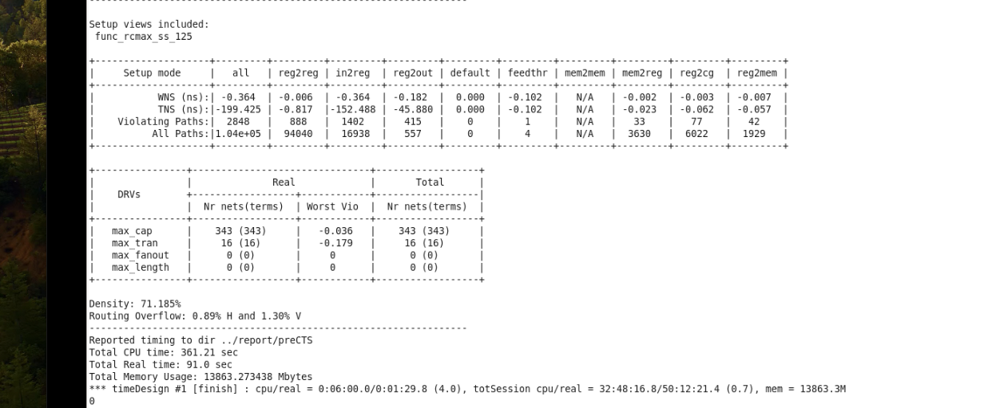
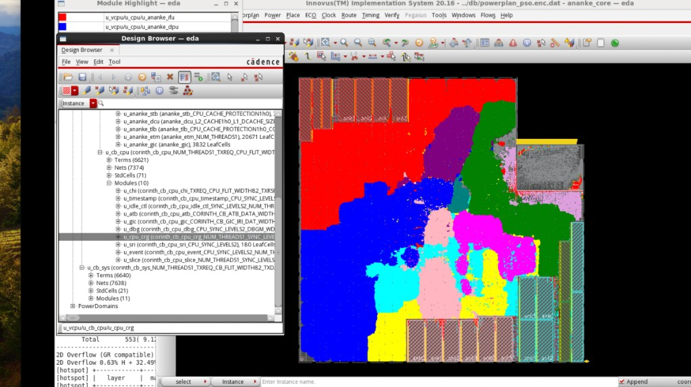
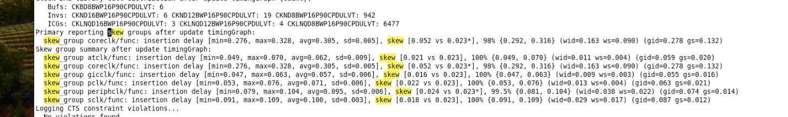

# 设计规模速览

> 工艺：T12nm  
> 设计：ARM A55（顶层 `ananke_core`）  
> 阶段：项目概况  
> 类型：设计规模 / 经验记录

## 口径

**本项目是 12nm ARM A55**（Innovus 设计名 `ananke_core`）。

该设计约有 **51 万个 cell、2 个 power domain、22 个 Macro**

**T12nm是9track Post-Color**

**T12nm 相邻 pin且相同的color容易出现drc问题；因此T12nm 下层金属双曝光，同色必须更大间距或者用不同的color的cell**

2 个 power domain 分别为：**PD_PSO**、**PD_AW_ON**。

| 项 | 内容 |
|------|------|
| 产品 | ARM A55 |
| 工艺 | 12nm（T12nm） |
| 设计名 | `ananke_core` |
| Cell | ~51 万 |
| Power domain | 2：`PD_PSO`、`PD_AW_ON` |
| Macro | 22 |

## Place 

做完place的日志

density: 71%

高亮各 module 后的布局（大块同色聚集，macro 在外围）：

不好的module分布:
1. 一个 module 被拆分成很多块，散落到各处
2. 孤岛
3. 逻辑和自己的memory离太远，飞线出现对角线（例： Place 可以做到：
u_xxx_dpu 全部挤在左上 → 高亮一片蓝，很漂亮
它读写的 idata / ddata SRAM 却被 floorplan 放在右下
从 hierarchy 看分布很好；从 数据通路 看，每一拍进出 memory 的 bus 都要斜跨几乎整个 core。）
4. module 分布挤到channel区域，congestion地图看起来很红

**核心就一句：Module 高亮看的是「同层次的 cell 有没有聚在一起」；和 memory 的远近**

## CTS

**CTS skew结果：coreclk 的 skew_group: avg skew是 305ps、max skew是 328ps， target_skew 设置20ps**

#### T12nm 检查了哪些 view？

**setup view: rc_max_ss_125、corner_tt_25**

**hold view: rc_min_ff_40**

#### useful skew 大小？

**控制在 100ps以内，T12设置为50ps**

## 跟T12nm比较

double patterning工艺
设计低功耗设计，power switch、多电源设计
placement做 early clock flow
routing做 power aware routing(让routing 遵守更多的约束)

## 备注

- 数量与 PD 名为项目经验记录，具体以当时网表 / UPF / floorplan 为准。
- 后续可补充：macro 类型分布（SRAM / IP 等）、各 PD 电压与开关策略。

