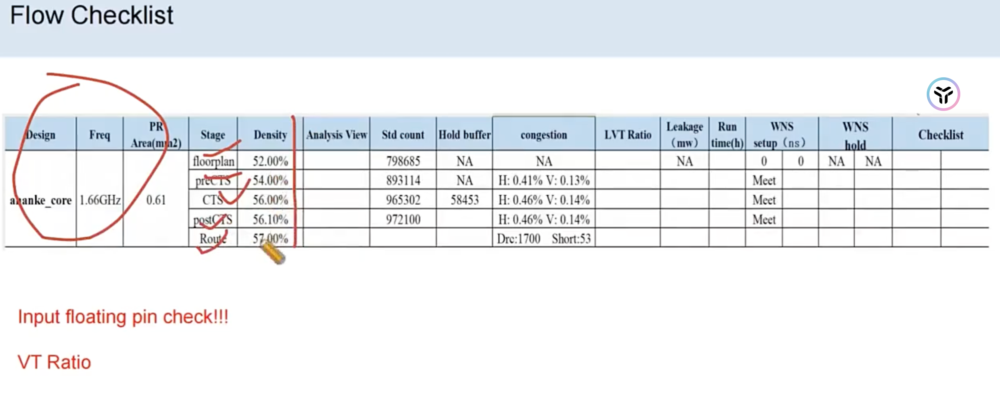

# Flow Checklist（PR 全流程检查表）

> 日期：2026-10-08  
> 工艺：T12nm（12nm ARM A55）  
> 阶段：PR 全流程（floorplan → route 每个阶段收口回填）  
> 类型：checklist / 指标记录

## 表

**Design：ananke_core ｜ Freq：1.66GHz ｜ PR Area：0.61**〔面积单位图上看不清，像是 mm²〕

| 指标 | floorplan | preCTS | CTS | postCTS | route |
|------|-----------|--------|-----|---------|-------|
| **Density** | 52.00% | 54.00% | 56.00% | 56.10% | 57.00% |
| Std count | 〔?〕 | 798685 | 893114 | 965302 | 972100 |
| Hold buffer | NA | NA | 〔?〕 | 58453 | 〔?〕 |
| congestion | NA | H: 0.41% V: 0.13% | H: 0.46% V: 0.14% | H: 0.46% V: 0.14% | 〔?〕 |
| VT Ratio / Analysis View | 〔?〕 | 〔?〕 | 〔?〕 | 〔?〕 | 〔?〕 |

**读出来了但列对位存疑的：**

- DRC：`Drc: 1700 Short: 53`（route 列附近，可能是独立行）
- WNS setup (ns)：`0 / 0 / Meet / Meet / Meet`（5 格，"Meet" 更像底部 Checklist 行的值）
- WNS hold：`NA / NA / …`
- LVT Ratio、Leakage (mW)、Run time (h)：多处 NA，具体格没对上
- 表里另有单独一格：**Input floating pin check!!!**

## 注记

1. 数字用本地 OCR 跑了两遍（原图 + 2 倍放大）+ 肉眼对照，**Density 一行 5 格对位是确定的**，其余行的列对位有猜的成分——标了〔?〕的格请对照原图补/纠。
2. 阶段列读作 floorplan / preCTS / CTS / postCTS / route；"preCTS" 原图模糊，也可能写的是 "place"。
3. 设计名 OCR 读作 `ahanke_core`，按项目设计名修正为 `ananke_core`。

## 原图（以图为准）

## 相关笔记

- [ARM A55 设计规模](./design-scale.md) —— Design / Freq 同口径
- [PR 后 Density](./pr-density.md) —— Density 行同口径
- [Place 后检查 Input Floating](../../tcl/check/input-floating.md) —— 表里那条 "Input floating pin check!!!"
- [Innovus CCOpt CTS 脚本](../../tcl/innovus-ccopt-cts.md)
