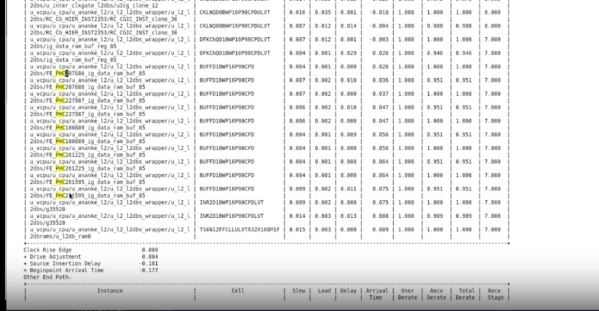
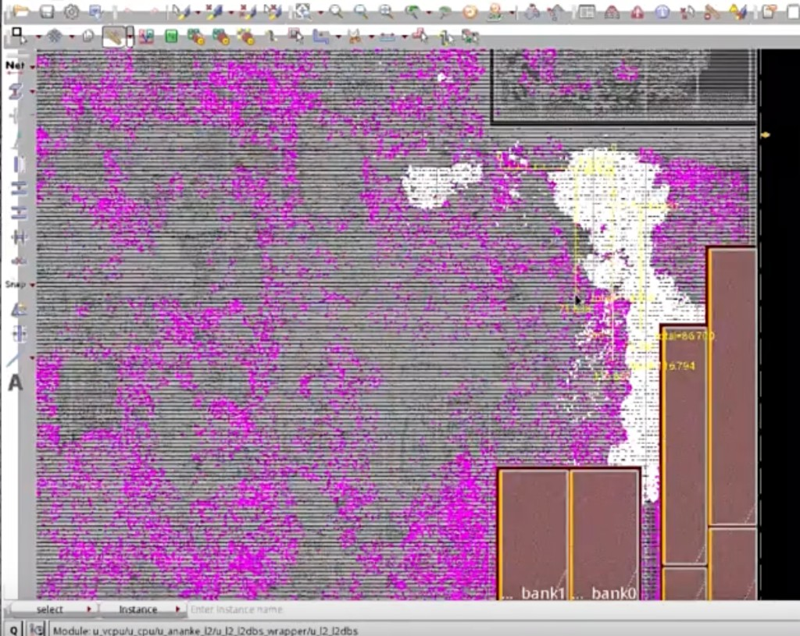
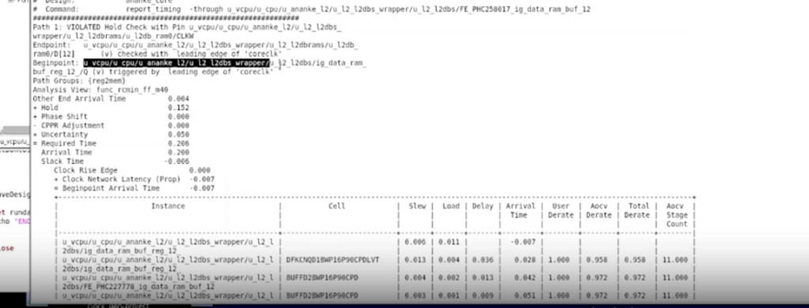

# Case：Hold Buffer 过多（CRPR=0 / Memory Channel）

> 日期：2026-10-17  
> 工艺：T12nm（12nm ARM A55）  
> 阶段：PostCTS · Hold 分析  
> 类型：Debug Case / 面试分享

---

## Case A：一条 path 上 PHC 过多 + CRPR=0

### 现象

PostCTS 后看 hold 报告，在 path 里搜 **PHC**，发现同一条 data path 上连续插了 **5 颗** hold buffer——偏多。经验上同一路径 **2～3 颗** 较常见。



### 先看物理分布

```tcl
select_obj [dbGet top.insts.name *PHC*]
```

在 layout 上看 PHC 落点；再用 **`selectModule`** 选中 hold buffer 特别多的 module，缩小分析范围。

### 对着某颗 PHC 报 timing

```tcl
report_timing -from <某个_PHC_instance或pin>
```

默认常是 **setup**，看 hold 前要先切分析类型：

```tcl
setAnalysisMode -checkType hold
```

本 case 在 hold 报告里发现 **CRPR（clock reconvergence pessimism / CPPR）为 0**——公共时钟路径的悲观量没被消掉，hold 被算紧，工具就多插 PHC。

### 完整时钟路径确认

同 module 的 reg 之间 **一定有 common path**。把 clock 全路径打出来核对：

```tcl
report_timing \
  -from u_vcpu/u_cpu/u_ananke_ifu/u_pf/u_pf_bpd/FE_PHC203791_bias_table_10__1 \
  -path_type full_clock
```

（`-from` 换成你实际在查的那颗 PHC / beginpoint。）

### 结论与处理

| 项 | 口径 |
|------|------|
| 根因判断 | 工具算错 / **未正确计算 CRPR**，hold 过悲观 → PHC 过修 |
| 处理 | **重新做时钟 propagated**（按项目流程重新 propagate clock / 更新 clock timing），再出 hold 报告核对 PHC 数量与 CRPR |
| 删多余 buffer | 选中后用 **`ecoDeleteRepeater`**（见 Tcl 页） |

正常应能在 `full_clock` / required 段看到非零的 CRPR/CPPR adjustment；若一直为 0，先别急着信「真要 5 颗 PHC」。

```tcl
select_obj [dbGet top.insts.name *PHC*]
ecoDeleteRepeater
```

完整说明见 [ecoDeleteRepeater](../../tcl/eco-delete-repeater.md)。

---

## Case B（面试分享）：白色 Module Reg → Memory，Channel 堆 PHC

### 场景

- **Path group**：`reg2mem`  
- **Startpoint**：白色高亮 module 内的 reg（例：`…/u_l2_l2dbs/…`）  
- **Endpoint**：旁边 **Memory** 的 `D`（例：`…/u_l2db_ram0/D[…]`）  
- Layout 上黄线为 reg→mem 连接；宏与逻辑之间的窄缝即 **memory channel**



### Hold 报告数字（本例）



| 项 | 数值 |
|------|------|
| Slack | **−6 ps**（VIOLATED） |
| Skew（经验对照） | ~**11 ps** |
| Uncertainty | **50 ps** |
| \(T_{hold}\)（library hold） | **152 ps** |
| CPPR Adjustment | **0.000**（与 Case A 同类信号，需警惕过修） |
| View | `func_rcmin_ff_m40` |

### 问题

工具在 **memory channel** 里插了 **比较多的 hold buffer（PHC）**：

- channel 本就窄，macro 又占多层金属  
- PHC 堆在 channel → **绕线 / congestion** 变差，后续 route、ECO 更难

### 处理（面试可讲的动作）

对 **Memory 的 D pin** 设 **Don’t touch**（或项目等价约束），限制工具在 MEM 口附近插/挪 cell：

→ 需要的 hold delay 被推到 **startpoint 所在白色 module** 一侧（往 launch reg 前移），**离开 channel**。

与 [Hold Time Analysis · Reg→MEM Don’t touch](./hold-time-analysis.md) 同一思路：保护 memory 口，PHC 往前插。

### 面试表述提纲（约 1 分钟）

1. **现象**：PostCTS hold，`reg2mem`，channel 里 PHC 扎堆；本例 slack −6ps，uncertainty 50ps，hold 152ps。  
2. **风险**：channel 拥塞、影响 mem 口 escape。  
3. **动作**：MEM `D` Don’t touch → buffer 转到 startpoint module。  
4. **延伸**：同时核对 CPPR/CRPR 是否为 0，避免「假 hold」驱动过修；真过修可用 `ecoDeleteRepeater` 清，并重做 clock propagated。

---

## 相关笔记

- [Hold Time Analysis](./hold-time-analysis.md)
- [ecoDeleteRepeater（删除 Buffer）](../../tcl/eco-delete-repeater.md)
- [CTS：CCOpt Mode、步骤、漏 Tree 与 Debug](./cts-ccopt-mode-debug.md)
- [Timing ECO 盯住 refinePlace 的 Max Move](./timing-eco-refineplace.md)
- [Pin 避开 M1–M2 / 双曝光](./pin-avoid-m1-m2.md)
