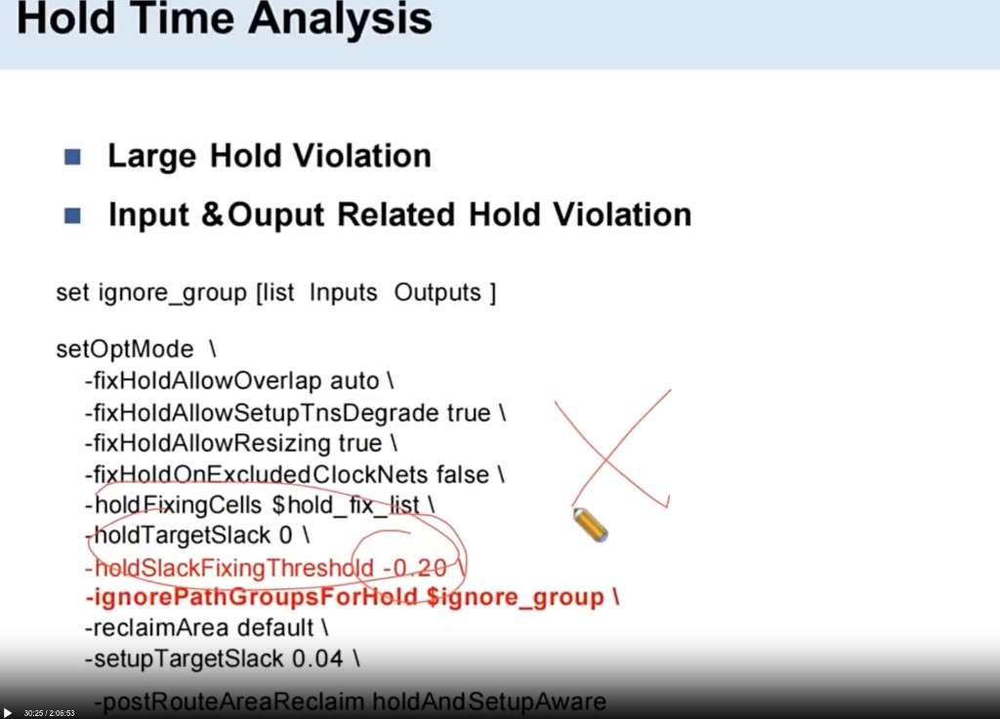
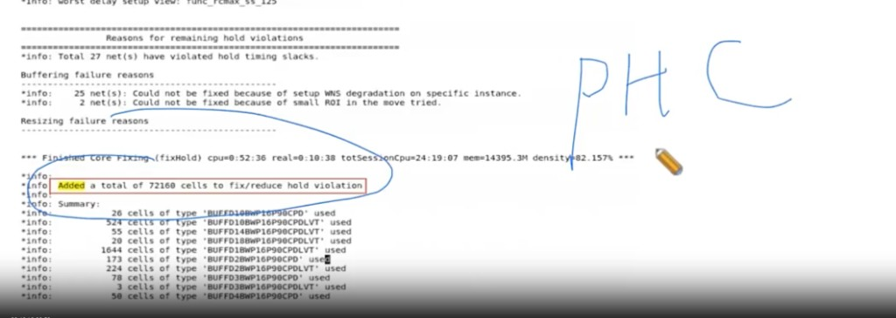
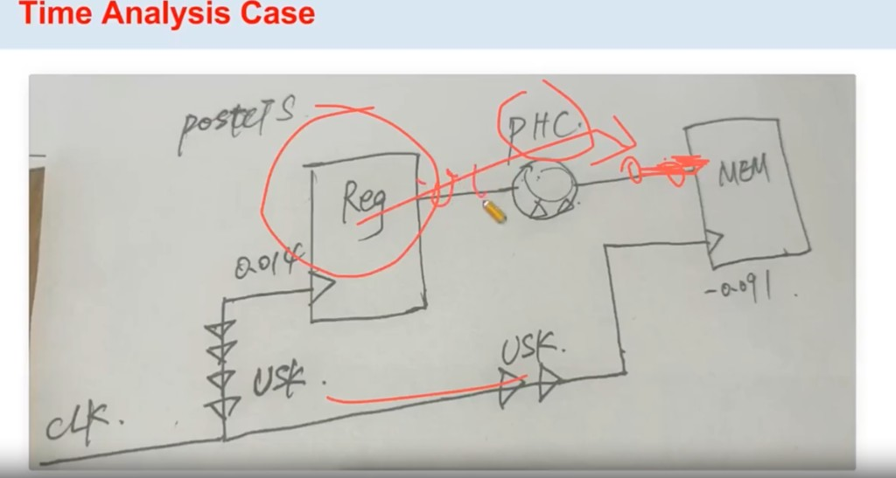

# Hold Time Analysis

> 日期：2026-10-17  
> 工艺：T12nm（12nm ARM A55）  
> 阶段：PostCTS / Opt（Hold）  
> 类型：经验口径

关注两类问题：

- **Large Hold Violation**
- **Input & Output Related Hold Violation**

## setOptMode：修 Hold 的阈值



```tcl
set ignore_group [list Inputs Outputs ]

setOptMode \
  -fixHoldAllowOverlap auto \
  -fixHoldAllowSetupTnsDegrade true \
  -fixHoldAllowResizing true \
  -fixHoldOnExcludedClockNets false \
  -holdFixingCells $hold_fix_list \
  -holdTargetSlack 0 \
  -holdSlackFixingThreshold -0.20 \
  -ignorePathGroupsForHold $ignore_group \
  -reclaimArea default \
  -setupTargetSlack 0.04 \
  -postRouteAreaReclaim holdAndSetupAware
```

### `-holdSlackFixingThreshold -0.20`

把工具**自动修 hold 的门槛**设在 **−200 ps**：

- slack **好于** −200 ps（例如 −50 ps、−100 ps）：交给 opt 插 buffer / resize 去修  
- slack **差于** −200 ps（例如 −300 ps、−500 ps）：**不要再硬修**

硬修超大 hold 会大量插 delay cell，**面积和功耗明显变大**，性价比差。

经验口径：**违例大于约 200 ps，多半是 clock tree 做得不好**（launch / capture 严重失衡、漏 tree、某支 insertion delay 异常等），应回到 CTS / skew / insertion_delay 查根因，而不是在 data path 上堆 hold buffer。

### 其它相关开关（同脚本）

| 选项 | 口径 |
|------|------|
| `-holdTargetSlack 0` | hold 修到 0 即可 |
| `-ignorePathGroupsForHold {Inputs Outputs}` | IO 相关 hold 先不纳入自动修（对应课件 Input & Output Related Hold） |
| `-holdFixingCells $hold_fix_list` | 限定用来修 hold 的 cell |
| `-setupTargetSlack 0.04` | setup 目标留一点 margin |

## 修完 Hold 后看什么

做完 hold 修复后，重点看：

1. **插了多少 hold buffer**（log 里 `Added a total of … cells to fix/reduce hold violation`）  
2. **hold buffer 分布**（常见命名带 **PHC**）  
3. **有没有局部区域插得特别多** → 再追根因



查 PHC（示例）：

```tcl
dbGet [dbGet -p2 top.insts.name *PHC*].name
# 或按项目习惯：
# dbGet top.insts.name *PHC*
```

局部插得特别多时，常见原因：

| 方向 | 说明 |
|------|------|
| **Clock skew 太大 / CTS 不好** | launch / capture 严重失衡，data path 被迫堆 delay |
| **Uncertainty 留太大** | hold 预算被吃掉，工具多插 buffer |
| **Derate 过约** | 时序过悲观，持修量虚高 |

（上图示例一次 fixHold 插了约 **7.2 万** 颗 cell，density 到约 **82%**——更要对照分布，判断是否过修、是否该回查 CTS / 约束。）

## 怎么尽量让 Hold 不过修

1. **PR（PostCTS）阶段先不跑** `optDesign -postCTS -hold`，改到 **PT 阶段**再修，配合 **refinePlace / ECO**。  
   - 好处：按 signoff 真实 hold 修，少在 PR 里按过悲观口径狂插 buffer。  
   - 风险：后期 ECO 可能 **绕不通**、塞不进，或迭代成本高。

2. 结合前文 **`-holdSlackFixingThreshold -0.20`**：超大约 200 ps 的大 hold **不硬修**，先查 clock tree / 约束。

3. **Hold view 不要开太多、也不要乱选**（见下节）——多余 corner 会放大“看起来要修”的量。

## Hold View 怎么选、选哪些 Corner

**原则：跟 PT signoff 对齐，一般 2～3 个 hold view 即可。**

做法：

1. 先跑 **第一版 PT**（例如 6 个 hold corner 都看一眼）。  
2. 看各 corner **相同点 / 不同点**：  
   - 某个 corner **WNS 最差**，且 **hold violation 的 endpoint 最多** → 往往能代表大部分情况，**加进 hold view**。  
   - 另有某个 corner 和其它差异大，按它修会 **多插很多 hold buffer** → 也值得 **单独加进 hold view**，避免漏场景。  
3. 其余与代表 corner 高度重合的，可先不进 PR 的 hold view，减轻过修。

| 问题 | 口径 |
|------|------|
| 选几个？ | 一般 **2～3 个** hold view |
| 为什么？ | 覆盖「最差且违例面最广」+「会驱动额外插 buffer 的特异 corner」，又避免 view 过多导致过修 / 过慢 |

## Case：PostCTS Hold 修复（Reg → MEM）

这是一条 **PostCTS hold violation 修复** 的典型 case：launch 为 **Reg**，capture 为 **MEM**，data path 上插 **PHC**；两边 clock path 上可见 **USK**（useful skew）。



### 1. 插 PHC，但避开 Memory 附近

修 hold 靠 data path 插 **buffer（PHC）** 做长数据。Memory 常占用 **M1–M4**，若在 MEM 口附近插太多 buf，容易 **堵绕线 / 加重 congestion**。

做法：对 memory 设 **Don’t touch**（或等价保护），让工具把 PHC **往 Reg 侧、往路径前段插**，而不是堆在 MEM 边上。

### 2. Capture path 上 USK 过多

若 **capture path 上 USK 明显多于 launch**（图中 capture 更“长”），多半是 **useful skew** 把 capture clock 做长了 → hold 更紧。

口径：**useful skew 不能设得太大**——除了让 clock tree 变长，还会 **面积、功耗变大**，并额外制造 hold，逼出更多 PHC。

## Case：Hold Buffer 过多（CRPR=0）

一条 path 上连续 **5 颗 PHC**（经验上 2～3 颗更常见）时，先查 layout / module，再用 hold + `full_clock` 看 **CRPR 是否为 0**；另有 **reg2mem + memory channel 堆 PHC**、对 MEM `D` Don’t touch 把 buffer 推回 startpoint module 的面试 case。完整见：

→ [Case：Hold Buffer 过多（CRPR=0 / Memory Channel）](./hold-phc-too-many-crpr.md)

## 项目后期阶段修 hold

1. clock tree ECO  
2. 优化 clock tree 长度（bypass）

## 相关笔记

- [CTS：CCOpt Mode、步骤、漏 Tree 与 Debug](./cts-ccopt-mode-debug.md)
- [CTS：Clock Path / Data Path 预算](./cts-path-budget.md)
- [CTS 要点：Sink Type / insertion_delay](./cts.md)
- [Timing Optimization 手段](./timing-optimization.md)
- [Timing ECO 盯住 refinePlace 的 Max Move](./timing-eco-refineplace.md)
- [PR 后 Density 目标](./pr-density.md)
