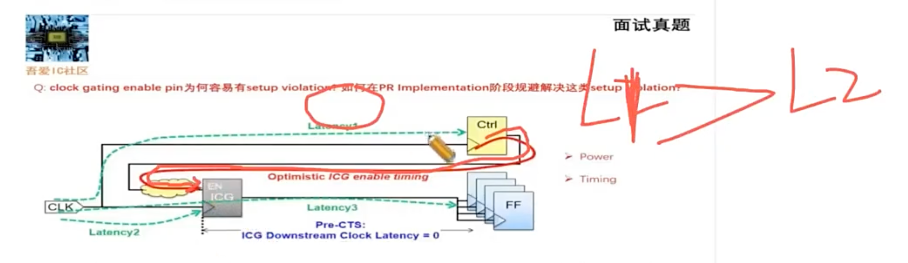
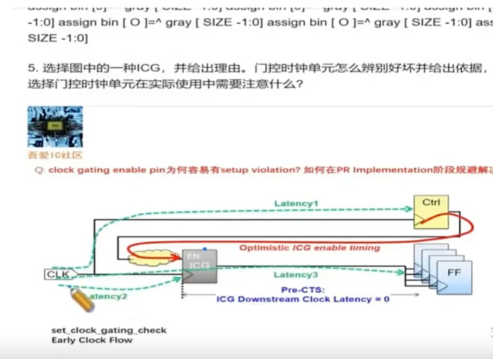

# ICG Enable Pin 容易 Setup 违例

> 日期：2026-09-29  
> 工艺：T12nm（12nm ARM A55）  
> 阶段：Place / CTS  
> 类型：原因分析 / 优化手段

## 造成原因

**根本原因：ICG 是 clock tree 中间的节点。capture path 小，Latency1 >> Latency2。**

| 路径 | 含义 | 相对长短 |
|------|------|----------|
| latency1 | CLK → Ctrl 寄存器时钟端（**launch**） | 长 |
| latency2 | CLK → ICG 时钟端（**capture**） | 短 |
| EN 数据路径 | Ctrl → 组合逻辑 → ICG 的 EN | 要在短 capture 窗口内赶到 |

Launch 时钟到得晚、capture 时钟到得早，EN 可用时间被吃掉 (Latency1 − Latency2)，所以 **ICG enable pin 容易 setup violation**。

- enable 又是控制逻辑汇聚出来的**深组合路径**，两头一挤就违例；
- place 阶段 clock 还是 ideal / estimated，估不准——**Pre-CTS 时 ICG 下游 clock latency 按 0 估（偏乐观）**，CTS 一做完就冒出来；
- PR 里要按这个结构看，而不是当普通 FF-to-FF：CTS 之后重点查 ICG EN 的 setup（`set_clock_gating_check`；Early Clock Flow 也是冲这个来的）。

## PR 阶段规避方式

1. **ICG 聚拢摆放**：`setPlaceMode -place_global_clock_gate_aware true` —— ICG 靠拢扇出寄存器（见 [Placement 做什么](./placement.md)）；但这只保 clock 侧，enable 侧还得靠下面几条
2. **把生成 enable 的寄存器和 ICG 拉近**：region / physical bound 约束到同一区域，别让 enable 横穿 die
3. **扇出大就拆 ICG**：clone ICG 分担 fanout，一个带几十个 flop 就拆几个，顺带缩短 enable net
4. **提前留 margin**：对 ICG 的 enable 路径单独加 clock uncertainty，防 CTS 后变差
5. **Don't Use 低阈值别一刀切**：enable 关键路径收不回来时，放几档低阈值 cell 出来救 setup
6. **CTS 配合**：ccopt 做 useful skew，把 ICG 的 insertion delay 和源寄存器对齐
7. **ECO 兜底**：ecoPlace 把 ICG 挪近源寄存器、路径上插 buffer / upsize——挪完看 refine place 的 max move（超 150 timing 会变差，见 [Timing ECO 盯住 refinePlace 的 Max Move](./timing-eco-refineplace.md)）

## 相关笔记

- [低功耗设计手段](./low-power-design.md) —— Clock Gating 在低功耗手段里的位置
- [Placement 做什么](./placement.md) —— `setPlaceMode -place_global_clock_gate_aware true`
- [Timing ECO 盯住 refinePlace 的 Max Move](./timing-eco-refineplace.md) —— ECO 挪 cell 的 max move 口径
