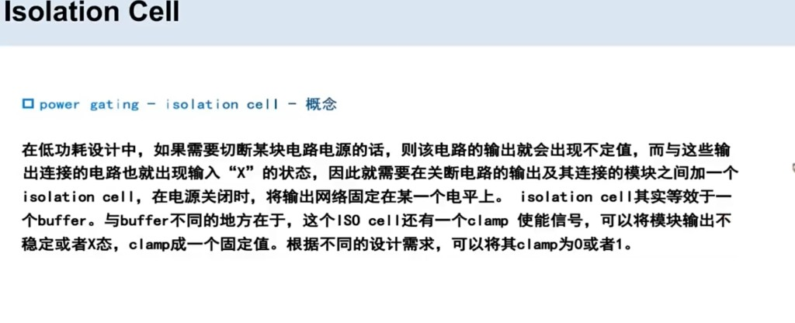
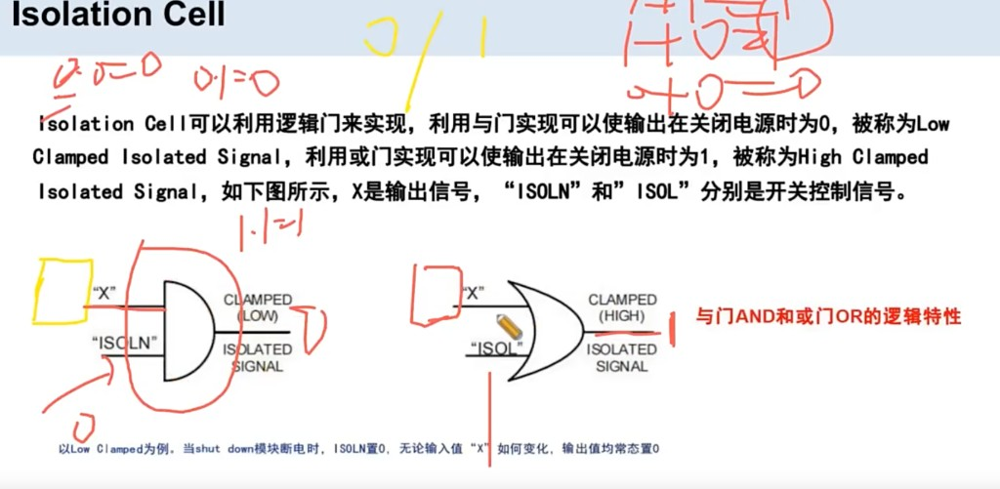
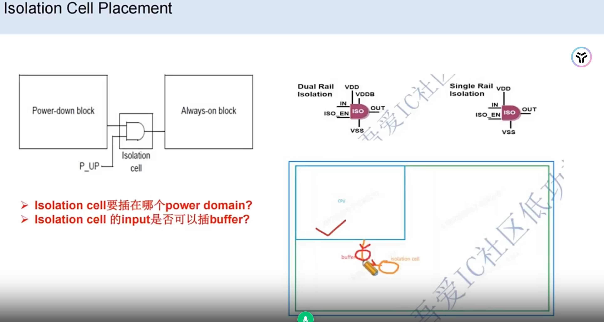

# Isolation Cell

> 日期：2026-09-20（2026-10-08 补充 placement domain 口径与课件图）  
> 来源：截图识别整理（picture-tcl）  
> 阶段：基本概念 · 低功耗 / Power gating  
> 工艺：T12nm（12nm ARM A55）

## 本项目口径

**Q：Isolation cell 放在哪个 domain？**

**放在更 on 的 domain——当电源 off 之后还有电的那个 domain 区域。**

T12nm 项目里有两个 domain：**always on domain** 和 **pd_pso domain**，本项目 isolation cell 放在 **always on domain** 上。

关断域掉电时，ISO 本身仍需有电才能把输出钳到 0/1，因此放在 **always-on（常开）域**。

也可以放在 **always-off domain** 上，但比较麻烦：需要插入 buffer 去解 **transition**，并且 **isolation 的类型也需要改**。本项目采用 always-on，更简单。

## 图 1：Isolation Cell 概念



课件原文（照录）：

> **Isolation Cell**  
> power gating - isolation cell - 概念  
>  
> 在低功耗设计中，如果要切断某块电路电源的话，则该电路的输出就会出现不定值，而与这些输出连接的电路就会出现输入“X”的状态，因此就需要在关断电路的输出及其连接的模块之间加一个 isolation cell，在电源关闭时，将输出网路固定到某一个电平上。isolation cell 其实等效于一个 buffer。与 buffer 不同的地方在于，这个 ISO cell 还有一个 clamp 使能信号，可以将模块输出不稳定或者 X 态，clamp 成一个固定值。根据不同的设计需求，可以将其 clamp 为 0 或者 1。

## 图 2：与门钳 0 / 或门钳 1



课件：ISO 可用逻辑门实现。**X** 是关断域输出；**ISOLN / ISOL** 是开关控制。

**Clamp 为 0 用与门（AND）；clamp 为 1 用或门（OR）。**

| 实现 | 控制脚 | 关电时输出 | 名称 |
|------|--------|------------|------|
| **与门 AND** | **ISOLN** | **0** | Low Clamped Isolated Signal |
| **或门 OR** | **ISOL** | **1** | High Clamped Isolated Signal |

Low clamp 例：shut down 时 **ISOLN = 0**，不论 **X** 如何，输出恒为 **0**（与门：一边为 0，结果必为 0）。或门一边为 1 则输出恒为 1。

## 图 3：Isolation Cell Placement（放在哪个 domain）



课件：左边 **Power-down block**（可关断），右边 **Always-on block**，isolation cell 放在**常开一侧**——就是"更 on 的 domain"。下面画了两种 ISO cell 的供电：**Dual Rail VDD Isolation**（多一个常供电的 VDDB 脚，掉电靠它维持钳位）和 **Single Rail VDD Isolation**。

图上另有两条提问：一条是 "Isolation cell 放在哪一个 power domain"；另一条涉及 input 端和 buffer，原图文字看不清，待补。

## 一句话

> **Isolation cell（ISO）** 属于低功耗设置：切断电路电源掉电时，输出连接会出现 X 态，这时加上 isolation cell，把输出 clamp 成 0/1。**Clamp 为 0 用与门，clamp 为 1 用或门。**

## 要点

| | 说明 |
|--|------|
| **何时要** | Power gating 切断某块电源 |
| **不插会怎样** | 关断域输出不定；下游输入变 **X** |
| **插在哪** | 关断电路的**输出** 和 与它相连的模块**之间** |
| **关电时做什么** | 把输出网 **固定到某一电平** |
| **和 buffer** | 数据通路像 buffer；多 **clamp enable**，把 X / 不定态钳成定值 |
| **钳位值** | 按设计 **clamp 到 0 或 1**（ISOLO / ISOHI）：**钳 0 → 与门，钳 1 → 或门** |
| **本项目放置** | 放在**更 on 的 domain**（off 后还有电的区域）；T12nm 有 **always on / pd_pso** 两个 domain，本项目放 **always on domain**。也可放 always-off，但需加 buffer 解 transition，且 isolation 类型要改 |

```text
关断域（电源可切）          always-on / 其它域
   逻辑 …… 输出 ──► [ISO] ──► 下游输入
                     ▲
              clamp 使能（关电时打开钳位）
```

和 **ESD Clamp Cell** 不是一类：ISO 钳 **信号网** 防 X；ESD Clamp 给静电低阻通路。

## 面试速答

**Q：Isolation cell 是干什么的？和 buffer 有什么不同？**  
> Power gating 关电后输出会浮空/X，ISO 插在关断域和下游之间，把网钳到 0 或 1。像 buffer，但多 clamp 使能。

**Q：Isolation cell 加在哪里？**  
> 放在更 on 的 domain——掉电后还有电的域。T12nm 项目放 always on domain（项目里还有个 pd_pso domain）


## 转录注记

- 图 `isolation-cell.png` / `isolation-cell-and-or-clamp.jpg` 若尚未放入 `docs/experience/t12nm/images/`，需自行拷入同名文件。

## 相关笔记

- [T12nm · 低功耗设计手段](./low-power-design.md)
- [T12nm · UPF 传递功耗设计意图](./upf-power-intent.md)
- [T12nm · Power Switch：Core / Channel 与边界](./power-switch-core-channel.md)
- [T12nm · Macro / Std Cell 供电（Global→Switch→Local→Memory）](./pg-term-local-vdd.md)
