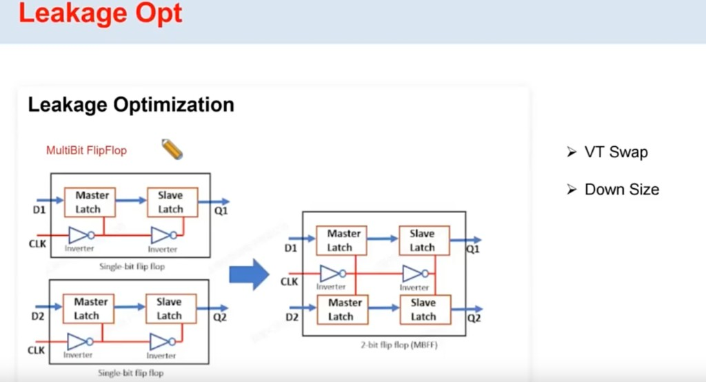

# Leakage 优化

> 日期：2026-10-17  
> 工艺：T12nm（12nm ARM A55）  
> 阶段：Opt / Power  
> 类型：方法口径 / 经验记录

课件 **Leakage Opt** 三条常用手段：

## 1. VT Swap

有 timing margin 的路径上，把偏快、漏电大的 cell（如 LVT）换成漏电更小的档（如 RVT / HVT），压 leakage。

注意：HVT 常用于修 hold，但跨 corner 偏差大，swap 时要对着 setup/hold margin 看，避免换完 hold/setup 翻车。

## 2. Down Size

非关键路径上把驱动过大的 cell **降 size**，减小晶体管宽度 / 漏电路径，同时往往也省一点 dynamic。

前提仍是：降完后 transition、setup/hold、DRV 还能过。

## 3. Multi-Bit Reg（MBFF）

把多颗 **single-bit FF** 合成 **multi-bit flip-flop**。图中 2-bit 示例：两路 D/Q 的 master/slave 仍各自一套，但 **时钟侧反相器链共用**，少一批 clock inverter 晶体管 → **leakage 和面积下降**。

适用：位宽相关、物理上能聚在一起的寄存器；聚合后要看 placement、时钟脚负载和时序是否可接受。

## 相关笔记

- [Power Optimization 手段（Leakage / Dynamic）](./power-optimization.md) —— High Effort / PowerAware、选 corner 等
- [低功耗设计手段](./low-power-design.md)
- [Timing Optimization 手段](./timing-optimization.md)
