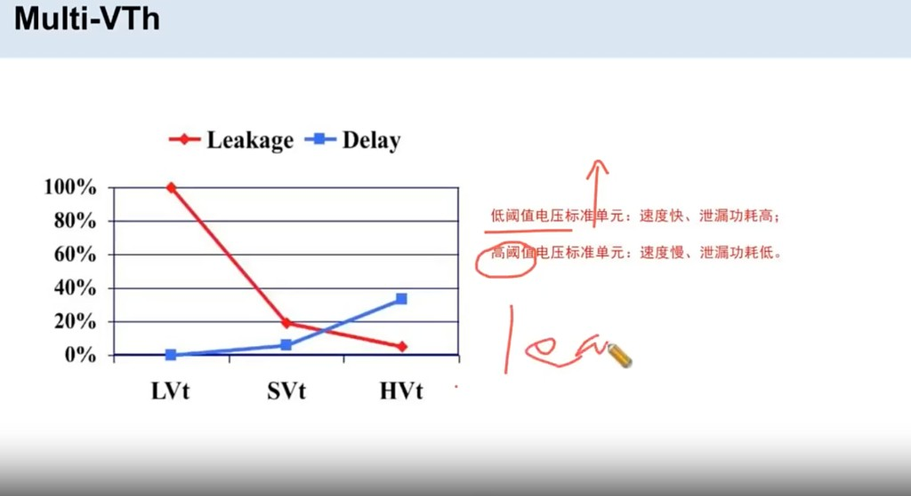
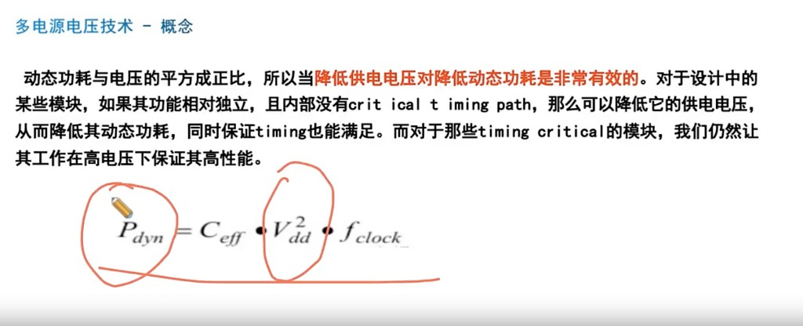
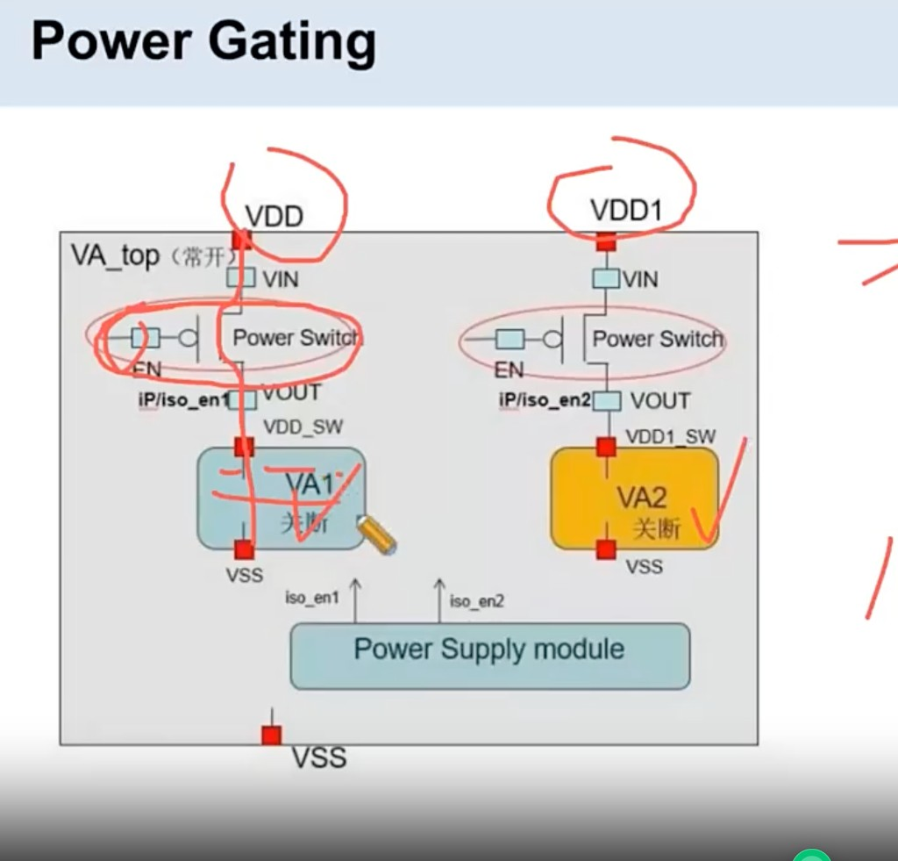
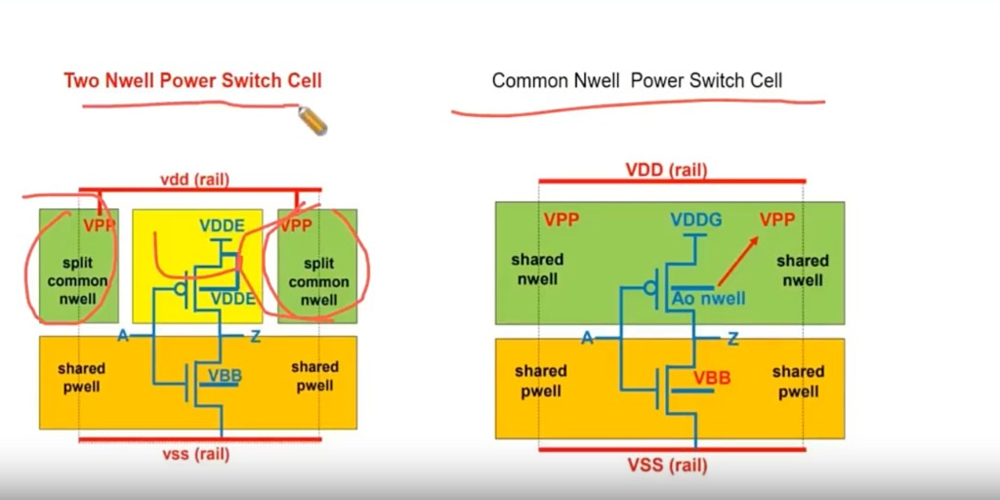
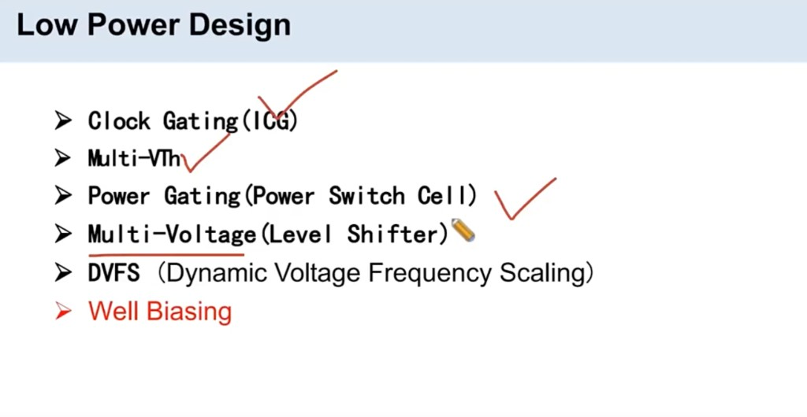

# 低功耗设计手段

> 工艺：T12nm（12nm ARM A55）  
> 阶段：低功耗 / 电源规划  
> 类型：方法清单 / 经验记录

## 口径

| # | 手段 | 含义 |
|---|------|------|
| 1 | **Clock Gating（ICG）** | 时钟门控，在**逻辑综合**阶段加 |
| 2 | **Multi-Vth** | 使用不同阈值电压的 cell |
| 3 | **Power Gating** | Power Switch Cell；会带来 **Isolation**（见 [Isolation Cell](./isolation-cell.md)） |
| 4 | **Multi-Voltage** | 多电源电压 / Voltage domain；动态功耗与电压相关（公式含 \(V_{dd}^{2}\)） |
| 5 | **DVFS** | Dynamic Voltage Frequency Scaling，动态调整电压和频率 |
| 6 | **Well Biasing** | 井偏置：N-well 接 **VDD ± ΔV**，P-substrate 接 **VSS ± ΔV**，调阈值以改善性能与功耗 |
| 7 | **Multi-bit Reg** | 多比特寄存器；也属于低功耗相关设置 |

## 说明

1. **Clock Gating**：关掉不工作逻辑的时钟，减动态功耗；ICG 一般在综合插入。  
2. **Multi-Vth**：高阈值 cell 漏电小、速度慢；低阈值相反。按路径选用。  
3. **Power Gating**：用 Power Switch 切断某 power domain 的供电；断电域与常电域之间要加 **Isolation**（详见 [Isolation Cell](./isolation-cell.md)）。本项目 `PD_PSO` 的 `addPowerSwitch` 属于这一类。  
4. **Multi-Voltage**：不同 voltage domain 电压不同，跨域要用 Level Shifter。公式里 **动态功耗跟电压成正比**（见下节 \(V_{dd}^{2}\)）。  
5. **DVFS**：运行中按负载升降电压和频率。  
6. **Well Biasing（井偏置）**：  
   - **N-well** 连接到 **VDD ± ΔV**  
   - **P-substrate** 连接到 **VSS ± ΔV**  
   从而调整阈值电压，改善 **performance**，并改善功耗。  
7. **Multi-bit Reg**：多比特寄存器打包，也属于低功耗相关设置（相对单比特 reg 可减面积/时钟相关开销）。

## Clock Gating enable 为何容易 setup violation

**根本原因：ICG 是 clock tree 中间的节点。**

如图，`latency1` 远大于 `latency2`：

| 路径 | 含义 | 相对长短 |
|------|------|----------|
| latency1 | CLK → Ctrl 寄存器时钟端（**launch**） | 长 |
| latency2 | CLK → ICG 时钟端（**capture**） | 短 |
| EN 数据路径 | Ctrl → 组合逻辑 → ICG 的 EN | 要在短 capture 窗口内赶到 |

Launch 时钟到得晚、capture 时钟到得早，EN 可用时间被吃掉，所以 **ICG enable pin 容易 setup violation**。

PR 里要按这个结构看，而不是当普通 FF-to-FF：CTS 之后重点查 ICG EN 的 setup。图中还标了 Pre-CTS 时 ICG 下游 clock latency 按 0 估（偏乐观），以及 `set_clock_gating_check`、Early Clock Flow。


## HVT / SVT / LVT 的 PPA 差异

**低阈值电压改善 performance，高阈值电压改善 leakage。**

| 类型 | Delay（性能） | Leakage |
|------|----------------|---------|
| **LVT** | 最快（delay 最低） | 最高 |
| **SVT** | 居中 | 居中（相对 LVT 明显下降） |
| **HVT** | 最慢 | 最低 |

- 低阈值标准单元：速度快、泄漏功耗高。  
- 高阈值标准单元：速度慢、泄漏功耗低。



## Multi-Voltage（多电源电压）概念

**公式里动态功耗跟电压成正比**（图中动态功耗公式含 \(V_{dd}^{2}\)，降压对动态功耗效果显著）：

\[
P_{dyn} = C_{eff} \cdot V_{dd}^{2} \cdot f_{clock}
\]

口径（来自课件）：

- 动态功耗与电压的平方相关，降低供电电压对减动态功耗很有效。  
- 相对独立、没有关键时序路径的模块，可降低供电电压，在满足时序的前提下减动态功耗。  
- 有关键时序路径的模块保持高电压，保证高性能。



## Power Gating 结构

顶层 **VA_top 常开**。里面可关断的子域（图中 **VA1 / VA2**）不直接吃全局 VDD，而是：

```text
VDD  ──► Power Switch (VIN) ──► VDD_SW  ──► VA1
VDD1 ──► Power Switch (VIN) ──► VDD1_SW ──► VA2
```

| 项 | 图中做法 |
|------|----------|
| 常开 | `VA_top` |
| 可关断 | `VA1`、`VA2`（关断） |
| Switch | `VDD`/`VDD1` 进 `VIN`，`VOUT` 接到域内 `VDD_SW` / `VDD1_SW` |
| 控制 | `EN` 接 `iso_en1` / `iso_en2`，由 Power Supply module 给出 |
| 地 | 两边 **VSS 仍接全局 VSS**，不切断 |

关断时只断电源、不断地；跨域信号还要 Isolation（与 Power Switch 配套）。本项目路径是 Global VDD → Power Switch → VDD_LOCAL → Memory，和这张图同一类结构。



## Power Switch：12nm Common Nwell / 28nm Two Nwell

**12nm 用 Common Nwell，28nm 用 Two Nwell。**

| 工艺 | Power Switch 阱结构 |
|------|---------------------|
| **28nm** | **Two Nwell**：N-well 拆开（中间 PMOS 阱 + 两侧 split common nwell，接 **VPP**）；P-well 为 shared pwell（NMOS body 接 **VBB**）。PMOS source 接 **VDDE** |
| **12nm** | **Common Nwell**：一整条 **shared nwell**（N-well bias 接 **VPP**）；下面 **shared pwell**（body 接 **VBB**）。PMOS source 接 **VDDG** |

本项目是 12nm，Power Switch 按 **Common Nwell（shared nwell）** 来理解，不是 28nm 那种两段 N-well。



## 为何 Physical / Timing Signoff 后还要看 IR Drop

芯片做完 **physical signoff** 和 **timing signoff** 后，仍要看 **IR Drop**，因为：

1. 芯片**不同位置的电压不一样**（供电阻抗 / 电流导致压降）。  
2. **电压跟功耗成正比**（动态功耗与电压相关，见 Multi-Voltage 公式）。  

因此要看在**电压偏低**的位置，功耗（以及依赖电压的时序/功能裕量）是否还满足。

Physical / Timing 过了只说明几何与标称/约束下的时序；IR Drop 查的是**片上实际供电是否够匀、够高**。

## 原图



## 相关笔记

- [T12nm · Macro / Std Cell 供电（Global→Switch→Local→Memory）](./pg-term-local-vdd.md)
- [T12nm · Power Switch：Core / Channel 与边界](./power-switch-core-channel.md)
- [Innovus 02 Floorplan](../../tcl/innovus-02-floorplan.md)
