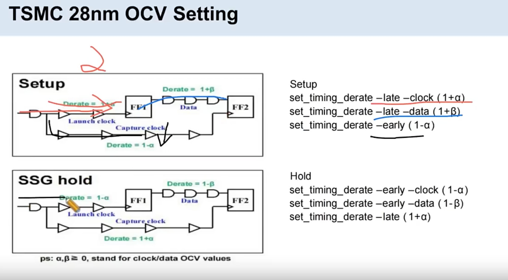
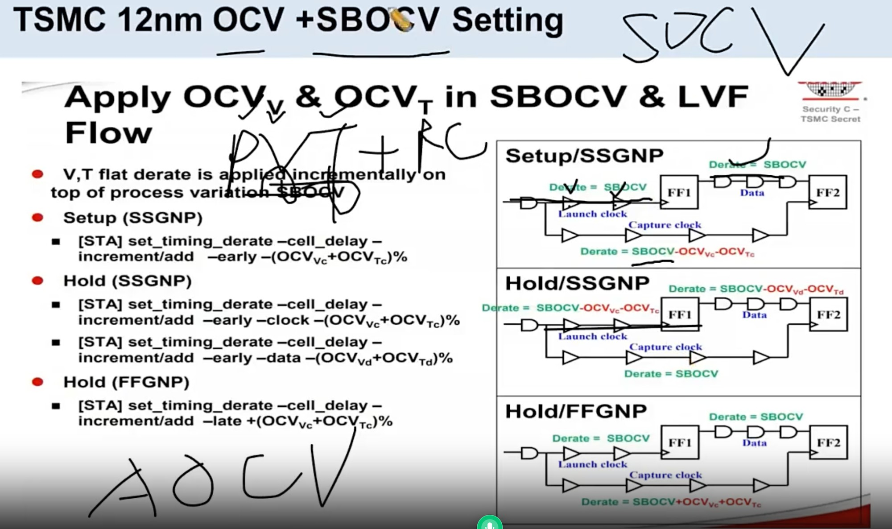

# Placement OCV Setting（ssg corner）

> 工艺：TSMC 28nm / TSMC 12nm  
> 阶段：Placement（OCV / SBOCV / timing derate）  
> 类型：方法口径 / 经验记录

## 口径

**TSMC 28nm 工艺中，placement 阶段设置的 OCV 是在 ssg corner 下。**




## TSMC 12nm：OCV + SBOCV

**在T12nm中 PR阶段**

- 对lanuch path 设置 set_timing_derate -late 1.04 （变大 4%）

- 对capture path 设置 set_timing_derate -early 0.92 （变小 8%）

**TSMC 12nm 不像 TSMC 28nm 只设置 OCV，而是通过设置 OCV + AOCV（SBOCV）（Stage-Based OCV）。**

OCV是采用一刀切，设置一个derating系数， AOCV 是根据cell的逻辑深度来设置derating系数，一般是 逻辑越深，derating系数越小




## PR 中设置的 set_timing_derate 怎么得到的？

根据PT中的 SignOff 文档（foundry提供） 然后 加上  0.[x] % 来过约一点

```tcl

```


## 为什么要对 hold 设置多个 corner

**Q：为什么要对 hold 设置多个 corner？**

**A：因为芯片 hold 出现问题就是功能挂掉**，而且不像 setup 那样**没法通过降频、调电压来解决**——所以只好**通过多个场景来 signoff，预防 hold 出问题**。

## 转录注记

1. 图 1（28nm rule）：表格由截图分两次识别拼全，第 2 行 constraint 两次交叉识别一致；左侧 Setup 框图（FF1 / FF2、Launch clock / Capture clock / Data 的 derate 公式标注）与表格对应；原图带红色手写笔迹（讲解标注，未转录）。
2. 图 2（SBOCV）：左片讲 Stage-Based OCV 概念（每个 stage 一个 sigma、随机差异 + 系统差异，total sigma 手写公式）；右片讲 SBOCV Setting（sigma 由 foundry 提供，随 stage depth / 距离累积，N·sigma = √N · sigma）；图中含示例命令（setOcvMode 等），原样见图片，此处未展开。

## 相关笔记

- [Placement 做什么](./placement.md) —— placement 阶段约束汇总
