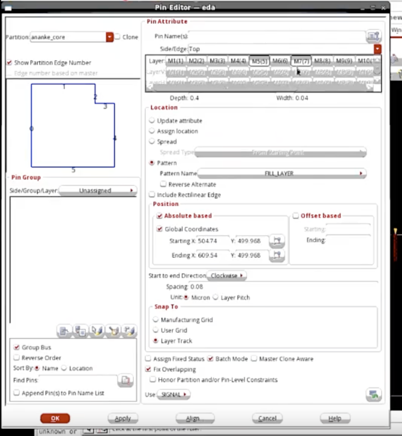

# 剩余 Pin 的 Pin Editor 摆放

> 工艺：T12nm  
> 阶段：Floorplan / Pin assignment  
> 类型：GUI 操作经验  
> 工具：Innovus → Pin Editor

在脚本批量摆完部分 pin（如 clock / 优先 IO）之后，**剩余 pin** 可在 Innovus **Pin Editor** 里按区间继续摆放。

## 界面截图

## 本项目关键设置

| 项 | 取值 |
|------|------|
| Partition | `ananke_core` |
| Side/Edge | **Top** |
| Layer | **M5、M7**（避开 M1–M2） |
| Depth / Width | `0.4` / `0.04` |
| Location | **Pattern** → Pattern Name：`FILL_LAYER` |
| Position | Absolute based + Global Coordinates |
| Start | X=`504.74`，Y=`499.968` |
| End | X=`609.54`，Y=`499.968` |
| Direction | Clockwise |
| Spacing | `0.08` Micron |
| Snap To | **Layer Track** |
| Batch Mode | 开 |
| Fix Overlapping | 开 |
| Pin Use | **SIGNAL** |

## 操作要点

1. 选 partition、边（本例 Top），层选中高层（M5/M7），不要勾 M1–M2。  
2. Location 用 **Pattern / FILL_LAYER**，在 Start–End 区间内铺剩余 SIGNAL pin。  
3. 开 **Batch Mode** + **Fix Overlapping**，并 **Snap To Layer Track**，保证在 track 上、尽量不重叠。  
4. Apply 后检查 pin 列表与布局视图，再与脚本摆的 pin 一起做连通 / 间距检查。

## 与脚本的关系

脚本侧常见对应：

- `setPinAssignMode -pinEditInBatch true` ↔ Batch Mode  
- `editPin -fixOverlap 1 ... -layer 5/7` ↔ Fix Overlapping + 高层出 pin  

GUI 适合「剩余大批 SIGNAL pin」按一段边填充；优先 pin（如 clock）仍建议单独定点。

## 相关笔记

- [T12nm · Pin 不要出在 M1–M2](./pin-avoid-m1-m2.md)
- [T12nm · Clock Port：位置 / NDR 2w2s / Shielding](./clock-port-mid-io.md)
- [Innovus 02 Floorplan](../../tcl/innovus-02-floorplan.md)
