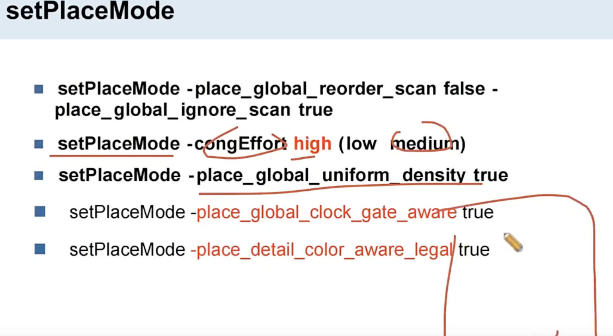
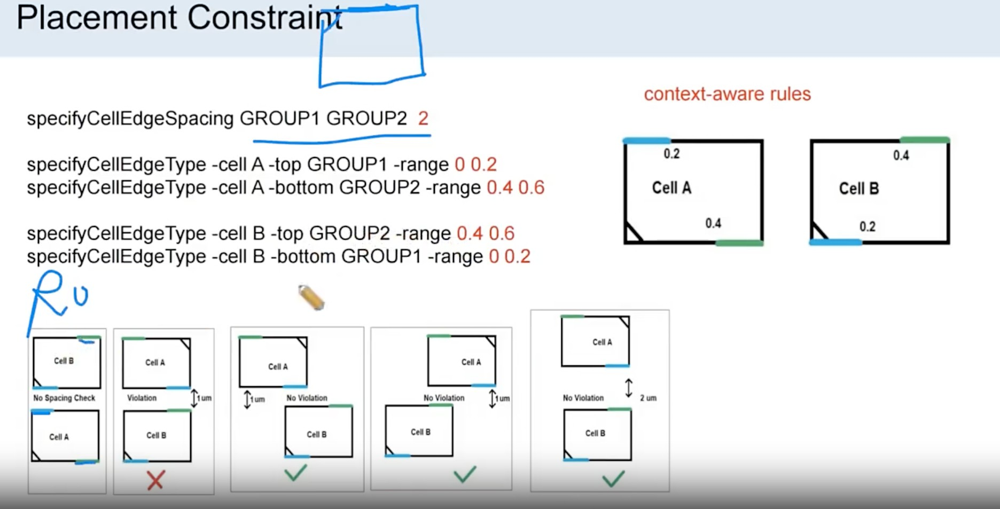
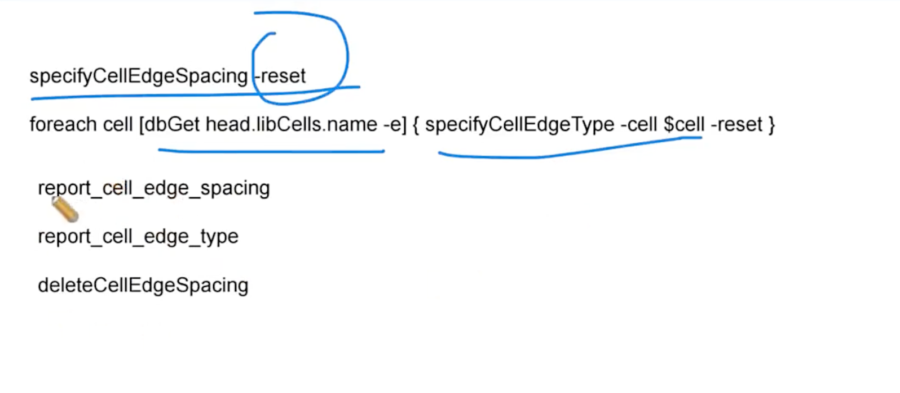
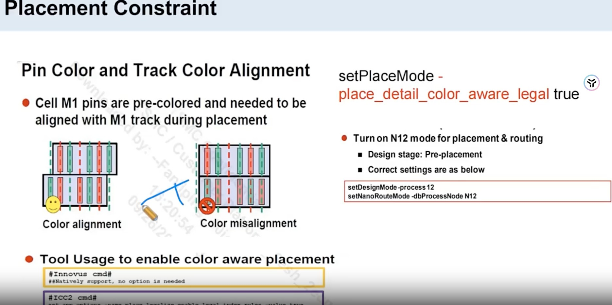
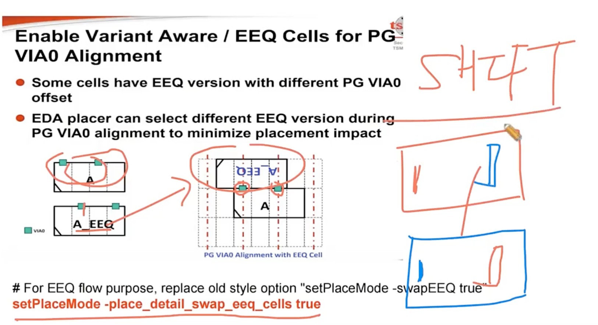
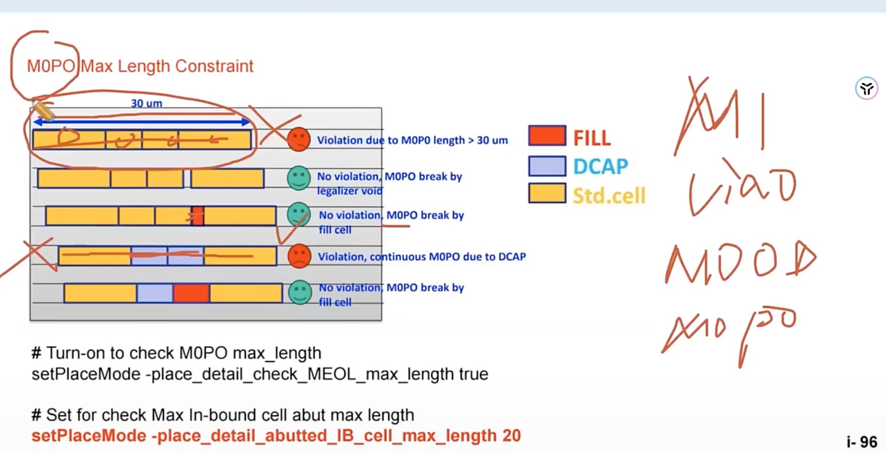
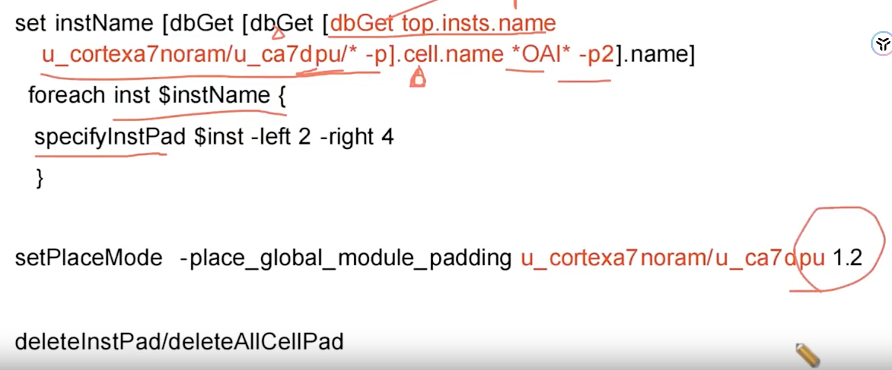
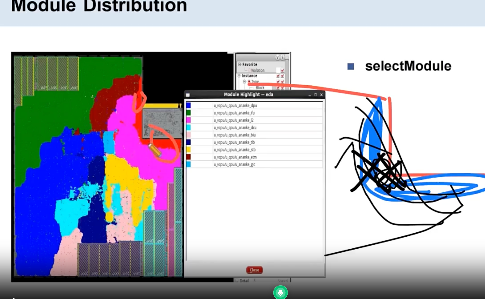

# Placement 做什么

> 工艺：T12nm（12nm ARM A55）  
> 阶段：Placement  
> 类型：方法口径 / 经验记录

## 口径

**Placement 的要求：**

1. 把 **std cell** 摆放到 **core 区域**；
2. 满足**时序需求**（**setup、max_cap、max_transition**）；
3. **net length 最短**；
4. **congestion 合理**；
5. **cell density 合理**。

**overflow，通常在 1.5% 内。**   **density 控制在 80%以内**

**Hot Spot**： 表征局部 overflow问题，大于100可能出现问题

## 哪一步最重要：floorplan > placement

**Q：做后端（floorplan、powerplan、placement、CTS、Route），哪一步最重要？其次呢？为什么？**

**A：最重要的是 floorplan，其次是 placement**——因为 placement 决定了模块的分布，模块分布不好，最终怎么优化都是徒劳的。

## 如何评判 placement 做得好不好

1. **模块分布的合理性**：有没有**大模块被拆分成各个模块**的情况，怎么进行干预；
2. **timing path 的合理性**：是否存在**逻辑深度深、fanout 多**的 path。

## place_opt_design 内部做了什么

**`place_opt_design` 内部做了什么？**

1. **global place**：进行粗摆；
2. **legalize**：摆到具体的 **row / site**；
3. **优化**：timing 时序优化、drv、congestion、density。

## 二.placement 做了哪些约束

### 2.1 设置 setPlaceMode

```tcl
setPlaceMode -congEffort high
setPlaceMode -place_global_uniform_density true
setPlaceMode -place_global_clock_gate_aware true
```

| 设置 | 作用 |
|------|------|
| `-congEffort high` | 让工具**加大力度优化 congestion** |
| `-place_global_uniform_density true` | 让工具**均匀摆放**（density） |
| `-place_global_clock_gate_aware true` | **ICG 倾向于其扇出寄存器摆放**、更聚拢 → **clock tree 更短、clock buffer 插入更少** |

### 2.2 设置 Don't Use

12nm 库里有 **UltraVT、LVT、RVT**；placement 阶段会将**低阈值电压的 cell** 设置 Don't use，还有**小驱动、容易有 DRC 问题的 cell**。

在12nm项目中有些cell身上容易发生drc问题，直接设置Don‘t use不用这款cell

### 2.3 std cell spacing rules

- 解决 **High pin count cell** 的 congestion；
- 避免 **base layer DRC**。


### 汇总图




### 图 1（设置 spacing 的案例脚本）：




### 图 2（看 cell 的 spacing 的脚本）：

```tcl
specifyCellEdgeSpacing -reset
foreach cell [dbGet head.libCells.name -e] { specifyCellEdgeType -cell $cell -reset }
report_cell_edge_spacing
report_cell_edge_type
deleteCellEdgeSpacing
```



### 图 3（设置 pin color）：

```tcl
setPlaceMode -place_detail_color_aware_legal true
```




### 图 4  VIA0 Align：EEQ cell 交换

**VIA0 Align 问题**：部分 cell 有 **EEQ 版本**（PG VIA0 **offset 不同**的等价版本）。EDA placer 在做 **PG VIA0 alignment** 时，可以**换用不同的 EEQ 版本**，以 **minimize placement impact**（减小对摆放的影响）。


```tcl
setPlaceMode -place_detail_swap_eeq_cells true
# For EEQ flow purpose，替代旧选项 setPlaceMode -swapEEQ true
```




### 图 5  M0P0 DRC Relaxation

**M0P0 DRC 问题**：M0P0 **run-to-run 1T2Ash rule** 会造成 **extra DRC**。处理方式：**relax M0P0 run-to-run spacing rule**，然后**重新跑 `place_opt_design`**。




## 2.4 设置 CRPR

```tcl
setAnalysisiMode -cppr both
```

AOCV 基于上面的脚本 读入一个 AOCVM 的库，之后工具会根据深度设置对应的timing derate系数 


## 2.5 设置 Module Spacing



[设置Module Spacing](../../tcl/innovus-place-padding.md)

## 三、checkPlace

**`checkPlace` 在检查什么？**

- 是否因为**摆放不合理**导致 **base layer 的 DRC**；
- 除此之外，还检查 **cell 是否摆放在 row 上**、**cell 的 PG 逻辑连接是否正确**；
- 带 `-check_paddingless_cells true` / `-check_high_pin_count_cells true` 时，检查 **cell 的 spacing**（见上图 2，与 `setSpacing` 设的规则配套）。

**`checkPlace` 有哪些类型**

钉钉搜索 checkPlace


## 四、Place 跑完要做哪些分析

- timing
- Module Distribution
- Congestion Map
- Density Map
- CheckPlace **钉钉搜索checkPlace**
- 逻辑关键路径/物理关键路径 
- timing path的合理性、，模块分布的合理性

不能仅仅停留在 timing 表面上，因为可能你用了很多低阈值电压的cell、可能面积 upsize; 所以还得看 逻辑关键路径和物理关键路径是否 match 上

```tcl
# 报告 timing的脚本

# setup timing
timeDesign

# DRV Timging
timeDesign -preCTS -numPaths 50 -prefix preCTS -outDir ../report
```

#### 模块分布不合理的图

避免模块分布出现 "L" 形, 一种方法通过设置 region, 另一种方法是改变floorplan的形状

案例分享： 我做完 placement厚发现有个模块呈现 L 的形状， 我通过 region



## 相关笔记

- [PR Density](./pr-density.md) —— cell density 的经验值
- [Floorplan Post Check](./floorplan-post-check.md) —— placement 之前 floorplan 的检查项
- [Powerplan 做什么](./powerplan.md) —— placement 之前的供电网络
- [Placement OCV Setting](./ocv-setting.md) —— placement 阶段 ssg corner 下的 OCV 设置


