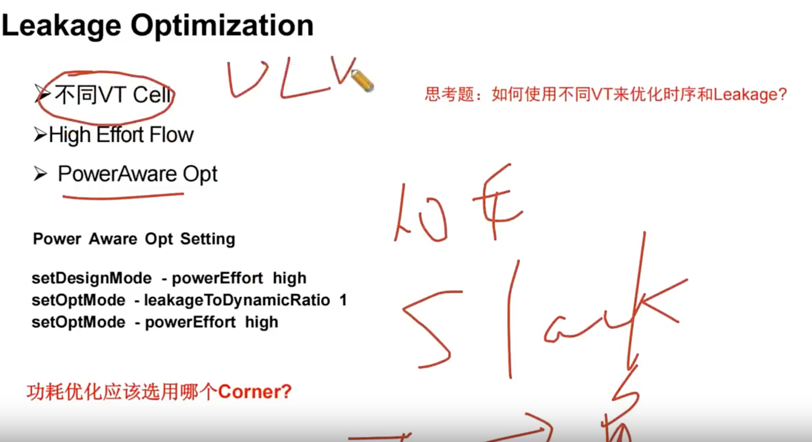

# Power Optimization 手段（Leakage / Dynamic）

> 日期：2026-10-08  
> 工艺：T12nm（12nm ARM A55）  
> 阶段：Place / Opt（PR place 阶段 + PT DMSA 阶段）  
> 类型：方法口径 / 经验记录

## Leakage Optimization 三手段

（课件 **Leakage Optimization**）：



1. **不同 VT Cell**
2. **High Effort Flow**
3. **PowerAware Opt**

可以在 **PR place 阶段** 和 **PT DMSA 阶段** 优化 Leakage。

### 不同 VT Cell

- VT 档位：ULVT、LVT、RVT、HVT；
- **HVT 用于修 hold**——HVT 在不同 corner 下偏差很大；
- 优化 Leakage 主要是：对**有 margin 余量的路径**，把 cell 换成功耗低的。

### PowerAware Opt 设置脚本

完整片段（含开关、截图）见 Tcl 目录：[PowerAware Opt](../../tcl/power-aware-opt.md)。优化 corner 用 **tt_25**。

```tcl
set if_power_aware 1

if {$if_power_aware} {
  setDesignMode -powerEffort high
  setOptMode -leakageToDynamicRatio 1
  setOptMode -powerEffort high
}
```

## 动态功耗怎么优化

**把 tree 做短，把 clock net 做到最短。**

## 功耗优化选哪个 corner

**tt25 / tt85**——tt85 的 leakage 是 tt25 的 **10 倍**。

## 相关笔记

- [Leakage 优化](./leakage-optimization.md) —— VT Swap / Down Size / MBFF
- [Timing Optimization 手段](./timing-optimization.md) —— 姊妹篇；High Effort Flow 的 `setOptMode -highEffortOptCells` 在那篇
- [低功耗设计手段](./low-power-design.md) —— power gating / UPF / ICG 等架构级手段
- [为何 Signoff 后还要看 IR Drop](./ir-drop-after-signoff.md)
