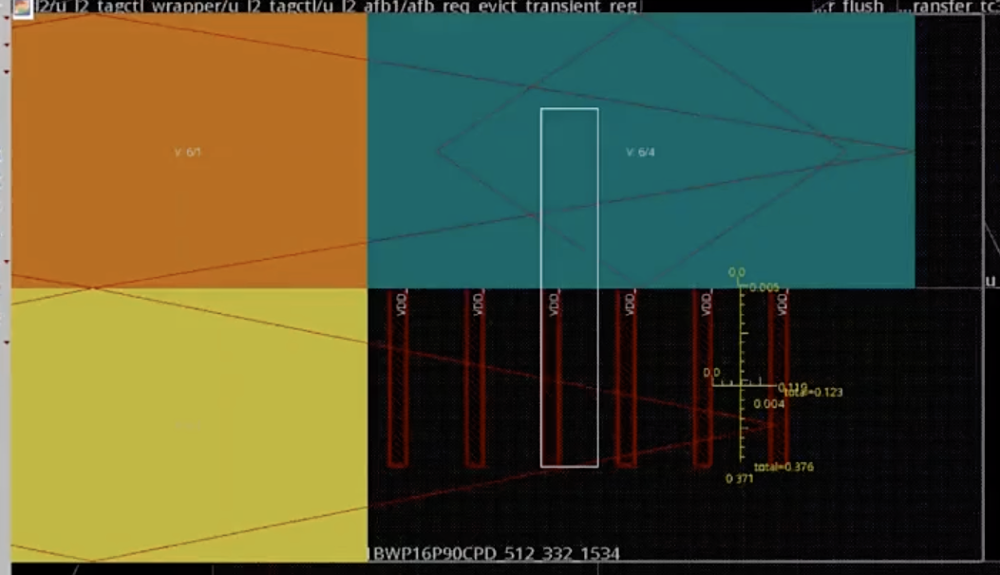

# Power Switch vdd_local 打太密引发 Congestion

> 日期：2026-10-07  
> 工艺：T12nm（12nm ARM A55）  
> 阶段：Place / Congestion 分析  
> 类型：踩坑记录

## 踩坑

**congestion map 上热点落在 power switch 上——power switch 打 vdd_local 的时候打得太密集；vdd_local 之间的间距调到 0.12 μm 后解决。**

- 现象：看 congestion map，红色热点集中在 power switch 区域（如下图竖条热点）；
- 分析：power switch 打 vdd_local 的时候打得太密集，供电占的布线资源太多，signal 绕不开；
- 解决：调整 **vdd_local 之间的间距到 0.12 μm**，congestion 消掉。单位：Innovus 里间距/坐标这类长度参数默认都是 μm。

## 相关笔记

- [Power Switch：Core / Channel 与边界](./power-switch-core-channel.md) —— switch 摆放经验
- [Power Gating 两种类型：Common Nwell / Two Nwell](./power-switch-nwell-type.md)
- [Macro / Std Cell 供电（Global→Switch→Local→Memory）](./pg-term-local-vdd.md) —— vdd_local 在供电网络里的位置
- [Powerplan 做什么](./powerplan.md)
