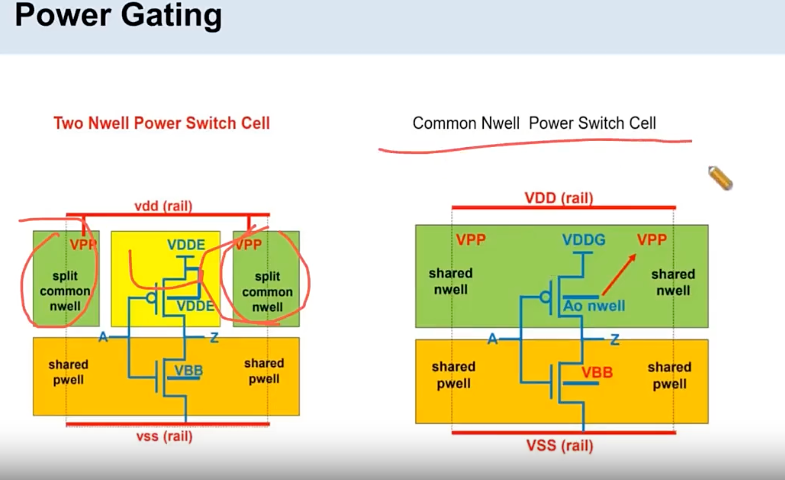

# Power Gating 两种类型：Common Nwell / Two Nwell

> 日期：2026-09-29  
> 工艺：T12nm（12nm ARM A55）；对比口径：T28nm  
> 阶段：Powerplan / Power Switch  
> 类型：口径记录

## 口径

**power gating 有 2 种类型（如图）：T12nm 用的是 Common Nwell，T28nm 用的是 Two Nwell，其Common Well 已经连接到 Global VDD了**

## 相关笔记

- [Power Switch：Core / Channel 与边界](./power-switch-core-channel.md) —— switch 摆放与边界的经验
- [Powerplan 做什么](./powerplan.md)
- [低功耗设计手段](./low-power-design.md) —— power gating 在低功耗手段里的位置
- [UPF 传递功耗设计意图](./upf-power-intent.md)
