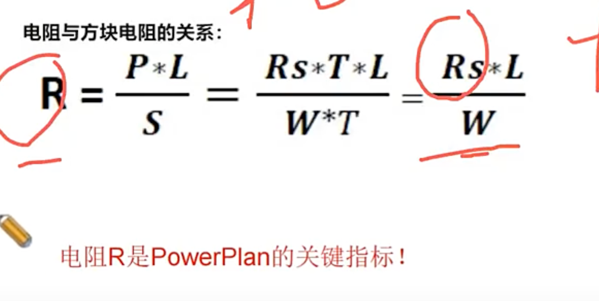
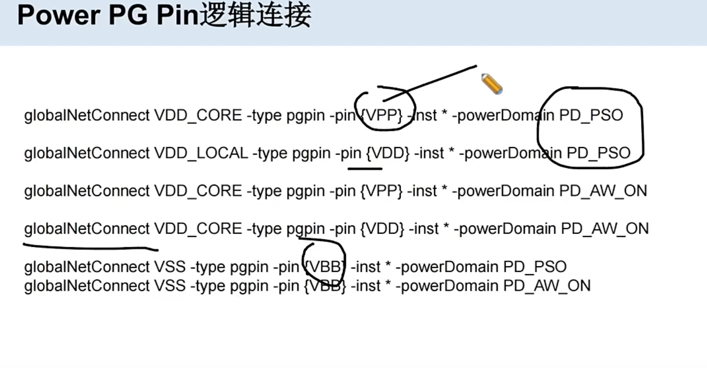
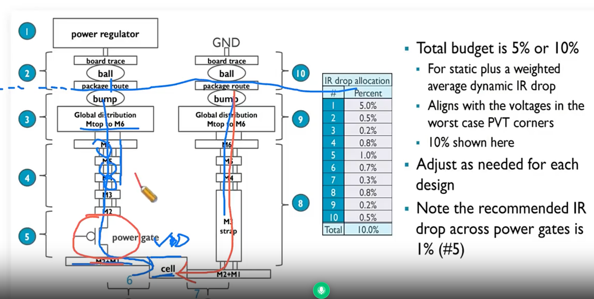
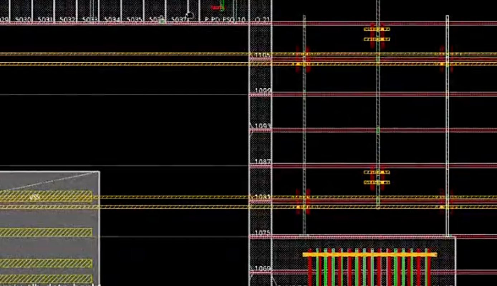
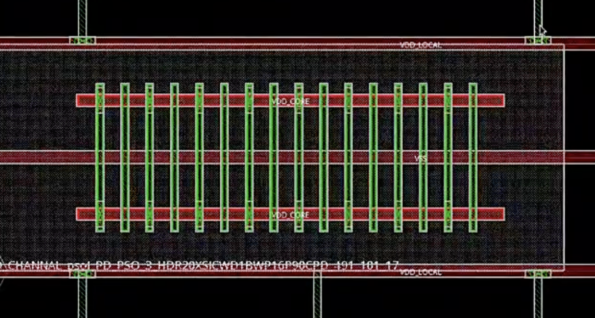

# Powerplan 做什么

> 工艺：T12nm（12nm ARM A55）  
> 阶段：Power planning  
> 类型：方法口径 / 经验记录

## 口径

#### 电阻计算公式



R：电阻
Rs：方块电阻
L：长度
W：横截面

**Powerplan 做什么？**  
创建从芯片**供电源头**到各个 **cell、PG pin** 的**供电通路**。

**在 T12nm 中，powerplan 的结构是：M1 和 M2 是 power rail，并联 dual rail（du rail）。** **为什么要做 dual rail？**


M1和M2的线宽小，使用dual rail 并联，电阻能变小，从而改善IR Drop

**在T12nm中也使用了Via Pillar, 为什么要用Via Pillar？** 

Via Pillar 本质也是通过 并联让电阻变小，从而改善IR Drop

**double patterning** 

在T12nm中 M1 - M3 都是 double patterning，有2张mask；因此做powerplan的时候没有添加 via1（会有spacing问题），需要到chipfinish阶段时才会添加 via1

## T12nm Metal（1P11M）

本项目用 **1P11M**（1 层 Poly + 11 层 Metal）：

| 层 | 用途 |
|------|------|
| **M1 / M2** | Power rail（并联 dual rail） |
| **最高打 PG：M9** | 本设计内部 powerplan / PG 打到 **M9** |
| **M10 / M11** | 给到**顶层打 Power**（更上层/封装侧供电） |

```text
M11 / M10 ── 顶层 Power
    │
   M9 ────── 本芯片 PG 最高层
    │
  … stripe / mesh …
    │
  M2 ∥ M1 ── power rail → cell / PG pin
```

## Domain 的  逻辑连接



| Power domain | VDD 逻辑连到 |
|--------------|--------------|
| **PD_PSO** power switch domain | **VDD_LOCAL** |
| **PD_AW_ON** power always on domain | **VDD_CORE** |

**Power Switch Domain**
- VDD -> VDD_LOCAL
- VPP -> VDD_CORE
- VSS -> VSS
- VBB -> VSS

**Power Always On Domain**
- VDD -> VDD_CORE
- VPP -> VDD_CORE
- VSS -> VSS
- VBB -> VSS

**VPP：N-well 连接 的 PG pin**


## 供电路径总览（结合 Power Switch）



```text
封装 / 顶层电源
     │
  M11 / M10 ──── 顶层打 Power（更上层 / 封装侧供电）
     │
    M9 ────────── 本设计 PG 最高层（global mesh 的起点）
     │
  M8 … M3 ────── stripe / mesh 横向铺开，via 逐层往下分流
     │
  VDD_CORE ───── global 网（always-on 一侧；PD_AW_ON 域直接用它）
     │
     ▼
┌────────────── Power Switch（闸门）─────────────┐
│  输入：VDD_CORE    控制/驱动：TVDD    地：VSS      │
│  输出：VDD_LOCAL（受控通断 → power gating）        │
└──────────────────────────────────────────────┘
     │
     ├─► std cell：M1 ∥ M2 dual rail（VDD_LOCAL / VSS）→ row 内每个 cell 的 PG pin
     │
     └─► Memory：macro box 内 M5 VDD_LOCAL stripe（addStripe）→ via 叠层 → memory PG pin

VSS：全程共地，回流路径与供电对称
```


### 名词对号入座

| 名词 | 角色 |
|------|------|
| **VDD_CORE** | global 电，switch **之前**，always-on |
| **TVDD** | switch 的控制 / 驱动电源，常供电 |
| **VDD_LOCAL** | switch **之后**的 local 电，PD_PSO 域内 std cell / memory 实际使用 |
| **PD_AW_ON** | always-on 域，直接用 VDD_CORE |
| **PD_PSO** | 可断电域，经 switch 用 VDD_LOCAL |
| **M1/M2 dual rail** | std cell 取电层 |
| **M5 memory stripe** | memory 本地供电层 |

**一句话：高层从M9 把 global 电（VDD_CORE）打到power switch 的 TVDD → power switch 这道闸决定哪片区域有电 → 闸后变成 VDD_LOCAL，std cell 走 M1/M2 双轨、memory 走自己的 M5 stripe 拿电。**


## Core区域 的供电结构（T12nm）

M9 的 VDD_CORE -> 打到M1的power switch -> pso 开启后 -> TVDD 拿到电 -> 相邻的 VDD_LOCAL 拿到电

core区域其它的rail如何拿到电？

T28nm通过 mesh 网络结构拿到， T12通过 via pillar 反供从而使得core区域其它rail也拿到电

core区域的 Tapcell 的 VPP 连接到 VDD_CORE, VDD 连接到 VDD_LOCAL

## Memory 的供电结构（T12nm）




**回答版：**Global VDD → TVDD → switch打开 -> VDD_LOCAL 的power rail -> 通过 via pillar 反供到高层去，然后在送进memory中

**理解版：**

> Memory 的pin 在M4， 连接到M6出去， M6拉出去就近找到PowerSwitch（在这个过程中是先通过 Via Pillar 连接到外面 Pillar 的M3，然后连接到 power switch所供的 VDD_LOCAL ）

**物理连接（从 Memory 往回看）：**

| 步骤 | 连接 |
|------|------|
| Memory 摆放 | 位于 **PD_PSO** 区域 |
| Memory 出 pin | 在 **M4**，逻辑连接到 **VDD_LOCAL** |
| M5 → M4 | Memory 的 M4 pin 由 **M5 打孔**进来 |
| M6 → M5 | **M5 又跟 M6 打孔** |
| Pillar | M6 找到**就近 pillar**，pillar 从 **M6 打到 M3** |
| Pillar → Switch | M3 之后从**就近 Power Switch** 拿电：switch 的 **M1** 的 TVDD 电有了之后，送到 **M2**，然后在 pillar 上送到 **M3** |

```text
Memory（PD_PSO 区）
  M4 pin ── 逻辑连 VDD_LOCAL
    ▲ via
   M5 ──via── M6 ──► 就近 pillar（M6 … M3）──► M3 ◄── M2 ◄── Power Switch（M1，TVDD）
```

即：switch 打开后 VDD_LOCAL 从低层 rail 经 pillar 反爬到 M6/M5 高层，再打孔逐层送进 Memory 的 M4 pin。

**注记：** 此处口径为 Global VDD → **TVDD** → switch（输入侧）；与上文「Power Switch 与高低层」中 **VDD_CORE** → switch 的表述并存，具体网名以项目 UPF / def 为准。

## 说明

- UPF 先把功耗意图（domain / net / switch 等）交给工具；**Powerplan** 再在物理上把供电从源头接到每个单元与 PG 脚。  
- 典型包括 ring、mesh、stripe、via 叠层，以及接到 std cell / macro 的 PG pin（含 local 如 `VDD_LOCAL`）。  
- 本项目路径：高层 **VDD_CORE** → Power switch → 低层 **M1/M2 的 VDD_LOCAL** → Memory / cell。Switch 侧电源名为 **TVDD、VDD_LOCAL、VSS**。


## 并联 dual rail 是什么？

**Dual rail** = 电源/地那套供电双轨；**并联** = 同一供电在 M1、M2 两层一起走、via 连上，不是只靠单层。

## Q：Primary PG / Secondary PG 是什么？

| 概念 | 含义 |
|------|------|
| **Primary PG** | cell 的主电源脚，接本 domain 的 VDD/VSS（如 VDD_LOCAL） |
| **Secondary PG** | 特殊 cell 上额外的那组电源脚，接的是另一路（通常是 always-on）电源，保证主轨断电时这部分功能还活着 |

需要 Secondary PG 的典型 cell：power switch（gate 驱动要常供电）、isolation cell（钳位电源常在）、retention register（备份状态 always-on）、always-on buffer / enable level shifter、**tap cell**（well tap，secondary PG pin 为 VPP）。

对应本项目：高层 **VDD_CORE / TVDD** 这类常供电网络接到这些 cell 的 secondary pin，普通 std cell 只接 M1/M2 的 **VDD_LOCAL**（见上文「Power Switch 与高低层」）。

**T12nm 中 tap cell 的 secondary PG pin（VPP）逻辑连接到 VDD_CORE。** 脚本佐证：[power_stape_pso](../../tcl/power-stape-pso.md) 图 1 先按 domain 连（PD_AW_ON 域 VPP→VDD_CORE、PD_PSO 域 VPP→VDD_LOCAL）；随后 [Innovus 03 Powerplan](../../tcl/innovus-03-powerplan.md) 图 3 对 `*VPP_VSS` cell（tap cell）先 `setPGPinUseSignalRoute` 让 VPP 走 signal route，再 `globalNetConnect VDD_CORE -type pgpin -pin VPP ... -override` 统一重连到 **VDD_CORE**。

**Core 区域 cell 的电源连接结构（物理）：** tapcell 的连接即是 std cell 的连接——从 **VPP** 出发往上层，接到 **power switch 附近的 pillar**，之后连接 **power switch**：

```text
VPP（tapcell，连接方式同 std cell）
   │  往上层（via 逐层上爬）
   ▼
power switch 附近的 pillar
   │
   ▼
power switch
```

pillar 即 power switch cell 上的 stapling / via pillar，其创建脚本见 [power_stape_pso](../../tcl/power-stape-pso.md)。


## Powerplan 质量检查

| 检查项 | 查什么 |
|--------|--------|
| **checkConnectivity** | **PG Floating**：供电网络断连 / 悬空（cell、PG pin 没接上 PG） |
| **Powerplan DRC** | PG 相关工艺规则违例（spacing / enclosure / via 规则等） |
| **PG short** | 电源网络之间短路 |
| **PG Weakness** | 供电薄弱点（via / stripe 不足、通路电阻过大等） |
| **IR Drop 分析** | 压降分析，验证供电网络能否满足电压余量 |

## 相关笔记

- [T12nm · UPF 传递功耗设计意图](./upf-power-intent.md)
- [T12nm · Macro / Std Cell 供电（Global→Switch→Local→Memory）](./pg-term-local-vdd.md)
- [T12nm · Power Switch：Core / Channel 与边界](./power-switch-core-channel.md)
- [Innovus PG Special（Memory M5）](../../tcl/innovus-pg-special.md)
- [Innovus 03 Powerplan 脚本](../../tcl/innovus-03-powerplan.md)
- [Via Pillar 下方不摆放特殊 cell（PG DRC）](../../tcl/via-pillar-pg-keepout.md)
