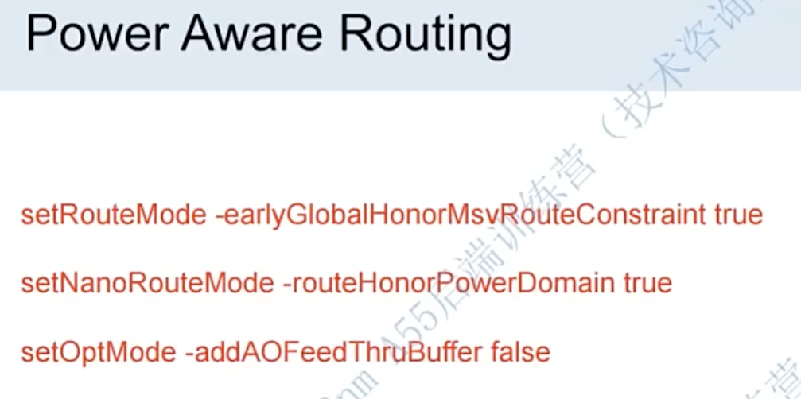
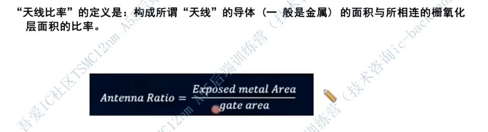

# Routing（Double Patterning / Power Aware）

> 日期：2026-10-18  
> 工艺：T12nm（FinFET，double patterning）  
> 阶段：Route  
> 类型：流程口径 / 经验记录

## 为什么 T12nm Routing 要额外设约束

**T12nm 是 double patterning（双重曝光）工艺**：同层金属图形拆成多套 mask，线距密、对 color / spacing / via 更敏感。因此相对非 DP 节点，**routing 会有额外的设置和 constraint**（与 pin 层、powerplan via 策略同一类工艺限制，见 [Pin 不要出在 M1–M2](./pin-avoid-m1-m2.md)、[Powerplan](./powerplan.md)）。

本项目口径：M1–M3 为 DP（2 张 mask）；绕线时要配合 foundry 规则与 Innovus route mode，不能只按「普通单曝光」默认去跑。

## Routing 步骤

常见三段：

1. **Global Route**  
2. **Detail Route**  
3. **Search and Repair**

先全局分配轨道 → 细布 → 再对违例做搜索修复。DP / MSV 相关 honor 开关应在进入 Global / Detail 前设好，避免后期大面积返工。

## Power Aware Routing

T12nm 多电源域设计里，routing 需要做 **Power Aware Routing**，让 Early Global / NanoRoute / Opt 尊重 power domain 与 MSV 约束。



```tcl
setRouteMode -earlyGlobalHonorMsvRouteConstraint true
setNanoRouteMode -routeHonorPowerDomain true
setOptMode -addAOFeedThruBuffer false
```

| 命令 | 口径 |
|------|------|
| `setRouteMode -earlyGlobalHonorMsvRouteConstraint true` | Early Global Route **遵守 MSV 绕线约束** |
| `setNanoRouteMode -routeHonorPowerDomain true` | Detail（NanoRoute）**遵守 power domain** |
| `setOptMode -addAOFeedThruBuffer false` | Opt **不自动加 Always-On feedthrough buffer** |

#### 如果Memory分成2个power switch， Low power实现时需要注意些什么呢？

memory要连成链，串链要用到 always on buffer

## Routing要考虑天线效应

「天线比率」的定义是：构成所谓「天线」的导体（一般是金属）的面积与所相连的栅氧化层面积的比率。

> 自己话: 金属层面积 / 所连的栅氧层面积

跑 Calibre 可以看到




比率越大，工艺过程中电荷泄放到栅氧的风险越高，routing 后要按 foundry 规则做 antenna check / 修复。

**解决方法**

1.跳层 2.插buffer 3.插入天线二极管 4.upsize driver（栅级面积增大）

一般在routing会设置  AntennaDiode 为true

```tcl
setNanoRouteMode -quiet -drouteFixAntenna true
setNanoRouteMode -quiet -routeInsertAntennaDiode true
setNanoRouteMode -quiet -routeAntennaCellName "ANTENNABWP6T16P96CPD"
```

## Routing要考虑Cross talk

crosstalk会对timing产生 delta delay对时序造成影响

可以在 report_timing 加上 -crosstalk 看其影响

不一定修，它不会影响逻辑功能，在data path一定会有cross talk的影响； **而noise 在pt里是必须修复的，因为其会造成逻辑电平错误**

可以通过下面脚本报告 crosstalk

```tcl
report_delay_calculation -from -to -crosstalk
```

**解决方式:** 1.设置NDR 2.加shielding


## PostRoute 时序优化

optDesign（setup和hold）

## 相关笔记

- [Pin 不要出在 M1–M2](./pin-avoid-m1-m2.md) —— double patterning 与 pin 层
- [Powerplan 做什么](./powerplan.md) —— M1–M3 DP、via1 时机
- [UPF 传递功耗设计意图](./upf-power-intent.md)
- [低功耗设计手段](./low-power-design.md)
