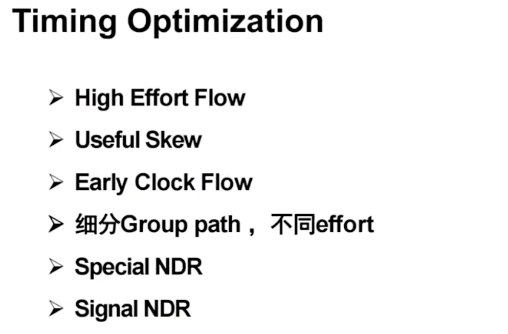
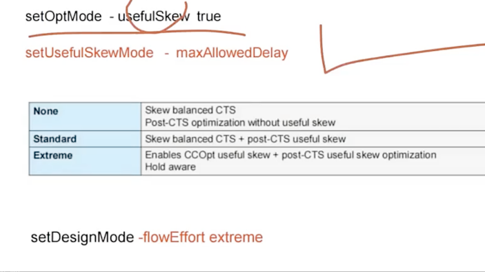
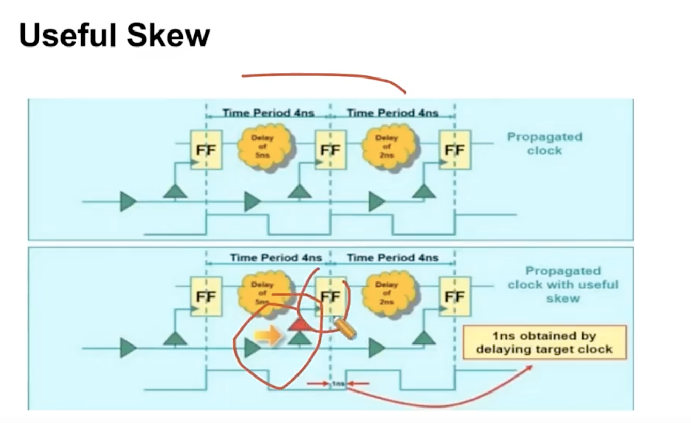
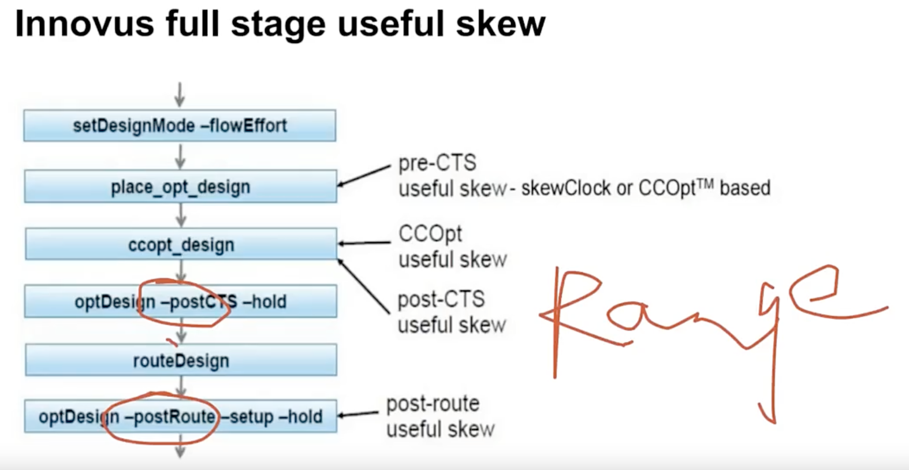
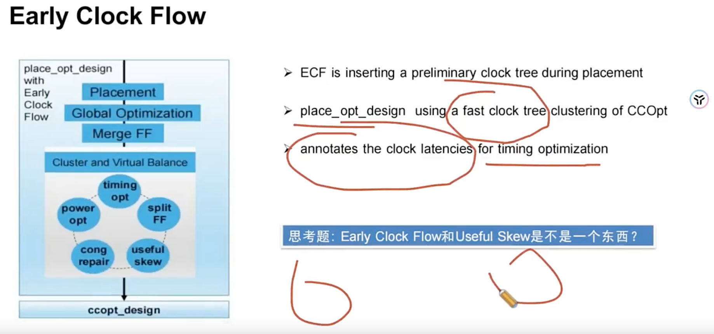
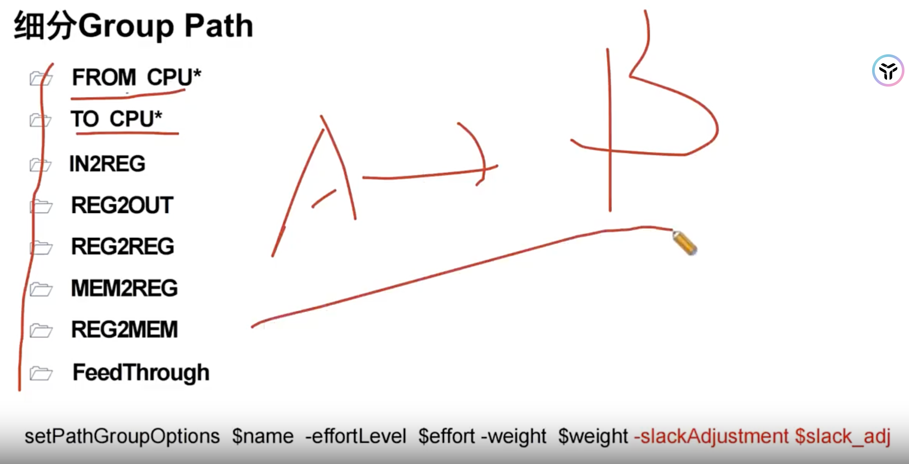

# Timing Optimization 手段

> 日期：2026-10-07  
> 工艺：T12nm（12nm ARM A55）  
> 阶段：Timing / Opt  
> 类型：方法口径 / 经验记录

## 口径

Timing 优化没有银弹，项目里常用下面几类手段组合推进（课件 **Timing Optimization**）：



| 手段 | 在做什么 |
|------|----------|
| **High Effort Flow** | 提高工具优化力度（如限定 LVT 等 cell 做 high-effort opt） |
| **Useful Skew** | 有意调整时钟到达时间，用 skew 帮 setup/hold |
| **Early Clock Flow** | 更早做 / 更重做时钟相关优化 |
| **细分 Group path，不同 effort** | 关键路径单独成组、加权重或不同 effort |
| **Special NDR** | 对关键 net 用非默认线宽/间距等规则降延迟 / 抗串扰 |
| **Signal NDR** | 对信号线套 NDR，改善 timing 或信号完整性 |

相关脚本/笔记：[high_opt.tcl](../../tcl/high-opt.md)、[Path Group 权重](../../tcl/path-group-weight.md)、[Clock Port NDR](./clock-port-mid-io.md)。

## 一、High Effort Flow

**核心脚本**

```tcl
setOptMode -highEffortOptCells $lvt_library_cells
```

钉钉笔记：Innovus 中如何控制 LVT 比例的数量


## 二、Userful Skew

1. 改善动态IR Drop
2. 优化timging

中间寄存器做长： set clock latency 正数
lauch path 做短（早到）：set clock latency 负数

#### 开启的脚本



```tcl
setOptMode -usefulSkew true
setUsefulSkewMode -maxAllowedDelay
setDesignMode -flowEffort extreme
```

#### 开启useful skew 坏处

- 会把 tree 做长
- 会影响 hold 

**对 performance 要求低的不需要开启**



#### userful skew 在 place、cts、route各个阶段都能设置，一般 routing timing出现问题不要考虑开 useful skew而是考虑 routing后是否有si、是否detour，这些方面去分析 coriation 问题




## 三、Early Clock Flow

在 placement 阶段提前长 tree



**对于high performance的、超过1GHz的建议 early clock flow + userful skew**

## 四、细分 Group Path（最大设到99）



## 五、Special NDR

**抓出 timing report 中 net delay 的部分设置 NDR**

```tcl
set net u_cortexa7noram/u_ca7dpulCTS_5
setAttribute -net $net -non_default_rule default
setAttribute -net $net -non_default_rule special_nets_clk -top_preferred_routing_layer 9 -bottom_preferred_routing_layer * -preferred_routing_layer_effort high
```

## Signal NDR

设置完后，对于全局的Signal线，工具自动对关键路径设置 NDR；

什么阶段加看你自己？T12nm是在place阶段加（也能在 routing阶段、post-cts阶段）

```tcl
addNDR -name signal_ndr -width_multiplier {4:9 2}
setOptMode -ndrAwareOpt [list signal_ndr]
```


## AI 与工程师经验

从 AI 对芯片行业的冲击来看，**目前 AI 还不可替代**。原因在于：要让 AI 同时综合考虑功耗、面积、performance、DRC，这类多目标、强约束的权衡太困难——所以工程师的经验就显得尤为重要。上表这些手段如何组合、何时开、开到什么程度，仍高度依赖项目经验与迭代判断。

## 相关笔记

- [Timing ECO 盯住 refinePlace 的 Max Move](./timing-eco-refineplace.md)
- [ICG Enable Pin 容易 Setup 违例](./icg-enable-setup.md)
- [Placement 做什么](./placement.md)
