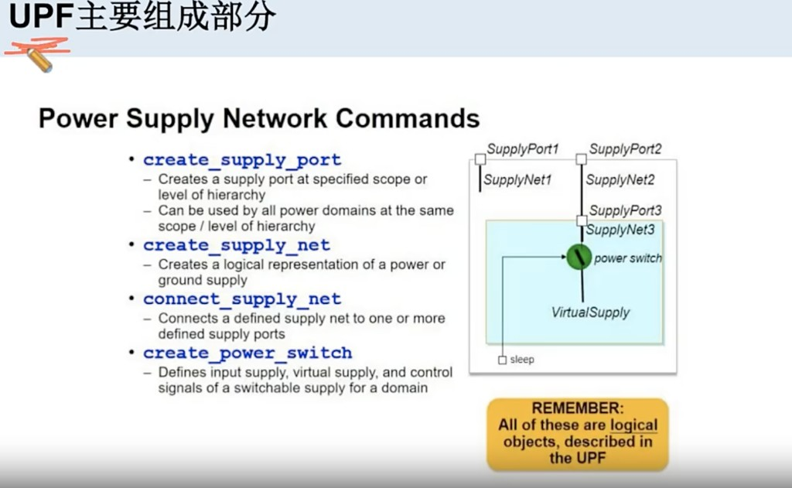
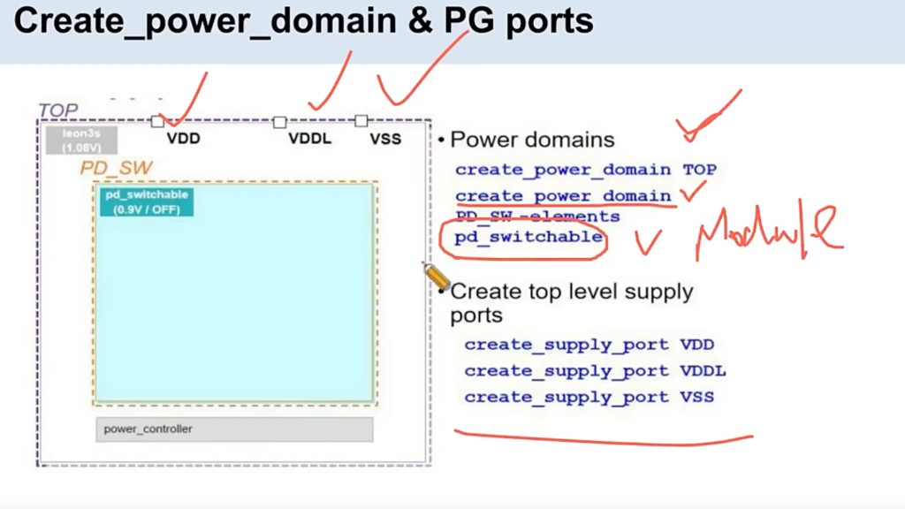
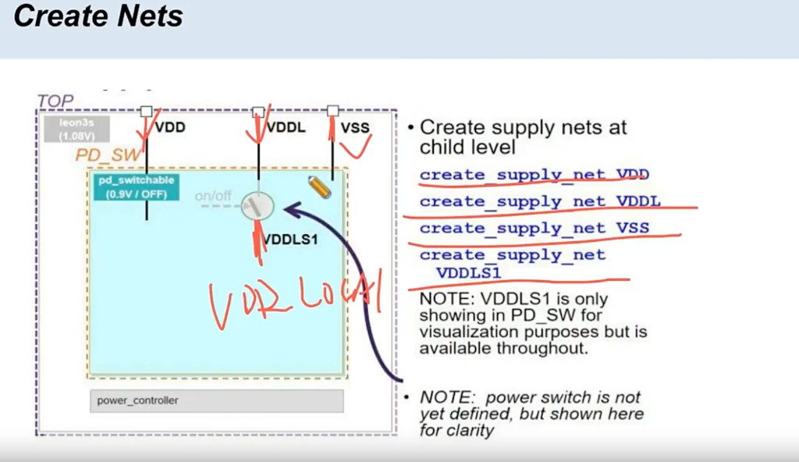
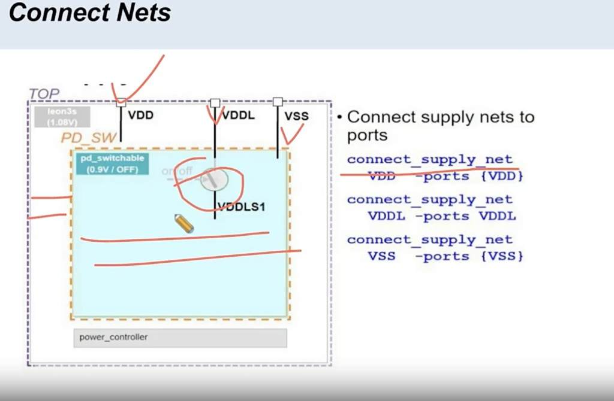

# UPF 传递功耗设计意图

> 工艺：T12nm（12nm ARM A55）  
> 阶段：低功耗 / Floorplan / 物理实现  
> 类型：方法口径 / 经验记录

## 口径

**UPF 是把功耗的设计意图（constraint）传递给 EDA 工具，从而帮助物理设计。**

## 说明

- UPF（Unified Power Format）是功耗侧的 **constraint / 意图文件**：把 power domain、电源网、开关、isolation / level shifter 等设计意图正式交给 EDA。  
- 物理工具（如 Innovus）通过 `read_power_intent` / `commit_power_intent` 读入后，按这些约束做 floorplan、power switch、供电与跨域检查。  
- 没有 UPF，工具缺少功耗意图，物理实现难以正确落实多电源 / 关断等策略。  
- 本项目有 `ananke_core.upf` 以及 `PD_PSO`、`PD_AW_ON` 等，均来自这类意图（constraint）传递。

## UPF 主要组成部分：Power Supply Network

电源供给网络相关命令（课件：**Power Supply Network Commands**）。记住：这些都是 **UPF 里描述的逻辑对象**，不是已经画好的物理金属。



### 命令解析

| 命令 | 作用 | 怎么理解 |
|------|------|----------|
| **`create_supply_port`** | 在指定 scope / 层次上创建 **supply port** | 该层次上的电源“端口”；同 scope 内 power domain 可共用 |
| **`create_supply_net`** | 创建电源/地的 **逻辑网** | 逻辑上的供电线（logical power/ground），还不是物理 stripe |
| **`connect_supply_net`** | 把 supply net 连到一个或多个 supply port | 把“线”接到“口”，建立层次间供电连通关系 |
| **`create_power_switch`** | 定义可开关供电：输入常电、输出 virtual supply、以及 sleep 等控制 | 对应 Power Gating：常电 → switch → 可关断域电源 |

### 图中结构（对应关系）

```text
顶层: SupplyPort1 ── SupplyNet1
      SupplyPort2 ── SupplyNet2 ──► SupplyPort3（进内层）
内层: SupplyNet3 ──► power switch ──► VirtualSupply（供域内逻辑）
                    ▲
                 sleep 控制
```

1. **Port + Net**：描述哪一层有电源口、逻辑电源网叫什么。  
2. **connect**：上下层如何把供电接进来（外层 Net2 → 内层 Port3 → Net3）。  
3. **power switch**：Net3 作为输入，经 switch 得到 **VirtualSupply** 再给可关断逻辑；`sleep` 控制开/关。  

与本项目 **Global VDD → Power Switch → VDD_LOCAL → Memory** 同一类模型：UPF 先定义逻辑意图，物理阶段再落成 `addPowerSwitch`、stripe 等。

## UPF 组成部分详解（推荐书写顺序）

如图，按下面顺序写完功耗意图，再交给 EDA：

```text
1. 定义 power domain
2. 定义 supply ports
3. 定义 supply nets
4. 联通（connect）
5. 定义 Top 的 power rail
6. 定义 switch domain 的 power rail
7. 定义开关的行为描述
8. 定义 isolation cell
9. 最后定义 PST
```

| 步骤 | 做什么 | 课件/命令例 |
|------|--------|-------------|
| 1. Power domain | 划常开域与可关断域 | `create_power_domain TOP`；`create_power_domain PD_SW -elements pd_switchable`（`-elements` 绑 **Module**） |
| 2. Supply ports | 顶层电源/地口 | `create_supply_port VDD` / `VDDL` / `VSS` |
| 3. Supply nets | 逻辑电源网（含 local） | `create_supply_net VDD` / `VDDL` / `VSS` / `VDDLS1`（图中 local ≈ VDD LOCAL） |
| 4. Connect | net 接到 port | `connect_supply_net VDD -ports {VDD}` 等 |
| 5. Top power rail | 常开域供电轨意图 | Top / leon3s 等用 VDD（如 1.08V） |
| 6. Switch domain rail | 可关断域用 switched / local 轨 | `PD_SW` 内 `pd_switchable` 用 `VDDLS1`（0.9V / OFF） |
| 7. Switch 行为 | 开关输入/输出/控制 | `create_power_switch`：VDDL 入 → switch → VDDLS1；`on/off` 由 power_controller |
| 8. Isolation cell | 关断域输出钳位 | 防 X；见 [Isolation Cell](./isolation-cell.md) |
| 9. PST | Power State Table | 定义各 supply 在不同电源状态下的组合关系 |

### 图：定义 Power Domain & PG ports



```tcl
create_power_domain TOP
create_power_domain PD_SW -elements pd_switchable

create_supply_port VDD
create_supply_port VDDL
create_supply_port VSS
```

### 图：Create Nets



```tcl
create_supply_net VDD
create_supply_net VDDL
create_supply_net VSS
create_supply_net VDDLS1
```

课件注：`VDDLS1` 为 switch 后的 local（图注 VDD LOCAL）；power switch 可稍后正式定义，图中先画出便于理解。

### 图：Connect Nets



```tcl
connect_supply_net VDD -ports {VDD}
connect_supply_net VDDL -ports VDDL
connect_supply_net VSS -ports {VSS}
```

联通后：`VDDL` → power switch → `VDDLS1` 供 `pd_switchable`；`on/off` 控制开关。

## 相关笔记

- [T12nm · 低功耗设计手段](./low-power-design.md)
- [T12nm · Isolation Cell](./isolation-cell.md)
- [T12nm · Macro / Std Cell 供电（Global→Switch→Local→Memory）](./pg-term-local-vdd.md)
- [T12nm · Power Switch：Core / Channel 与边界](./power-switch-core-channel.md)
- [Innovus 02 Floorplan](../../tcl/innovus-02-floorplan.md)
