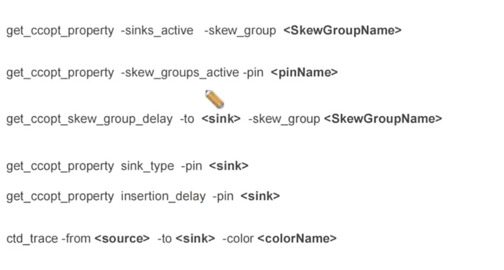

# Clock Tree Debug 高频命令

> 日期：2026-10-09  
> 来源：截图识别整理（picture-tcl）  
> 阶段：CTS / CCOpt Debug

Innovus **Clock Tree Debugger（CTD）** 场景下高频查询与高亮命令。占位符（`<SkewGroupName>` / `<pinName>` / `<sink>` / `<source>` / `<colorName>`）换成当前设计里的实际名字后再执行。

## 场景

CTS 跑完后排查：某个 skew group 里哪些 sink 在 balancing、某个 pin 属于哪些 group、到 sink 的 delay、sink type、insertion delay，以及在 GUI 里把 source→sink 的时钟路径描出来。

## 环境

- 工具：Innovus（CCOpt）
- 前提：已 `ccopt_design`（或等价 CTS），skew group / clock tree 已存在；`ctd_trace` 需要打开 GUI

## 截图



## 脚本

```tcl
get_ccopt_property -sinks_active -skew_group <SkewGroupName>
get_ccopt_property -skew_groups_active -pin <pinName>
get_ccopt_skew_group_delay -to <sink> -skew_group <SkewGroupName>
get_ccopt_property sink_type -pin <sink>
get_ccopt_property insertion_delay -pin <sink>
ctd_trace -from <source> -to <sink> -color <colorName>
```

## 各条在做什么

| 命令 | 作用 |
|------|------|
| `get_ccopt_property -sinks_active -skew_group <SkewGroupName>` | 列出该 **skew group 当前参与 balancing 的 active sink**。用来核对 group 里实际被平衡的终点是不是你以为的那批。 |
| `get_ccopt_property -skew_groups_active -pin <pinName>` | 反过来查：这个 **pin 当前挂在哪些 active skew group**。一个 pin 可能属于多个 group，debug 跨时钟 / balance group 时常用。 |
| `get_ccopt_skew_group_delay -to <sink> -skew_group <SkewGroupName>` | 查询该 skew group 下，从 source 到指定 **sink 的 insertion / group delay**。对比多个 sink 的 delay 即可看 skew 差在哪颗。 |
| `get_ccopt_property sink_type -pin <sink>` | 查该 pin 的 **sink type**（stop / through / ignore / exclude / floating）。type 决定要不要 balance、DRV 怎么修。 |
| `get_ccopt_property insertion_delay -pin <sink>` | 读该 pin 上的 **insertion_delay** 属性（CCOpt 用它把这条 clock path 做短/做长）。先查再 `set_ccopt_property insertion_delay ...`。 |
| `ctd_trace -from <source> -to <sink> -color <colorName>` | **Clock Tree Debugger** 把 source→sink 的时钟网络在 GUI 里按指定颜色描出来，方便看走哪层、经过哪些 buffer / ICG。 |

### 示例替换

```tcl
get_ccopt_property -sinks_active -skew_group core_clk
get_ccopt_property -skew_groups_active -pin u_core/reg_a/CK
get_ccopt_skew_group_delay -to u_core/reg_a/CK -skew_group core_clk
get_ccopt_property sink_type -pin u_core/reg_a/CK
get_ccopt_property insertion_delay -pin u_core/reg_a/CK
ctd_trace -from core_clk -to u_core/reg_a/CK -color red
```

## 备注

- 课件/经验页里也有 `get_ccopt_property <pin> sink_type` 这种写法；与本页 `-pin` 形式是同一属性，以当前 Innovus 版本 help 为准。
- `sinks_active` / `skew_groups_active` 反映的是 **当前 active** 集合，不是历史上创建过的全部 group。
- `ctd_trace` 是 GUI 可视化，不是时序报告；延迟数值仍用 `get_ccopt_skew_group_delay` / `insertion_delay`。

## 相关笔记

- [Innovus CCOpt CTS 脚本](./innovus-ccopt-cts.md)
- [CTS 要点：Sink Type / SDC→CCOpt / Clock NDR / Routing](../experience/t12nm/cts.md)
