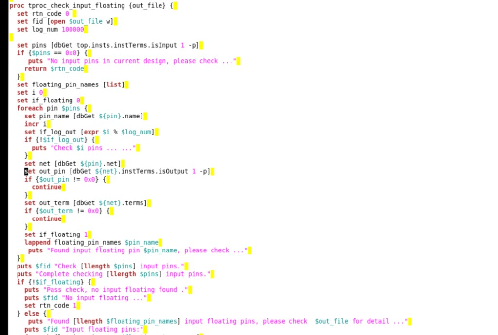
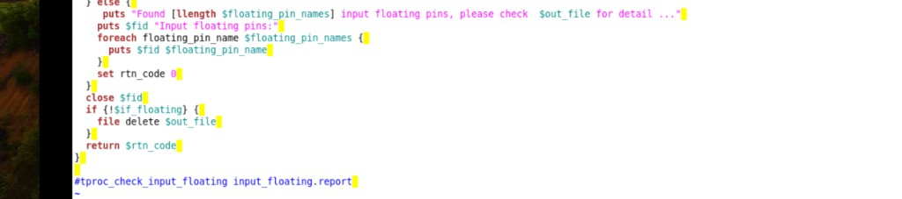

# Place 后检查 Input Floating

> 日期：2026-09-18  
> 来源：截图识别整理（picture-tcl）  
> 阶段：Place 后检查 floating

Place 后用 `dbGet` 检查 input floating pin 的完整 Tcl 过程（由两张连续截图拼合）。

## 完整脚本

```tcl
proc tproc_check_input_floating {out_file} {
  set rtn_code 0
  set fid [open $out_file w]
  set log_num 100000

  set pins [dbGet top.insts.instTerms.isInput 1 -p]
  if {$pins == 0x0} {
    puts "No input pins in current design, please check ..."
    return $rtn_code
  }
  set floating_pin_names [list]
  set i 0
  set if_floating 0
  foreach pin $pins {
    set pin_name [dbGet ${pin}.name]
    incr i
    set if_log_out [expr $i % $log_num]
    if {!$if_log_out} {
      puts "Check $i pins ... "
    }
    set net [dbGet ${pin}.net]
    set out_pin [dbGet ${net}.instTerms.isOutput 1 -p]
    if {$out_pin != 0x0} {
      continue
    }
    set out_term [dbGet ${net}.terms]
    if {$out_term != 0x0} {
      continue
    }
    set if_floating 1
    lappend floating_pin_names $pin_name
    puts "Found input floating pin $pin_name, please check ..."
  }
  puts $fid "Check [llength $pins] input pins."
  puts "Complete checking [llength $pins] input pins."
  if {!$if_floating} {
    puts "Pass check, no input floating found ."
    puts $fid "No input floating ..."
    set rtn_code 1
  } else {
    puts "Found [llength $floating_pin_names] input floating pins, please check $out_file for detail ..."
    puts $fid "Input floating pins:"
    foreach floating_pin_name $floating_pin_names {
      puts $fid $floating_pin_name
    }
    set rtn_code 0
  }
  close $fid
  if {!$if_floating} {
    file delete $out_file
  }
  return $rtn_code
}
# 在innovus 执行脚本
# tproc_check_input_floating input_floating.report
```

**转录注记：** `"Check $i pins ... "` 与 `"Pass check, no input floating found ."` 中句末空格照原图保留；末行注释为调用示例。

## 原图





## 相关笔记

- [TCL 脚本](../index.md)
- [脚本页模板](../template.md)
