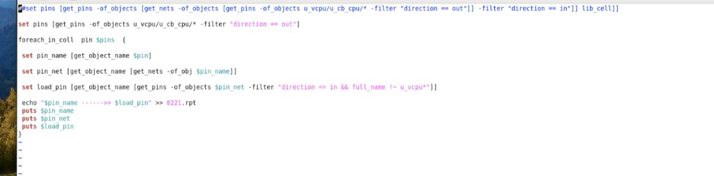

# 检查 Always-on Isolation 前是否插 Buf

## 场景

低功耗设计里，**always-on** 电源域上的 **isolation cell** 往往要求其驱动端（或接收端前）按规范插入 **buffer**，避免 ISO 直接挂在跨域 / 长距离网上导致驱动不足、时序或电气规则问题。

本脚本在 **PrimeTime / Synopsys Tcl** 环境下，对层次 `u_vcpu/u_cb_cpu` 的**输出 pin** 做「驱动 → net → 外部 load」追踪，把结果写到 `0221.rpt`。人工（或后续脚本）再看 load 是否为 isolation 相关 pin、中间是否已有 buf 实例。

## 截图



## 脚本

```tcl
#set pins [get_pins -of_objects [get_nets -of_objects [get_pins -of_objects u_vcpu/u_cb_cpu/* -filter "direction == out"]] -filter "direction == in"]] lib_cell]]
set pins [get_pins -of_objects u_vcpu/u_cb_cpu/* -filter "direction == out"]
foreach_in_coll pin $pins {
  set pin_name [get_object_name $pin]
  set pin_net [get_object_name [get_nets -of_obj $pin_name]]
  set load_pin [get_object_name [get_pins -of_objects $pin_net -filter "direction == in && full_name !~ u_vcpu**"]]
  echo "$pin_name ------>> $load_pin" >> 0221.rpt
  puts $pin_name
  puts $pin_net
  puts $load_pin
}
```

## 解析

### 1. 取源：模块输出 pin

```tcl
set pins [get_pins -of_objects u_vcpu/u_cb_cpu/* -filter "direction == out"]
```

- 在 `u_vcpu/u_cb_cpu` 层次下取出所有 **direction == out** 的 pin，作为跨出去的候选信号。
- 第一行被注释掉的写法更绕（先 out → net → in），当前用的是更直接的「只要输出 pin」。

### 2. 逐 pin：名字 → net → 外部 load

| 步骤 | 代码 | 含义 |
|------|------|------|
| 名字 | `get_object_name $pin` | 当前驱动 pin 全名 |
| Net | `get_nets -of_obj $pin_name` | 该 pin 所连的 net |
| Load | `get_pins -of_objects $pin_net -filter "direction == in && full_name !~ u_vcpu**"` | 同 net 上、方向为 **in**、且**不在** `u_vcpu*` 层次内的 pin |

`full_name !~ u_vcpu**` 的作用：丢掉模块内部自己的输入/反馈，只保留**走出 `u_vcpu` 之后**的第一个（或一批）外部 sink。这些 sink 里就包括挂在 always-on 侧的 **isolation cell 输入**，以及中间若已插入则会出现的 **buf 输入**。

### 3. 怎么用来判断「ISO 前有没有 buf」

脚本本身**不直接打印** cell 类型，而是产出映射：

```text
<source_out_pin> ------>> <external_load_pin>
```

写入 `0221.rpt`，同时 `puts` 三行到终端便于调试。

人工检查时典型看法：

1. 看 `load_pin` 名字是否落在 isolation 实例上（如 `*ISO*` / 项目约定的 ISO cell 命名）。
2. 若 load 直接是 ISO 的 data 输入 → **前面没有 buf**（或 buf 不在这条 net 的「首个外部 in」上）。
3. 若 load 是某个 `BUF*` / `CKB*` 等 buffer 的输入，再顺着该 buf 的输出继续查是否接到 ISO → **已插 buf**。
4. 若 `load_pin` 为空或多对象异常 → net 悬空、多扇出未拆开、或命名过滤过严，需单独排查。

### 4. 使用注意

- 层次名 `u_vcpu/u_cb_cpu`、排除前缀 `u_vcpu**`、报告名 `0221.rpt` 都是项目定制，换设计时改路径与过滤条件。
- `full_name !~ u_vcpu**` 是 glob 风格排除；若 PT 版本对 `**` 支持不同，可改成更精确的正则 / `hierarchy` 过滤。
- 一条 net 若有多个外部 in，`get_object_name` 可能返回列表字符串，报告里要按多 fanout 再拆。
- 真正「是否 always-on 上的 ISO」还需结合 UPF / power domain 属性或 ISO cell 列表二次过滤；本脚本负责**连线级追踪**，域属性需另查。

## 工具环境

- Synopsys **PrimeTime**（或同类 `get_pins` / `foreach_in_coll` 命令集）
- 已读入 netlist（及可选 UPF），层次名与设计一致
