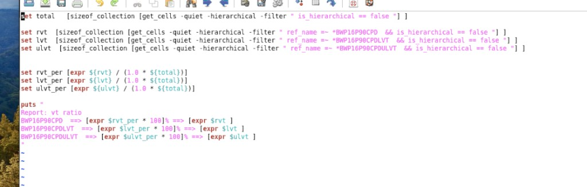

# 检查 VT Cell 数量与比例（BWP16P90）

> 日期：2026-10-17  
> 来源：截图识别整理（picture-tcl）  
> 阶段：Place 之后  
> 用途：看当前 design 里不同 VT cell 的**数量和比例**

**Place 做完之后**可以跑这段脚本，按库名统计 RVT / LVT / ULVT（`BWP16P90CPD` 系列）占全部 leaf cell 的百分比。

## 截图



## 脚本

```tcl
# check_vt_ratio.tcl
set total [sizeof_collection [get_cells -quiet -hierarchical -filter " is_hierarchical == false " ]]
set rvt [sizeof_collection [get_cells -quiet -hierarchical -filter " ref_name =~ *BWP16P90CPD && is_hierarchical == false " ]]
set lvt [sizeof_collection [get_cells -quiet -hierarchical -filter " ref_name =~ *BWP16P90CPDLVT && is_hierarchical == false " ]]
set ulvt [sizeof_collection [get_cells -quiet -hierarchical -filter " ref_name =~ *BWP16P90CPDULVT && is_hierarchical == false " ]]
set rvt_per [expr ${rvt} / (1.0 * ${total})]
set lvt_per [expr ${lvt} / (1.0 * ${total})]
set ulvt_per [expr ${ulvt} / (1.0 * ${total})]
puts "
Report: vt ratio
BWP16P90CPD ==> [expr $rvt_per * 100]% ==> [expr $rvt ]
BWP16P90CPDLVT ==> [expr $lvt_per * 100]% ==> [expr $lvt ]
BWP16P90CPDULVT ==> [expr $ulvt_per * 100]% ==> [expr $ulvt ]
"
```

```tcl
# 使用 check_vt_ratio 并输出到单独文件里
source ./check_vt_ratio.tcl > ../report/preCTS/vt_radio.rpt
```

## 说明

- **ref_name** 是库单元名（cell / reference 名）；
- **Cell name** 是标准单元库里的 reference name，描述的是这一类器件的功能、版图、面积和时序模型，在库里同名只有一种
- **instance name**网表实例化出来的 instance 唯一标识，一个cell可以被实例化很多次，每次的 instance nam不同
- `is_hierarchical == false`：只数 leaf cell。
- `*BWP16P90CPD` / `*LVT` / `*ULVT`：按本工艺库 ref 名区分三档 VT。
- `1.0 * $total`：强制浮点除法，再 `* 100` 打成百分比。输出是「百分比 ==> 颗数」。

> 注记：`ref_name =~ *BWP16P90CPD` 也会匹配 `*BWP16P90CPDLVT`、`*BWP16P90CPDULVT`，RVT 计数可能把 LVT、ULVT 算进去。脚本按截图照录，未改。

## 相关笔记

- [统计 VT Cell 比例（RVT / LVT，40P140）](../vt-cell-ratio.md)
- [T12nm · Leakage 优化](../../experience/t12nm/leakage-optimization.md)
- [high_opt.tcl（High Effort Opt + LVT）](../high-opt.md)
