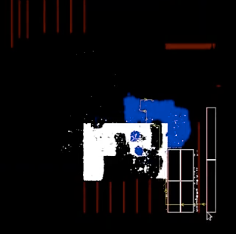
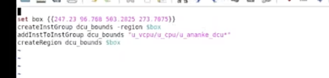

# Create Region 区域约束（createInstGroup / createRegion）

> 日期：2026-10-05  
> 工具：Innovus  
> 阶段：place（给模块加摆放区域约束）  
> 用途：把 DCU 模块的 cell 圈进一块矩形区域里摆——module placement 约束

## 脚本



```tcl
deGet selected.boxex # 获取 box的坐标
set box {{247.23 96.768 503.2025 273.7075}}
createInstGroup dcu_bounds -region $box
addInstToInstGroup dcu_bounds "u_vcpu/u_cpu/u_ananke_dcu*"
createRegion dcu_bounds $box
```

## 逐行说明

- `set box {{247.23 96.768 503.2025 273.7075}}` —— 四个数是 **{llx lly urx ury}**（左下角 + 右上角，单位 μm），外层多包一层是给 region 类命令传的 box 列表格式
- `createInstGroup dcu_bounds -region $box` —— 建一个名叫 `dcu_bounds` 的 instance group，绑在这个矩形上
- `addInstToInstGroup dcu_bounds "u_vcpu/u_cpu/u_ananke_dcu*"` —— 按 inst 名通配把 DCU 的 cell 全塞进组，place 时整组往这块区域里收
- `createRegion dcu_bounds $box` —— 再建一个同名 region 对象

这套属于软约束思路：组员**尽量**摆进 region，摆不下可以溢出；要"必须摆进去"的硬约束用 fence（区域约束里 guide / fence 两档强度）。

## 转录注记

1. 组名首遍识别成带空格的 `dcu bounds`、box 结尾识别成 `)`——放大复核后确认是**下划线一个词 `dcu_bounds`**、结尾是 `}`，四行组名统一。
2. 坐标首遍读作 `96.788 / 563.2825`，单独放大逐字符核对后确认是 **`96.768 / 503.2025`**（第二数中间是 6，第三数 5 后面是 0）。

## 原图



## 相关笔记

- [TCL 脚本](./index.md)
- [Innovus Place Padding（cell / instance / module）](./innovus-place-padding.md) —— 同属对 instance 摆放的控制手段
- [T12nm · Placement](../experience/t12nm/placement.md)
