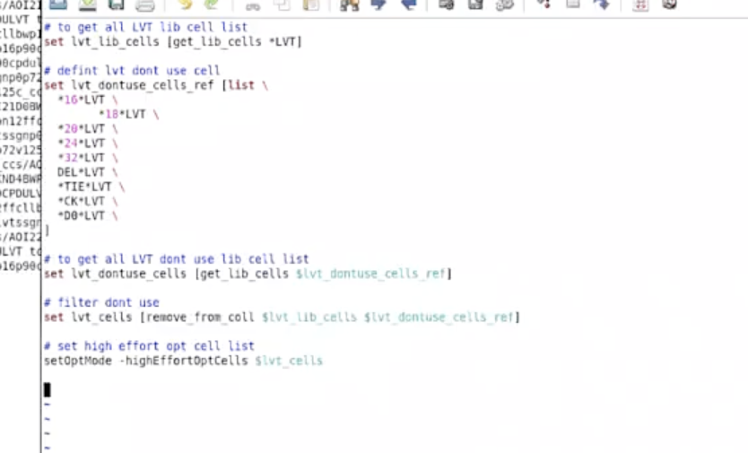

# high_opt.tcl（High Effort Opt + LVT）

> 日期：2026-10-07  
> 来源：截图识别整理（picture-tcl）  
> 阶段：Opt / Multi-Vt

开启 Innovus **high effort** 优化，并把可用的 **LVT** library cell 列表交给 `-highEffortOptCells`。

## 截图



## 脚本

```tcl
# to get all LVT lib cell list
set lvt_lib_cells [get_lib_cells *LVT]

# defint lvt dont use cell
set lvt_dontuse_cells_ref [list \
*16*LVT \
   *18*LVT \
*20*LVT \
*24*LVT \
*32*LVT \
DEL*LVT \
*TIE*LVT \
*CK*LVT \
*D0*LVT \
]

# to get all LVT dont use lib cell list
set lvt_dontuse_cells [get_lib_cells $lvt_dontuse_cells_ref]

# filter dont use
set lvt_cells [remove_from_coll $lvt_lib_cells $lvt_dontuse_cells_ref]

# set high effort opt cell list 约束工具在关键路径上使用低阈值电压的cell
setOptMode -highEffortOptCells $lvt_cells
```

## 在做什么

1. `get_lib_cells *LVT`：取出全部 LVT lib cell。
2. `lvt_dontuse_cells_ref`：排除过大 drive（16/18/20/24/32）、delay / tie / clock / `D0` 等不宜给 high-effort 乱插的 LVT。
3. `remove_from_coll` 得到可用集合 `$lvt_cells`。
4. `setOptMode -highEffortOptCells $lvt_cells`：开启 high effort flow，并限定用这批 cell。

> 注记：图中 `remove_from_coll` 第二参数写的是 `$lvt_dontuse_cells_ref`（pattern 列表）；若工具要求 collection，可改成上一步得到的 `$lvt_dontuse_cells`。照实转录，未改原脚本。

## VT 选型经验（RVT / LVT / ULVT）

用哪一档 VT **没有固定答案**。RVT 漏电小、速度偏慢；LVT / ULVT 更快但功耗更高。实际做法是：

- 多跑几套版本（例如主力 RVT + 关键路径开 LVT high-effort，或掺一部分 ULVT）；
- 对比本 design 的 timing / power / area；
- **哪个版本结果更好就用哪个**，而不是先验认定「必须全 LVT」或「绝不能用 ULVT」。

本脚本只是其中一种：把过滤后的 LVT 交给 high effort，便于 timing 紧时冲性能；是否采用仍以你 design 多版本对比为准。

## 相关笔记

- [统计 VT Cell 比例（RVT / LVT）](./vt-cell-ratio.md)
