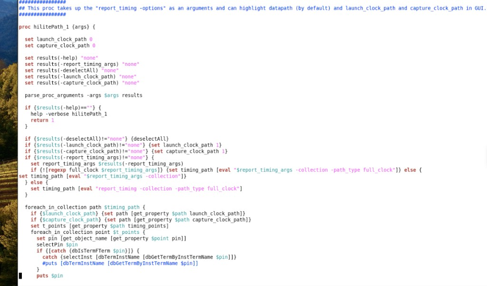
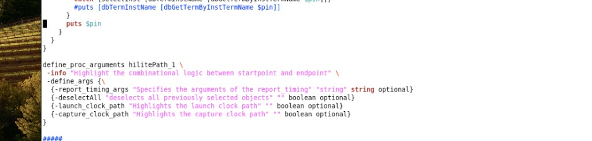

# hilitePath_1 高亮 Timing Path

> 日期：2026-10-17  
> 来源：截图识别整理（picture-tcl，两张连续截图拼合）  
> 阶段：Innovus GUI / Timing Path 高亮

把 `report_timing` 的参数传给过程，在 Innovus GUI 里高亮 path。默认高亮 datapath；加 `-launch_clock_path` 或 `-capture_clock_path` 则高亮对应时钟路径。

## 截图





## 完整脚本

```tcl
## This proc takes up the "report_timing -options" as an arguments and can highlight datapath (by default) and launch_clock_path and capture_clock_path in GUI.

proc hilitePath_1 {args} {
  set launch_clock_path 0
  set capture_clock_path 0
  set results(-help) "none"
  set results(-report_timing_args) "none"
  set results(-deselectAll) "none"
  set results(-launch_clock_path) "none"
  set results(-capture_clock_path) "none"
  parse_proc_arguments -args $args results
  if {$results(-help)==""} {
    help -verbose hilitePath_1
    return 1
  }
  if {$results(-deselectAll)!="none"} {deselectAll}
  if {$results(-launch_clock_path)!="none"} {set launch_clock_path 1}
  if {$results(-capture_clock_path)!="none"} {set capture_clock_path 1}
  if {$results(-report_timing_args)!="none"} {
    set report_timing_args $results(-report_timing_args)
    if {![regexp full_clock $report_timing_args]} {
      set timing_path [eval "$report_timing_args -collection -path_type full_clock"]
    } else {
      set timing_path [eval "$report_timing_args -collection"]
    }
  } else {
    set timing_path [eval "report_timing -collection -path_type full_clock"]
  }
  foreach_in_collection path $timing_path {
    if {$launch_clock_path} {set path [get_property $path launch_clock_path]}
    if {$capture_clock_path} {set path [get_property $path capture_clock_path]}
    set t_points [get_property $path timing_points]
    foreach_in_collection point $t_points {
      set pin [get_object_name [get_property $point pin]]
      selectPin $pin
      if {[catch {dbIsTermFTerm $pin}]} {
        catch {selectInst [dbTermInstName [dbGetTermByInstTermName $pin]]}
        #puts [dbTermInstName [dbGetTermByInstTermName $pin]]
      }
      puts $pin
    }
  }
}

define_proc_arguments hilitePath_1 \
  -info "Highlight the combinational logic between startpoint and endpoint" \
  -define_args {\
    {-report_timing_args "Specifies the arguments of the report_timing" "string" string optional}
    {-deselectAll "deselects all previously selected objects" "" boolean optional}
    {-launch_clock_path "Highlights the launch clock path" "" boolean optional}
    {-capture_clock_path "Highlights the capture clock path" "" boolean optional}
  }
```

> 转录注记：`regexp full_clock` 那一行在截图里被折断，已拼回一行。图 2 末尾有分隔线 `#####`，未写入脚本。

## 用法

```tcl
hilitePath_1 -report_timing_args {report_timing -from <start> -to <end>}
hilitePath_1 -deselectAll -launch_clock_path -report_timing_args {report_timing -to <pin> -path_type full_clock}
hilitePath_1 -capture_clock_path -report_timing_args {report_timing -to <pin>}
```

`-report_timing_args` 里若还没有 `full_clock`，过程会自动补上 `-collection -path_type full_clock`。

## 相关笔记

- [CTS 涉及脚本](./cts-related-scripts.md)
- [Clock Tree Debug 高频命令](./ccopt-clock-tree-debug.md)
- [报告 Path 逻辑深度](./timing_report/report-logic-depth.md)
