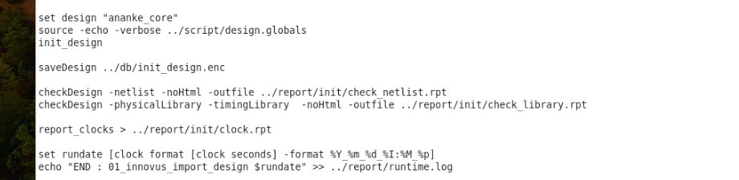

# Innovus 01 Import Design

> 日期：2026-09-19  
> 来源：截图识别整理（picture-tcl）  
> 阶段：01_innovus_import_design

## 完整脚本

```tcl
set design "ananke_core"
source -echo -verbose ../script/design.globals
init_design

saveDesign ../db/init_design.enc

checkDesign -netlist -noHtml -outfile ../report/init/check_netlist.rpt
checkDesign -physicalLibrary -timingLibrary  -noHtml -outfile ../report/init/check_library.rpt

report_clocks > ../report/init/clock.rpt

set rundate [clock format [clock seconds] -format %Y_%m_%d_%I:%M_%p]
echo "END : 01_innovus_import_design $rundate" >> ../report/runtime.log
```

**转录注记：** `-timingLibrary` 与 `-noHtml` 之间保留原图双空格；`$design` 在本段未再引用，照实转录。

## 原图



## 相关笔记

- [TCL 脚本](./index.md)
- [Innovus CCOpt CTS 脚本](./innovus-ccopt-cts.md)
- [Innovus 估算 Chip 面积](./innovus-estimate-area.md)
