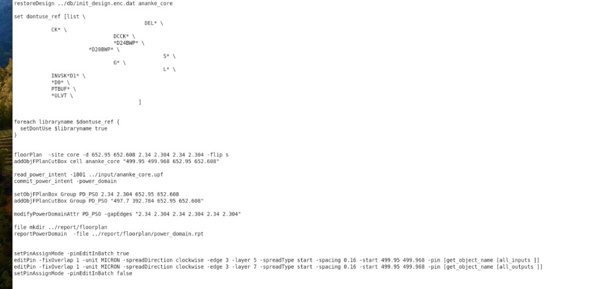
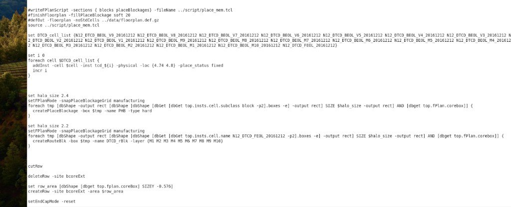
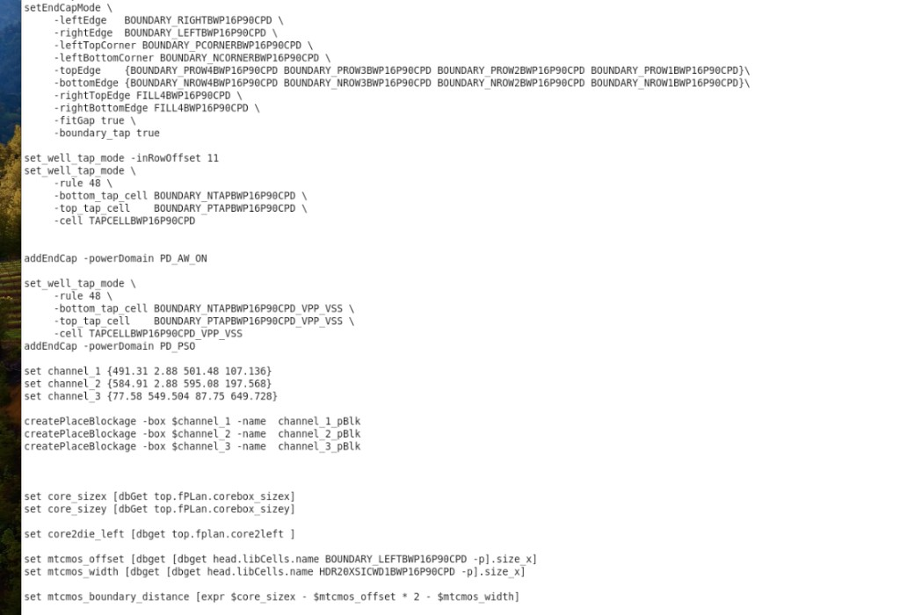
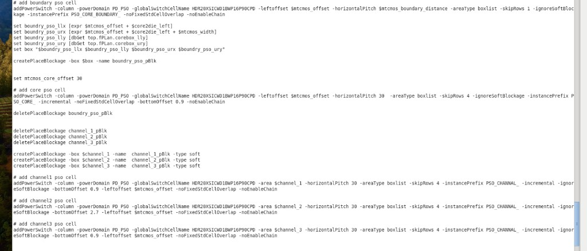
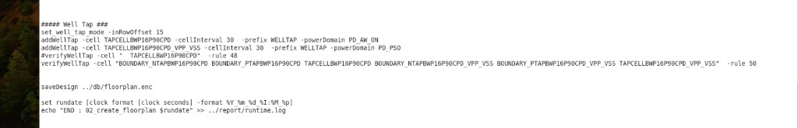

# Innovus 02 Floorplan

> 日期：2026-09-19  
> 来源：截图识别整理（picture-tcl）  
> 阶段：02_create_floorplan

五张截图为同一 `02_floorplan` 流程的连续片段，已拼合为完整脚本。

## 完整脚本

```tcl
restoreDesign ../db/init_design.enc.dat ananke_core

set dontuse_ref [list \
  CK* \
  DEL* \
  DCCK* \
  *D24BWP* \
  *D20BWP* \
  G* \
  S* \
  L* \
  INVSK*D1* \
  *D0* \
  PTBUF* \
  *ULVT \
]

foreach libraryname $dontuse_ref {
  setDontUse $libraryname true
}

floorPlan -site core -d 652.95 652.608 2.34 2.304 2.34 2.304 -flip s
addObjFPlanCutBox cell ananke_core "499.95 499.968 652.95 652.608"

read_power_intent -1801 ../input/ananke_core.upf
commit_power_intent -power_domain

setObjFPlanBox Group PD_PS0 2.34 2.304 652.95 652.608
addObjFPlanCutBox Group PD_PS0 "497.7 392.784 652.95 652.608"

modifyPowerDomainAttr PD_PS0 -gapEdges "2.34 2.304 2.34 2.304 2.34 2.304"

file mkdir ../report/floorplan
reportPowerDomain -file ../report/floorplan/power_domain.rpt

setPinAssignMode -pinEditInBatch true
editPin -fixOverlap 1 -unit MICRON -spreadDirection clockwise -edge 3 -layer 5 -spreadType start -spacing 0.16 -start 499.95 499.968 -pin [get_object_name [all_inputs ]]
editPin -fixOverlap 1 -unit MICRON -spreadDirection clockwise -edge 3 -layer 7 -spreadType start -spacing 0.16 -start 499.95 499.968 -pin [get_object_name [all_outputs ]]
setPinAssignMode -pinEditInBatch false

#writeFPlanScript -sections { blocks placeBlockages} -fileName ../script/place_mem.tcl
#finishFloorplan -fillPlaceBlockage soft 20
#defOut -floorplan -noStdCells ../data/floorplan.def.gz
source ../script/place_mem.tcl

set DTCD_cell_list {N12_DTCD_BEOL_V9_20161212 N12_DTCD_BEOL_V8_20161212 N12_DTCD_BEOL_V7_20161212 N12_DTCD_BEOL_V6_20161212 N12_DTCD_BEOL_V5_20161212 N12_DTCD_BEOL_V4_20161212 N12_DTCD_BEOL_V3_20161212 N12_DTCD_BEOL_V2_20161212 N12_DTCD_BEOL_V1_20161212 N12_DTCD_BEOL_M9_20161212 N12_DTCD_BEOL_M8_20161212 N12_DTCD_BEOL_M7_20161212 N12_DTCD_BEOL_M6_20161212 N12_DTCD_BEOL_M5_20161212 N12_DTCD_BEOL_M4_20161212 N12_DTCD_BEOL_M3_20161212 N12_DTCD_BEOL_M2_20161212 N12_DTCD_BEOL_M1_20161212 N12_DTCD_BEOL_M10_20161212 N12_DTCD_FEOL_20161212}

set i 0
foreach cell $DTCD_cell_list {
    addInst -cell $cell -inst tcd_${i} -physical -loc {4.74 4.8} -place_status fixed
    incr i
}

set halo_size 2.4
setFPlanMode -snapPlaceBlockageGrid manufacturing
foreach tmp [dbShape -output rect [dbShape [dbShape [dbGet [dbGet top.insts.cell.subclass block -p2].boxes -e] -output rect] SIZE $halo_size -output rect] AND [dbget top.fPlan.corebox]] {
    createPlaceBlockage -box $tmp -name PHB -type hard
}

set halo_size 2.2
setFPlanMode -snapPlaceBlockageGrid manufacturing
foreach tmp [dbShape -output rect [dbShape [dbShape [dbGet [dbGet top.insts.cell.name N12_DTCD_FEOL_20161212 -p2].boxes -e] -output rect] SIZE $halo_size -output rect] AND [dbget top.fPlan.corebox]] {
    createRouteBlk -box $tmp -name DTCD_rBlk -layer {M1 M2 M3 M4 M5 M6 M7 M8 M9 M10}
}

cutRow

deleteRow -site bcoreExt

set row_area [dbShape [dbget top.fplan.coreBox] SIZEY -0.576]
createRow -site bcoreExt -area $row_area

setEndCapMode -reset

setEndCapMode \
    -leftEdge       BOUNDARY_RIGHTBWP16P90CPD \
    -rightEdge      BOUNDARY_LEFTBWP16P90CPD \
    -leftTopCorner  BOUNDARY_PCORNERBWP16P90CPD \
    -leftBottomCorner BOUNDARY_NCORNERBWP16P90CPD \
    -topEdge        {BOUNDARY_PROW4BWP16P90CPD BOUNDARY_PROW3BWP16P90CPD BOUNDARY_PROW2BWP16P90CPD BOUNDARY_PROW1BWP16P90CPD} \
    -bottomEdge     {BOUNDARY_NROW4BWP16P90CPD BOUNDARY_NROW3BWP16P90CPD BOUNDARY_NROW2BWP16P90CPD BOUNDARY_NROW1BWP16P90CPD} \
    -rightTopEdge   FILL4BWP16P90CPD \
    -rightBottomEdge FILL4BWP16P90CPD \
    -fitGap true \
    -boundary_tap true

set_well_tap_mode -inRowOffset 11
set_well_tap_mode \
    -rule 48 \
    -bottom_tap_cell BOUNDARY_NTAPBWP16P90CPD \
    -top_tap_cell    BOUNDARY_PTAPBWP16P90CPD \
    -cell            TAPCELLBWP16P90CPD

addEndCap -powerDomain PD_AW_ON

set_well_tap_mode \
    -rule 48 \
    -bottom_tap_cell BOUNDARY_NTAPBWP16P90CPD_VPP_VSS \
    -top_tap_cell    BOUNDARY_PTAPBWP16P90CPD_VPP_VSS \
    -cell            TAPCELLBWP16P90CPD_VPP_VSS

addEndCap -powerDomain PD_PSO

set channel_1 {491.31 2.88 501.48 107.136}
set channel_2 {584.91 2.88 595.08 197.568}
set channel_3 {77.58 549.504 87.75 649.728}

createPlaceBlockage -box $channel_1 -name channel_1_pBlk
createPlaceBlockage -box $channel_2 -name channel_2_pBlk
createPlaceBlockage -box $channel_3 -name channel_3_pBlk

set core_sizex [dbGet top.fPlan.corebox_sizex]
set core_sizey [dbGet top.fPlan.corebox_sizey]

set core2die_left [dbget top.fplan.core2left]

set mtcmos_offset [dbget [dbget head.libCells.name BOUNDARY_LEFTBWP16P90CPD -p].size_x]
set mtcmos_width [dbget [dbget head.libCells.name HDR20XSICWD1BWP16P90CPD -p].size_x]

set mtcmos_boundary_distance [expr $core_sizex - $mtcmos_offset * 2 - $mtcmos_width]

# add boundary pso cell
addPowerSwitch -column -powerDomain PD_PSO -globalSwitchCellName HDR20XSICWD1BWP16P90CPD -leftoffset $mtcmos_offset -horizontalPitch $mtcmos_boundary_distance -areaType boxlist -skipRows 1 -ignoreSoftBlockage -instancePrefix PSO_CORE_BOUNDARY_ -noFixedStdCellOverlap -noEnableChain

set boundry_pso_llx [expr $mtcmos_offset + $core2die_left]
set boundry_pso_urx [expr $mtcmos_offset + $core2die_left + $mtcmos_width]
set boundry_pso_lly [dbGet top.fPlan.corebox_lly]
set boundry_pso_ury [dbGet top.fPlan.corebox_ury]
set box "$boundry_pso_llx $boundry_pso_lly $boundry_pso_urx $boundry_pso_ury"

createPlaceBlockage -box $box -name boundry_pso_pBlk

set mtcmos_core_offset 30

# add core pso cell
addPowerSwitch -column -powerDomain PD_PSO -globalSwitchCellName HDR20XSICWD1BWP16P90CPD -leftoffset $mtcmos_offset -horizontalPitch 30 -areaType boxlist -skipRows 4 -ignoreSoftBlockage -instancePrefix PSO_CORE_ -incremental -noFixedStdCellOverlap -bottomOffset 0.9 -noEnableChain

deletePlaceBlockage boundry_pso_pBlk

deletePlaceBlockage channel_1_pBlk
deletePlaceBlockage channel_2_pBlk
deletePlaceBlockage channel_3_pBlk

createPlaceBlockage -box $channel_1 -name channel_1_pBlk -type soft
createPlaceBlockage -box $channel_2 -name channel_2_pBlk -type soft
createPlaceBlockage -box $channel_3 -name channel_3_pBlk -type soft

# add channel1 pso cell
addPowerSwitch -column -powerDomain PD_PSO -globalSwitchCellName HDR20XSICWD1BWP16P90CPD -area $channel_1 -horizontalPitch 30 -areaType boxlist -skipRows 4 -instancePrefix PSO_CHANNEL_ -incremental -ignoreSoftBlockage -bottomOffset 0.9 -leftoffset $mtcmos_offset -noFixedStdCellOverlap -noEnableChain

# add channel2 pso cell
addPowerSwitch -column -powerDomain PD_PSO -globalSwitchCellName HDR20XSICWD1BWP16P90CPD -area $channel_2 -horizontalPitch 30 -areaType boxlist -skipRows 4 -instancePrefix PSO_CHANNEL_ -incremental -ignoreSoftBlockage -bottomOffset 2.7 -leftoffset $mtcmos_offset -noFixedStdCellOverlap -noEnableChain

# add channel3 pso cell
addPowerSwitch -column -powerDomain PD_PSO -globalSwitchCellName HDR20XSICWD1BWP16P90CPD -area $channel_3 -horizontalPitch 30 -areaType boxlist -skipRows 4 -instancePrefix PSO_CHANNEL_ -incremental -ignoreSoftBlockage -bottomOffset 0.9 -leftoffset $mtcmos_offset -noFixedStdCellOverlap -noEnableChain

##### Well Tap ###
set_well_tap_mode -inRowOffset 15
addWellTap -cell TAPCELLBWP16P90CPD -cellInterval 30 -prefix WELLTAP -powerDomain PD_AW_ON
addWellTap -cell TAPCELLBWP16P90CPD_VPP_VSS -cellInterval 30 -prefix WELLTAP -powerDomain PD_PSO
#verifyWellTap -cell " TAPCELLBWP16P90CPD* -rule 48
verifyWellTap -cell "BOUNDARY_NTAPBWP16P90CPD BOUNDARY_PTAPBWP16P90CPD TAPCELLBWP16P90CPD BOUNDARY_NTAPBWP16P90CPD_VPP_VSS BOUNDARY_PTAPBWP16P90CPD_VPP_VSS TAPCELLBWP16P90CPD_VPP_VSS" -rule 50

saveDesign ../db/floorplan.enc

set rundate [clock format [clock seconds] -format %Y_%m_%d_%I:%M_%p]
echo "END : 02_create_floorplan $rundate" >> ../report/runtime.log
```

**转录注记：**

- 图中 `PD_PS0`（前段 floorplan box）与后段 `PD_PSO` 并存，照实保留，未统一改名。
- `boundry_pso_*` 拼写、`dbGet`/`dbget`、`fPlan`/`fplan`、`corebox`/`coreBox`、`subclass` 大小写均按原图。
- `[all_inputs ]` / `[all_outputs ]` 括号内尾部空格照原图。
- `#verifyWellTap -cell " TAPCELLBWP16P90CPD* -rule 48` 原图注释引号似未闭合，照实转录。
- `$mtcmos_core_offset` 定义后本段未见引用，照实保留。

## `addPowerSwitch` 间距说明（Channel / Core）

以 channel 为例：

```tcl
addPowerSwitch -column -powerDomain PD_PSO -globalSwitchCellName HDR20XSICWD1BWP16P90CPD \
  -area $channel_1 -horizontalPitch 30 -areaType boxlist -skipRows 4 \
  -instancePrefix PSO_CHANNEL_ -incremental -ignoreSoftBlockage \
  -bottomOffset 0.9 -leftoffset $mtcmos_offset -noFixedStdCellOverlap -noEnableChain
```

| 选项 | 含义 |
|------|------|
| `-horizontalPitch 30` | **水平间距**：列与列约 **30 μm**（与 floorplan 单位一致，一般为 micron） |
| `-skipRows 4` | **竖直方向**：隔 4 行再插；微米间距 ≈ `4 × row_height` |
| `-leftoffset $mtcmos_offset` | 相对区域左边的起始偏移 |
| `-bottomOffset 0.9` | 相对底边偏移 0.9 |

问「间距」时，通常先看水平 **30**；竖直看 **skipRows 4**。  
Core 区 `PSO_CORE_` 同样是 `-horizontalPitch 30`、`-skipRows 4`；边界 `PSO_CORE_BOUNDARY_` 用的是 `-horizontalPitch $mtcmos_boundary_distance`、`-skipRows 1`，与 channel/core 内部不同。

## 原图











## 相关笔记

- [TCL 脚本](./index.md)
- [Innovus 01 Import Design](./innovus-01-import-design.md)
- [Innovus CCOpt CTS 脚本](./innovus-ccopt-cts.md)
- [T12nm · Power Switch：Core / Channel 与边界](../experience/t12nm/power-switch-core-channel.md)
