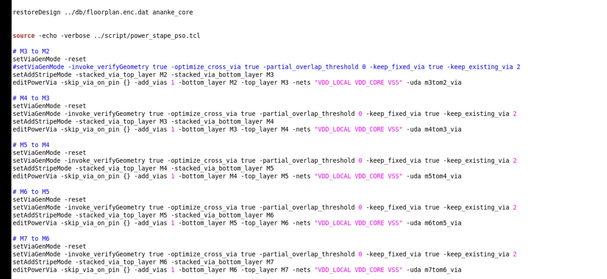
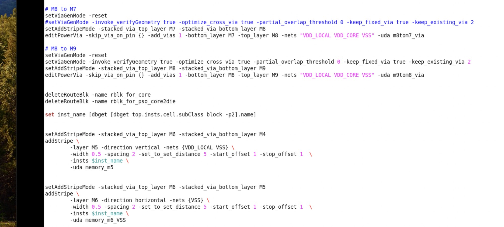
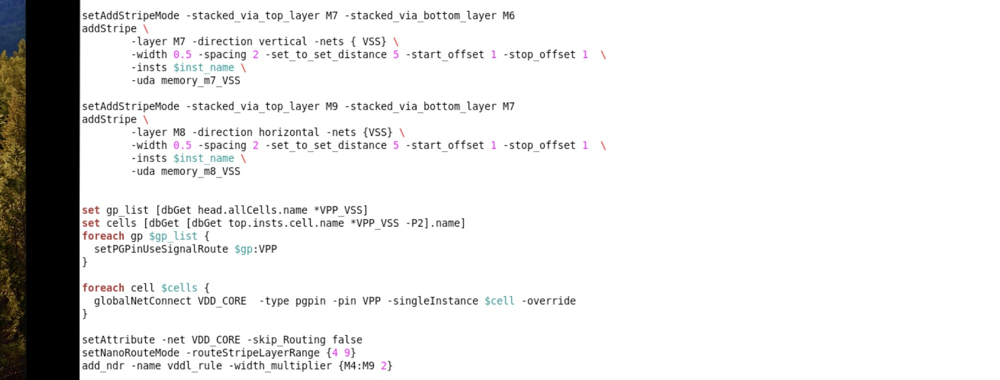
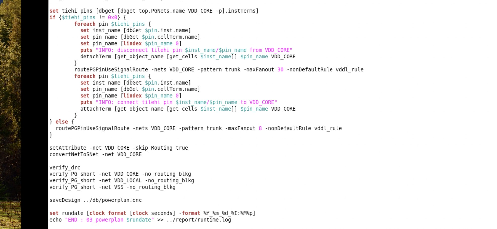

# Innovus 03 Powerplan

> 日期：2026-09-22  
> 来源：截图识别整理（picture-tcl，4 张连续截图）  
> 阶段：Powerplan（承接 [Innovus 02 Floorplan](./innovus-02-floorplan.md)，脚本末尾回显 `END : 03_powerplan`）

4 张图是同一段 powerplan 脚本的连续截图，按 图 1 → 图 4 即脚本执行顺序，整合为一份完整脚本如下（`# ===== 图 N =====` 为整理时加入的分图标记）：

## 完整脚本

| 段（图） | 内容 |
|----|------|
| 图 1 | restoreDesign floorplan + source power_stape_pso.tcl + editPowerVia 阶梯（M3→M2 … M7→M6） |
| 图 2 | editPowerVia（M8→M7 / M8→M9）+ 删 route blk + memory M5 / M6 stripe |
| 图 3 | memory M7 / M8 VSS stripe + VPP cell 处理 + NDR 与 route 准备 |
| 图 4 | tiehi pin 断开重连 + convertNetToSNet + verify + saveDesign |

```tcl
# ===== 图 1 =====
restoreDesign ../db/floorplan.enc.dat ananke_core

source -echo -verbose ../script/power_stape_pso.tcl

# M3 to M2
setViaGenMode -reset
#setViaGenMode -invoke_verifyGeometry true -optimize_cross_via true -partial_overlap_threshold 0 -keep_fixed_via true -keep_existing_via 2
setAddStripeMode -stacked_via_top_layer M2 -stacked_via_bottom_layer M3
editPowerVia -skip_via_on_pin {} -add_vias 1 -bottom_layer M2 -top_layer M3 -nets "VDD_LOCAL VDD_CORE VSS" -uda m3tom2_via

# M4 to M3
setViaGenMode -reset
setViaGenMode -invoke_verifyGeometry true -optimize_cross_via true -partial_overlap_threshold 0 -keep_fixed_via true -keep_existing_via 2
setAddStripeMode -stacked_via_top_layer M3 -stacked_via_bottom_layer M4
editPowerVia -skip_via_on_pin {} -add_vias 1 -bottom_layer M3 -top_layer M4 -nets "VDD_LOCAL VDD_CORE VSS" -uda m4tom3_via

# M5 to M4
setViaGenMode -reset
setViaGenMode -invoke_verifyGeometry true -optimize_cross_via true -partial_overlap_threshold 0 -keep_fixed_via true -keep_existing_via 2
setAddStripeMode -stacked_via_top_layer M4 -stacked_via_bottom_layer M5
editPowerVia -skip_via_on_pin {} -add_vias 1 -bottom_layer M4 -top_layer M5 -nets "VDD_LOCAL VDD_CORE VSS" -uda m5tom4_via

# M6 to M5
setViaGenMode -reset
setViaGenMode -invoke_verifyGeometry true -optimize_cross_via true -partial_overlap_threshold 0 -keep_fixed_via true -keep_existing_via 2
setAddStripeMode -stacked_via_top_layer M5 -stacked_via_bottom_layer M6
editPowerVia -skip_via_on_pin {} -add_vias 1 -bottom_layer M5 -top_layer M6 -nets "VDD_LOCAL VDD_CORE VSS" -uda m6tom5_via

# M7 to M6
setViaGenMode -reset
setViaGenMode -invoke_verifyGeometry true -optimize_cross_via true -partial_overlap_threshold 0 -keep_fixed_via true -keep_existing_via 2
setAddStripeMode -stacked_via_top_layer M6 -stacked_via_bottom_layer M7
editPowerVia -skip_via_on_pin {} -add_vias 1 -bottom_layer M6 -top_layer M7 -nets "VDD_LOCAL VDD_CORE VSS" -uda m7tom6_via

# ===== 图 2 =====
# M8 to M7
setViaGenMode -reset
#setViaGenMode -invoke_verifyGeometry true -optimize_cross_via true -partial_overlap_threshold 0 -keep_fixed_via true -keep_existing_via 2
setAddStripeMode -stacked_via_top_layer M7 -stacked_via_bottom_layer M8
editPowerVia -skip_via_on_pin {} -add_vias 1 -bottom_layer M7 -top_layer M8 -nets "VDD_LOCAL VDD_CORE VSS" -uda m8tom7_via

# M8 to M9
setViaGenMode -reset
setViaGenMode -invoke_verifyGeometry true -optimize_cross_via true -partial_overlap_threshold 0 -keep_fixed_via true -keep_existing_via 2
setAddStripeMode -stacked_via_top_layer M8 -stacked_via_bottom_layer M9
editPowerVia -skip_via_on_pin {} -add_vias 1 -bottom_layer M8 -top_layer M9 -nets "VDD_LOCAL VDD_CORE VSS" -uda m9tom8_via


deleteRouteBlk -name rblk_for_core
deleteRouteBlk -name rblk_for_pso_core2die

set inst_name [dbget [dbget top.insts.cell.subClass block -p2].name]

setAddStripeMode -stacked_via_top_layer M6 -stacked_via_bottom_layer M4
addStripe \
    -layer M5 -direction vertical -nets {VDD_LOCAL VSS} \
    -width 0.5 -spacing 2 -set_to_set_distance 5 -start_offset 1 -stop_offset 1 \
    -insts $inst_name \
    -uda memory_m5

setAddStripeMode -stacked_via_top_layer M6 -stacked_via_bottom_layer M5
addStripe \
    -layer M6 -direction horizontal -nets {VSS} \
    -width 0.5 -spacing 2 -set_to_set_distance 5 -start_offset 1 -stop_offset 1 \
    -insts $inst_name \
    -uda memory_m6_VSS

# ===== 图 3 =====
setAddStripeMode -stacked_via_top_layer M7 -stacked_via_bottom_layer M6
addStripe \
        -layer M7 -direction vertical -nets { VSS} \
        -width 0.5 -spacing 2 -set_to_set_distance 5 -start_offset 1 -stop_offset 1 \
        -insts $inst_name \
        -uda memory_m7_VSS

setAddStripeMode -stacked_via_top_layer M9 -stacked_via_bottom_layer M7
addStripe \
        -layer M8 -direction horizontal -nets {VSS} \
        -width 0.5 -spacing 2 -set_to_set_distance 5 -start_offset 1 -stop_offset 1 \
        -insts $inst_name \
        -uda memory_m8_VSS


set gp_list [dbGet head.allCells.name *VPP_VSS]
set cells [dbGet [dbGet top.insts.cell.name *VPP_VSS -P2].name]
foreach gp $gp_list {
   setPGPinUseSignalRoute $gp:VPP
}

foreach cell $cells {
   globalNetConnect VDD_CORE  -type pgpin -pin VPP -singleInstance $cell -override
}

setAttribute -net VDD_CORE -skip_Routing false
setNanoRouteMode -routeStripeLayerRange {4 9}
add_ndr -name vdd1_rule -width_multiplier {M4:M9 2}

# ===== 图 4 =====
set tiehi_pins [dbget [dbget top.PGNets.name VDD_CORE -p].instTerms]
if {$tiehi_pins != 0x0} {
        foreach pin $tiehi_pins {
                set inst_name [dbGet $pin.inst.name]
                set pin_name [dbGet $pin.cellTerm.name]
                set pin_name [lindex $pin_name 0]
                puts "INFO: disconnect tilehi pin $inst_name/$pin_name from VDD_CORE"
                detachTerm [get_object_name [get_cells $inst_name]] $pin_name VDD_CORE
        }
        routePGPinUseSignalRoute -nets VDD_CORE -pattern trunk -maxFanout 30 -nonDefaultRule vddl_rule
        foreach pin $tiehi_pins {
                set inst_name [dbGet $pin.inst.name]
                set pin_name [dbGet $pin.cellTerm.name]
                set pin_name [lindex $pin_name 0]
                puts "INFO: connect tilehi pin $inst_name/$pin_name to VDD_CORE"
                attachTerm [get_object_name [get_cells $inst_name]] $pin_name VDD_CORE
        }
} else {
    routePGPinUseSignalRoute -nets VDD_CORE -pattern trunk -maxFanout 8 -nonDefaultRule vddl_rule
}

setAttribute -net VDD_CORE -skip_Routing true
convertNetToSNet -net VDD_CORE

verify_drc
verify_PG_short -net VDD_CORE -no_routing_blkg
verify_PG_short -net VDD_LOCAL -no_routing_blkg
verify_PG_short -net VSS -no_routing_blkg

saveDesign ../db/powerplan.enc

set rundate [clock format [clock seconds] -format %Y_%m_%d_%I:%M%p]
echo "END : 03_powerplan $rundate" >> ../report/runtime.log
```

同目录可直接 source 的版本：[innovus-03-powerplan.tcl](/tcl/innovus-03-powerplan.tcl)

图 1 中 `source` 的 `power_stape_pso.tcl`（power switch cell 上的 stapling stripe / via pillar 脚本）也已单独整理：[Power Switch Stapling Stripe（power_stape_pso）](./power-stape-pso.md)

**转录注记（存疑处均照录未改）：**

1. 4 张图中均无提示符与回显，全部为脚本内容，按原图顺序逐行转录。
2. 图 1 `power_stape_pso.tcl` 文件名照录（`stape` 疑为 `stripe`，存疑）。该脚本本身的内容（15 张截图）已单独整理为 [Power Switch Stapling Stripe](./power-stape-pso.md) 一页，存疑处见其转录注记。
3. 「M3 to M2」（图 1）与「M8 to M7」（图 2）两块的 `setViaGenMode` 选项行为**注释状态**，其余块启用，照录。
4. 图 2 `set inst_name` 行与图 4 首行的 `dbget` 为小写，与其它处 `dbGet` 大小写混用，照录。
5. 图 3 `-nets { VSS}` 花括号内空格照录。
6. 图 3 `setPGPinUseSignalRoute $gp:VPP` 写法照录：Tcl 会把 `$gp:VPP` 解析为名为 `gp:VPP` 的变量；若意图是「$gp 的值 + `:VPP`」应写 `${gp}:VPP`，**存疑**。
7. 图 3 `add_ndr -name vdd1_rule`（数字 `1`）与图 4 `-nonDefaultRule vddl_rule`（字母 `l`）不一致，1/l 形近易混，**存疑**。
8. 图 4 puts 字符串中 `tilehi` 疑为 `tiehi`，照录。

## 原图

图 1（restoreDesign 与 editPowerVia 阶梯）：



图 2（editPowerVia 与 memory M5/M6 stripe）：



图 3（memory M7/M8 stripe 与 VPP 处理）：



图 4（tiehi pin 重连、verify 与存盘）：



## 相关笔记

- [TCL 脚本](./index.md)
- [Innovus 02 Floorplan](./innovus-02-floorplan.md)
- [Innovus PG Special（Memory M5）](./innovus-pg-special.md)
- [Power Switch Stapling Stripe（power_stape_pso）](./power-stape-pso.md)
- [T12nm · Powerplan 做什么](../experience/t12nm/powerplan.md)
- [Via Pillar 下方不摆放特殊 cell](./via-pillar-pg-keepout.md)
