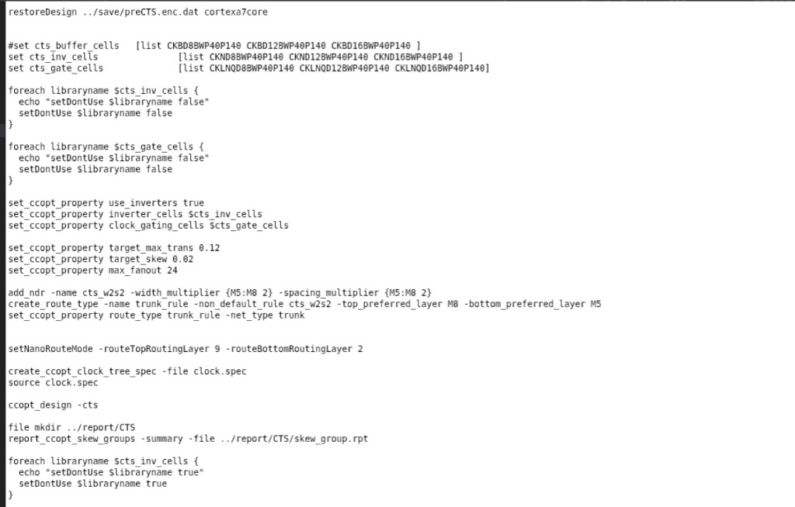

# Innovus CCOpt CTS 脚本

> 日期：2026-09-18  
> 来源：截图识别整理（picture-tcl）  
> 阶段：Innovus CCOpt CTS

两张截图为同一 CTS 流程的连续片段：restoreDesign → CCOpt 配置与跑树 → dontUse 还原 → saveDesign。

## 图 1：CCOpt CTS 主体



```tcl
restoreDesign ../save/preCTS.enc.dat cortexa7core

#set cts_buffer_cells  [list CKBD8BWP40P140 CKBD12BWP40P140 CKBD16BWP40P140 ]
set cts_inv_cells          [list CKND8BWP40P140 CKND12BWP40P140 CKND16BWP40P140 ]
set cts_gate_cells         [list CKLNQD8BWP40P140 CKLNQD12BWP40P140 CKLNQD16BWP40P140]

foreach libraryname $cts_inv_cells {
  echo "setDontUse $libraryname false"
  setDontUse $libraryname false
}

foreach libraryname $cts_gate_cells {
  echo "setDontUse $libraryname false"
  setDontUse $libraryname false
}

set_ccopt_property use_inverters true
set_ccopt_property inverter_cells $cts_inv_cells
set_ccopt_property clock_gating_cells $cts_gate_cells

set_ccopt_property target_max_trans 0.12
set_ccopt_property target_skew 0.02
set_ccopt_property max_fanout 24

add_ndr -name cts_w2s2 -width_multiplier {M5:M8 2} -spacing_multiplier {M5:M8 2}
create_route_type -name trunk_rule -non_default_rule cts_w2s2 -top_preferred_layer M8 -bottom_preferred_layer M5
set_ccopt_property route_type trunk_rule -net_type trunk

setNanoRouteMode -routeTopRoutingLayer 9 -routeBottomRoutingLayer 2

create_ccopt_clock_tree_spec -file clock.spec
source clock.spec

ccopt_design -cts

file mkdir ../report/CTS
report_ccopt_skew_groups -summary -file ../report/CTS/skew_group.rpt

foreach libraryname $cts_inv_cells {
  echo "setDontUse $libraryname true"
  setDontUse $libraryname true
}
```

**转录注记：** 截图在 inv `foreach` 结束的 `}` 处截断，续接见图 2；注释行 `#set cts_buffer_cells` 中 cell 名为 `CKBD*BWP40P140`（OCR 核对）。

## 图 2：gate dontUse 还原与存盘


```tcl
}

foreach libraryname $cts_gate_cells {
  echo "setDontUse $libraryname true"
  setDontUse $libraryname true
}

saveDesign ../save/CTS.enc
```

**转录注记：** 开头的 `}` 为图 1 中 `foreach libraryname $cts_inv_cells` 的闭合括号；与图 1 末尾衔接后为完整脚本。

## 相关笔记

- [set_ccopt_property target_skew](./ccopt-target-skew.md) —— `target_skew 0.02` 含义与用途
- [TCL 脚本](./index.md)
- [脚本页模板](./template.md)
- [PT DMSA Hold ECO 脚本](./pt-dmsa-hold-eco.md)
