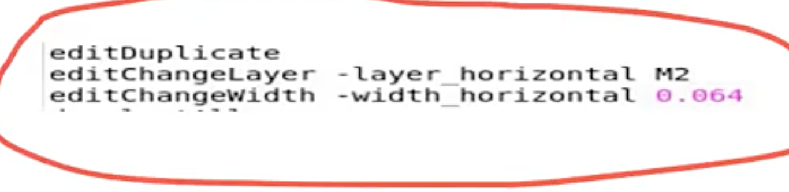

# Innovus 复制走线并改层改线宽

> 日期：2026-09-21  
> 来源：截图识别整理（picture-tcl）  
> 阶段：Routing Edit（edit 系列手工修改）

## 完整脚本

```tcl
editDuplicate
editChangeLayer -layer_horizontal M2
editChangeWidth -width_horizontal 0.064
```

**转录注记：** 图中无可见提示符，以上 3 行按原图顺序逐行转录。原图共 4 行，第 4 行被窗口底边截断，仅可见前几个字符（约为 `editC...`），完整命令无法辨认，未收录，请对照下图确认。同目录下有可直接 source 的 [innovus-edit-duplicate-change-layer.tcl](/tcl/innovus-edit-duplicate-change-layer.tcl)。

## 原图



## 相关笔记

- [TCL 脚本](./index.md)
- [Innovus PG Special（Memory M5）](./innovus-pg-special.md)
