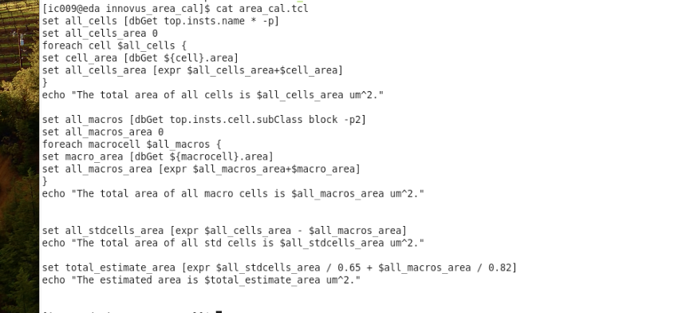

# Innovus 估算 Chip 面积

> 日期：2026-09-19  
> 来源：截图识别整理（picture-tcl）  
> 阶段：Floorplan 面积估算（`area_cal.tcl`）

## 完整脚本

```tcl
set all_cells [dbGet top.insts.name * -p]
set all_cells_area 0
foreach cell $all_cells {
set cell_area [dbGet ${cell}.area]
set all_cells_area [expr $all_cells_area+$cell_area]
}
echo "The total area of all cells is $all_cells_area um^2."

set all_macros [dbGet top.insts.cell.subClass block -p2]
set all_macros_area 0
foreach macrocell $all_macros {
set macro_area [dbGet ${macrocell}.area]
set all_macros_area [expr $all_macros_area+$macro_area]
}
echo "The total area of all macro cells is $all_macros_area um^2."

set all_stdcells_area [expr $all_cells_area - $all_macros_area]
echo "The total area of all std cells is $all_stdcells_area um^2."

set total_estimate_area [expr $all_stdcells_area / 0.65 + $all_macros_area / 0.82]
echo "The estimated area is $total_estimate_area um^2."
```

**转录注记：** 来源为终端 `cat area_cal.tcl`；`foreach` 体内缩进按原文件（无额外缩进）；利用率系数为 std `0.65`、macro `0.82`。

## 原图



## 相关笔记

- [TCL 脚本](./index.md)
- [示例：统计 cell 数量](./report-cells.md)
- [Innovus 02 Floorplan](./innovus-02-floorplan.md)
