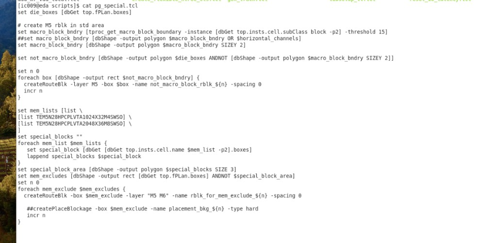
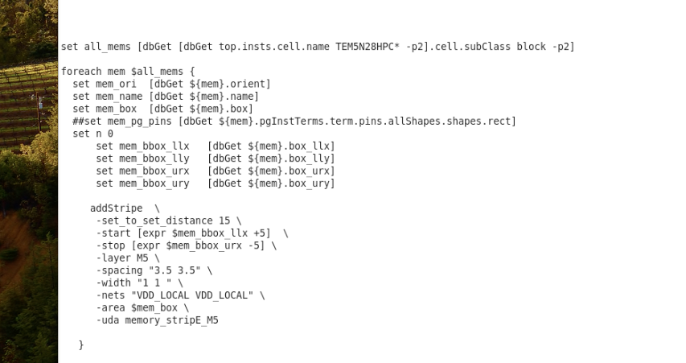

# Innovus PG Special（Memory M5）

> 日期：2026-09-19  
> 来源：截图识别整理（picture-tcl）  
> 阶段：Power / PG special（`pg_special.tcl` + memory M5 stripe）

两张截图为同一类 **PG 特殊处理** 流程：先用 route blockage 腾出/限制金属层，再在 memory 上加 `VDD_LOCAL` 的 M5 stripe。

## 脚本作用（总览）

整体目标不是算面积，而是做 **memory 相关电源金属的特殊规划**：

1. **图 1 `pg_special.tcl`**：用 `createRouteBlk` 挡住部分区域的走线层  
   - 在 **非 macro（偏 std）区域** 挡 **M5**，把 M5 留给后续 PG / 特殊用途  
   - 在 **指定 memory 周边以外** 挡 **M5+M6**，只在这些 memory 附近留下 M5/M6，方便本地电源 stripe  
2. **图 2**：对 `TEM5N28HPC*` memory 在其 box 内 `addStripe` 打 **M5 / VDD_LOCAL** 电源条

典型用法：先跑 blockage，再跑 stripe（或按你们 flow 的 source 顺序）。

---

## 图 1：`pg_special.tcl`（Route Blockage）



```tcl
set die_boxes [dbGet top.fPlan.boxes]

# create M5 rblk in std area
set macro_block_bndry [tproc_get_macro_block_boundary -instance [dbGet top.insts.cell.subClass block -p2] -threshold 15]
##set macro_block_bndry [dbShape -output polygon $macro_block_bndry OR $horizontal_channels]
set macro_block_bndry [dbShape -output polygon $macro_block_bndry SIZEY 2]

set not_macro_block_bndry [dbShape -output polygon $die_boxes ANDNOT [dbShape -output polygon $macro_block_bndry SIZEY 2]]

set n 0
foreach box [dbShape -output rect $not_macro_block_bndry] {
  createRouteBlk -layer M5 -box $box -name not_macro_block_rblk_${n} -spacing 0
  incr n
}

set mem_lists [list \
[list TEM5N28HPCPLVTA1024X32M4SWSO] \
[list TEM5N28HPCPLVTA2048X36M8SWSO] \
]
set special_blocks ""
foreach mem_list $mem_lists {
  set special_block [dbGet [dbGet top.insts.cell.name $mem_list -p2].boxes]
  lappend special_blocks $special_block
}
set special_block_area [dbShape -output polygon $special_blocks SIZE 3]
set mem_excludes [dbShape -output rect [dbGet top.fPlan.boxes] ANDNOT $special_block_area]
set n 0
foreach mem_exclude $mem_excludes {
  createRouteBlk -box $mem_exclude -layer "M5 M6" -name rblk_for_mem_exclude_${n} -spacing 0

  ##createPlaceBlockage -box $mem_exclude -name placement_bkg_${n} -type hard
  incr n
}
```

### 这段在做什么

| 步骤 | 含义 |
|------|------|
| `tproc_get_macro_block_boundary` + `SIZEY 2` | 取所有 macro（`subClass block`）边界，并在 Y 向膨胀 |
| `die ANDNOT macro` | 得到「非 macro 区」（偏 std 区） |
| `createRouteBlk -layer M5` | 在这些区域打 M5 routing blockage |
| 指定两颗 memory 名 | 找到其实例 box，再 `SIZE 3` 膨胀 |
| `fPlan ANDNOT special` | 得到「不在这些 memory 附近」的区域 |
| `createRouteBlk -layer "M5 M6"` | 在这些区域挡 M5+M6，等价于 **只在指定 memory 附近保留 M5/M6** |

**转录注记：** 注释行里的 `$horizontal_channels` 本段未定义；`SIZEY 2` 在赋值与 `ANDNOT` 中各出现一次，照原图保留；`##createPlaceBlockage` 为注释掉的 placement hard blockage。

---

## 图 2：Memory 上打 M5 `VDD_LOCAL` Stripe



```tcl
set all_mems [dbGet [dbGet top.insts.cell.name TEM5N28HPC* -p2].cell.subClass block -p2]

foreach mem $all_mems {
    set mem_ori  [dbGet ${mem}.orient]
    set mem_name [dbGet ${mem}.name]
    set mem_box  [dbGet ${mem}.box]
    ##set mem_pg_pins [dbGet ${mem}.pgInstTerms.term.pins.allShapes.shapes.rect]
    set n 0
        set mem_bbox_llx  [dbGet ${mem}.box_llx]
        set mem_bbox_lly  [dbGet ${mem}.box_lly]
        set mem_bbox_urx  [dbGet ${mem}.box_urx]
        set mem_bbox_ury  [dbGet ${mem}.box_ury]

    addStripe \
    -set_to_set_distance 15 \
    -start [expr $mem_bbox_llx +5] \
    -stop [expr $mem_bbox_urx -5] \
    -layer M5 \
    -spacing "3.5 3.5" \
    -width "1 1" \
    -nets "VDD_LOCAL VDD_LOCAL" \
    -area $mem_box \
    -uda memory_stripE_M5

}
```

### 这段在做什么

对名字匹配 `TEM5N28HPC*` 且为 block 的 memory：

- 取 box / 四角坐标  
- 在 memory 面积内 `addStripe`：层 **M5**，网 **VDD_LOCAL**，宽 `1`、间距 `3.5`、组距 `15`  
- `-start/-stop` 相对左右边界内缩 5，避免贴边  
- `-uda memory_stripE_M5` 打标记，方便后续查找/删除

**转录注记：** `mem_ori` / `mem_name` / `$n` 本段未见后续使用；`mem_bbox_lly` / `ury` 未参与 `addStripe`，照实保留。

---

## 两段如何配合

```text
pg_special.tcl          →  std 区挡 M5；指定 mem 区外挡 M5/M6
memory addStripe        →  在 TEM5N28HPC* mem 上铺 M5 VDD_LOCAL stripe
```

效果上：信号/通用布线少占这些层，memory 局部电源条有空间可打。

## 相关笔记

- [TCL 脚本](./index.md)
- [Innovus 02 Floorplan](./innovus-02-floorplan.md)
- [Innovus 估算 Chip 面积](./innovus-estimate-area.md)
