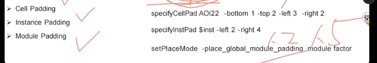
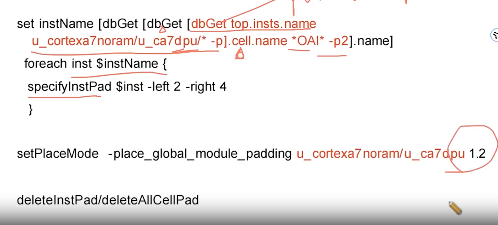

# Innovus Place Padding（cell / instance / module）

> 日期：2026-09-27  
> 来源：截图识别整理（picture-tcl，2 张截图：讲解示例 + 实操 case）  
> 阶段：Placement（布局 padding 间距）

## 设置 Module Padding 解决 Module Congestion 问题

讲解示例：

```tcl
specifyCellPad AOI22 -bottom 1 -top 2 -left 3 -right 2
specifyInstPad $inst -left 2 -right 4
setPlaceMode -place_global_module_padding module factor
```

**设置 Module 的padding会影响其它Module 的Congestion问题，一般第一版本先设置 1.2 try 一下**


## 实操 case：u_ca7dpu 的 OAI* 实例加 padding

背景：当我们追踪 Congestion 问题的时候发现某类Module(**u_cortexa7noram/u_ca7dpu**) 的pin density很高

实操 case：


```tcl
## 抓出 module为 u_cortexa7noram/u_ca7dpu/* 中，cellName 为 *OAI* 的 insts
set instName [dbGet [dbGet [dbGet top.insts.name u_cortexa7noram/u_ca7dpu/* -p].cell.name *OAI* -p2].name]
foreach inst $instName {
specifyInstPad $inst -left 2 -right 4
}

setPlaceMode -place_global_module_padding u_cortexa7noram/u_ca7dpu 1.2

deleteInstPad/deleteAllCellPad
```

**转录注记：**

1. 原图 1775×803，无提示符、无回显，全部为命令行文字；`foreach` 体内的 `specifyInstPad` 一行原图即顶格无缩进，照录。
2. 最后一行 `deleteInstPad/deleteAllCellPad` 是幻灯片并列写法（二选一：按实例删 `deleteInstPad` / 全部删 `deleteAllCellPad`），直接 source 会报「命令不存在」；因含此行，未另存可直接 source 的 .tcl 文件。


## 相关笔记

- [TCL 脚本](./index.md)
- [T12nm Placement 经验](../experience/t12nm/placement.md)
