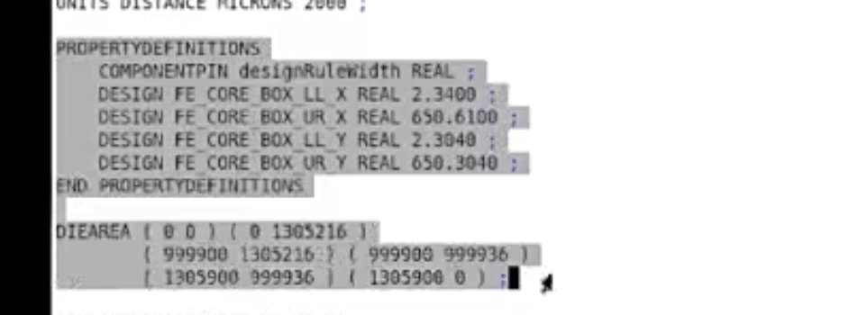

# 选中 Macro 并导出 DEF（给他人引摆放）

> 日期：2026-09-20  
> 工具：Innovus  
> 场景：把 Macro / Memory 摆放通过 DEF 交给别人引用

## 完整流程脚本

```tcl
# 1) 选中所有 Macro
select_obj [dbGet top.insts.cell.subClass block -p2]

# 2) 只导出当前选中对象的 DEF（文件名按项目改）
defOut -selected ../data/macro_place.def

# 3) 注释掉 DEF 头部 PROPERTYDEFINITIONS 与 DIEAREA，避免把本设计 die/core 属性带给对方
#    用法: comment_def_header_for_share ../data/macro_place.def
proc comment_def_header_for_share {def_file} {
  set fp [open $def_file r]
  set lines [split [read $fp] "\n"]
  close $fp

  set out {}
  set in_prop 0
  set in_die 0
  foreach line $lines {
    set t [string trim $line]
    if {[string match "PROPERTYDEFINITIONS*" $t]} {
      set in_prop 1
    }
    if {$in_die == 0 && [string match "DIEAREA*" $t]} {
      set in_die 1
    }

    if {$in_prop || $in_die} {
      if {[string match "#*" $t]} {
        lappend out $line
      } else {
        lappend out "#$line"
      }
    } else {
      lappend out $line
    }

    if {$in_prop && [string match "END PROPERTYDEFINITIONS*" $t]} {
      set in_prop 0
    }
    if {$in_die && [string match "*;" $t]} {
      set in_die 0
    }
  }

  set fp [open $def_file w]
  puts $fp [join $out "\n"]
  close $fp
  puts "Commented PROPERTYDEFINITIONS + DIEAREA in $def_file"
}

comment_def_header_for_share ../data/macro_place.def
```

## 要注释的内容（图）

导出后需注释的是 **`UNITS` 之后** 的整段（保留 `UNITS DISTANCE MICRONS ...`）：



包含：

1. **`PROPERTYDEFINITIONS` … `END PROPERTYDEFINITIONS`**（如 `FE_CORE_BOX_*` 等）  
2. **`DIEAREA` … `;`**（本芯片 die 多边形）

留给对方的主要是 **COMPONENTS** 里 Macro 的摆放信息，而不是你这颗芯片的 die/core 框。

## 说明

| 步骤 | 作用 |
|------|------|
| `select_obj ... block` | 选中全部 Macro |
| `defOut -selected xxx.def` | 只导出选中对象，便于他人 `defIn` / 参考摆放 |
| 注释 PROPERTYDEFINITIONS / DIEAREA | 去掉本设计 floorplan 边界与属性，避免覆盖或冲突对方设计的 die |

## 相关笔记

- [Innovus 02 Floorplan](./innovus-02-floorplan.md)
- [T12nm · Dirty Memory 靠近 IO Port](../experience/t12nm/dirty-memory-near-io.md)
