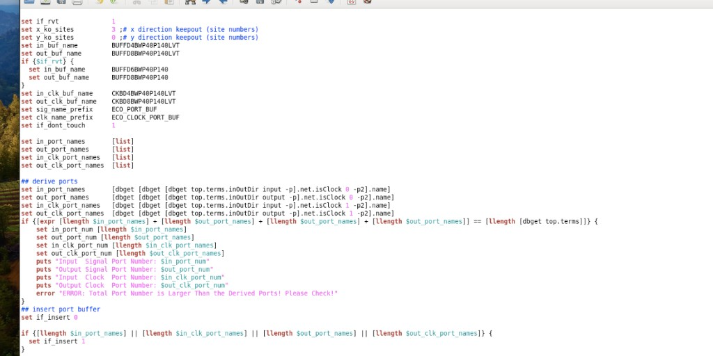
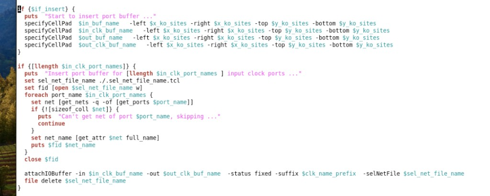
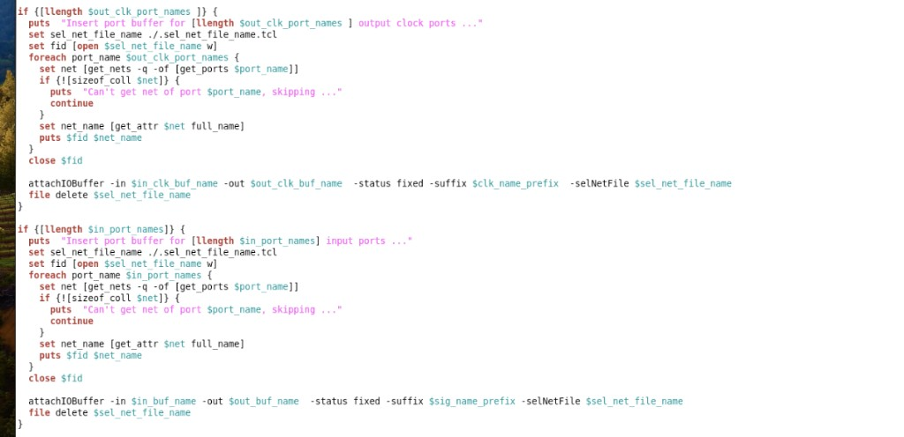
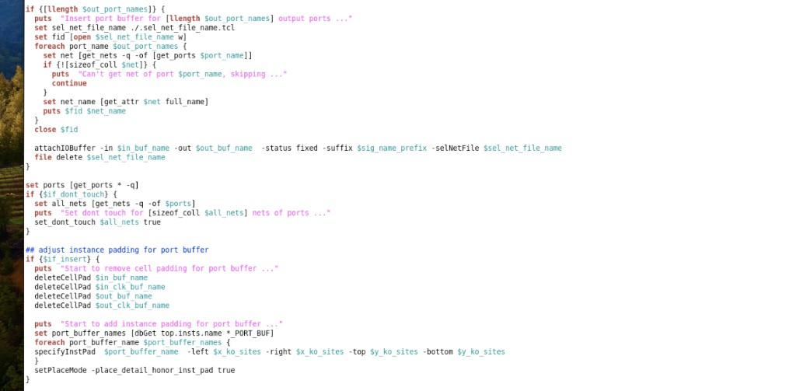

# insert_port_buffer（端口插 Buffer）

> 日期：2026-10-07  
> 来源：截图识别整理（picture-tcl，四张连续截图拼合）  
> 阶段：Place / ECO IO Buffer

对 top port 按 **signal / clock**、**input / output** 分类，用 `attachIOBuffer` 插入 buffer（可切 RVT/LVT），并设置 cell/instance padding 与 `dont_touch`。

## 截图









## 完整脚本

```tcl
set if_rvt             1
set x_ko_sites         3 ;# x direction keepout (site numbers)
set y_ko_sites         0 ;# y direction keepout (site numbers)
set in_buf_name        BUFFD4BWP40P140LVT
set out_buf_name       BUFFD8BWP40P140LVT
if {$if_rvt} {
  set in_buf_name      BUFFD6BWP40P140
  set out_buf_name     BUFFD8BWP40P140
}
set in_clk_buf_name    CKBD4BWP40P140LVT
set out_clk_buf_name   CKBD8BWP40P140LVT
set sig_name_prefix    ECO_PORT_BUF
set clk_name_prefix    ECO_CLOCK_PORT_BUF
set if_dont_touch      1

set in_port_names      [list]
set out_port_names     [list]
set in_clk_port_names  [list]
set out_clk_port_names [list]

## derive ports
set in_port_names      [dbget [dbget [dbget top.terms.inOutDir input -p].net.isClock 0 -p2].name]
set out_port_names     [dbget [dbget [dbget top.terms.inOutDir output -p].net.isClock 0 -p2].name]
set in_clk_port_names  [dbget [dbget [dbget top.terms.inOutDir input -p].net.isClock 1 -p2].name]
set out_clk_port_names [dbget [dbget [dbget top.terms.inOutDir output -p].net.isClock 1 -p2].name]

if {[expr [llength $in_port_names] + [llength $out_port_names] + [llength $in_clk_port_names] + [llength $out_clk_port_names]] != [llength [dbget top.terms]]} {
  set in_port_num [llength $in_port_names]
  set out_port_num [llength $out_port_names]
  set in_clk_port_num [llength $in_clk_port_names]
  set out_clk_port_num [llength $out_clk_port_names]
  puts "Input Signal Port Number: $in_port_num"
  puts "Output Signal Port Number: $out_port_num"
  puts "Input Clock Port Number: $in_clk_port_num"
  puts "Output Clock Port Number: $out_clk_port_num"
  error "ERROR: Total Port Number is Larger Than the Derived Ports! Please Check!"
}

## insert port buffer
set if_insert 0
if {[llength $in_port_names] || [llength $in_clk_port_names] || [llength $out_port_names] || [llength $out_clk_port_names]} {
  set if_insert 1
}

if {$if_insert} {
  puts "Start to insert port buffer ..."
  specifyCellPad $in_buf_name      -left $x_ko_sites -right $x_ko_sites -top $y_ko_sites -bottom $y_ko_sites
  specifyCellPad $in_clk_buf_name  -left $x_ko_sites -right $x_ko_sites -top $y_ko_sites -bottom $y_ko_sites
  specifyCellPad $out_buf_name     -left $x_ko_sites -right $x_ko_sites -top $y_ko_sites -bottom $y_ko_sites
  specifyCellPad $out_clk_buf_name -left $x_ko_sites -right $x_ko_sites -top $y_ko_sites -bottom $y_ko_sites
}

if {[llength $in_clk_port_names]} {
  puts "Insert port buffer for [llength $in_clk_port_names] input clock ports ..."
  set sel_net_file_name ./.sel_net_file_name.tcl
  set fid [open $sel_net_file_name w]
  foreach port_name $in_clk_port_names {
    set net [get_nets -q -of [get_ports $port_name]]
    if {![sizeof_coll $net]} {
      puts "Can't get net of port $port_name, skipping ..."
      continue
    }
    set net_name [get_attr $net full_name]
    puts $fid $net_name
  }
  close $fid

  attachIOBuffer -in $in_clk_buf_name -out $out_clk_buf_name -status fixed -suffix $clk_name_prefix -selNetFile $sel_net_file_name
  file delete $sel_net_file_name
}

if {[llength $out_clk_port_names]} {
  puts "Insert port buffer for [llength $out_clk_port_names] output clock ports ..."
  set sel_net_file_name ./.sel_net_file_name.tcl
  set fid [open $sel_net_file_name w]
  foreach port_name $out_clk_port_names {
    set net [get_nets -q -of [get_ports $port_name]]
    if {![sizeof_coll $net]} {
      puts "Can't get net of port $port_name, skipping ..."
      continue
    }
    set net_name [get_attr $net full_name]
    puts $fid $net_name
  }
  close $fid

  attachIOBuffer -in $in_clk_buf_name -out $out_clk_buf_name -status fixed -suffix $clk_name_prefix -selNetFile $sel_net_file_name
  file delete $sel_net_file_name
}

if {[llength $in_port_names]} {
  puts "Insert port buffer for [llength $in_port_names] input ports ..."
  set sel_net_file_name ./.sel_net_file_name.tcl
  set fid [open $sel_net_file_name w]
  foreach port_name $in_port_names {
    set net [get_nets -q -of [get_ports $port_name]]
    if {![sizeof_coll $net]} {
      puts "Can't get net of port $port_name, skipping ..."
      continue
    }
    set net_name [get_attr $net full_name]
    puts $fid $net_name
  }
  close $fid

  attachIOBuffer -in $in_buf_name -out $out_buf_name -status fixed -suffix $sig_name_prefix -selNetFile $sel_net_file_name
  file delete $sel_net_file_name
}

if {[llength $out_port_names]} {
  puts "Insert port buffer for [llength $out_port_names] output ports ..."
  set sel_net_file_name ./.sel_net_file_name.tcl
  set fid [open $sel_net_file_name w]
  foreach port_name $out_port_names {
    set net [get_nets -q -of [get_ports $port_name]]
    if {![sizeof_coll $net]} {
      puts "Can't get net of port $port_name, skipping ..."
      continue
    }
    set net_name [get_attr $net full_name]
    puts $fid $net_name
  }
  close $fid

  attachIOBuffer -in $in_buf_name -out $out_buf_name -status fixed -suffix $sig_name_prefix -selNetFile $sel_net_file_name
  file delete $sel_net_file_name
}

set ports [get_ports * -q]
if {$if_dont_touch} {
  set all_nets [get_nets -q -of $ports]
  puts "Set dont touch for [sizeof_coll $all_nets] nets of ports ..."
  set_dont_touch $all_nets true
}

## adjust instance padding for port buffer
if {$if_insert} {
  puts "Start to remove cell padding for port buffer ..."
  deleteCellPad $in_buf_name
  deleteCellPad $in_clk_buf_name
  deleteCellPad $out_buf_name
  deleteCellPad $out_clk_buf_name

  puts "Start to add instance padding for port buffer ..."
  set port_buffer_names [dbGet top.insts.name *_PORT_BUF]
  foreach port_buffer_name $port_buffer_names {
    specifyInstPad $port_buffer_name -left $x_ko_sites -right $x_ko_sites -top $y_ko_sites -bottom $y_ko_sites
  }
  setPlaceMode -place_detail_honor_inst_pad true
}
```

## 流程摘要

1. **配置**：`if_rvt` 切换 signal buf 的 RVT/LVT；clock buf 固定用 LVT；keepout 用 `x_ko_sites` / `y_ko_sites`。
2. **derive ports**：`dbget` 按 `inOutDir` + `isClock` 分成四类 port 列表。
3. **一致性检查**：四类数量之和须等于 `top.terms` 总数，否则 `error`。
4. **插 buffer**：先 `specifyCellPad`，再对四类分别写 net 列表到临时文件，调用 `attachIOBuffer`（`-status fixed`）。
5. **收尾**：可选 `set_dont_touch`；删掉 cell-level pad，改为对 `*_PORT_BUF` instance 做 `specifyInstPad`，并 `setPlaceMode -place_detail_honor_inst_pad true`。

> 转录注记：端口数量比较那一行，截图识别曾出现重复写 `$out_port_names` / 比较符歧义；此处按语义拼成  
> `in + out + in_clk + out_clk != top.terms`，与 error 文案一致。请对照原脚本确认。

## 相关笔记

- [Innovus Place Padding](./innovus-place-padding.md)
- [检查 Always-on Isolation 前是否插 Buf](./check/iso-buf-always-on.md)
