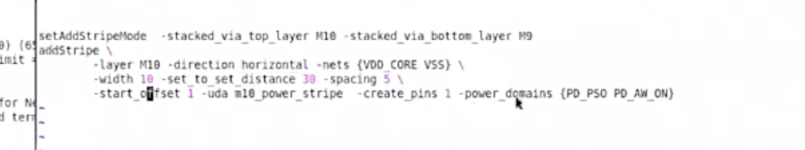

# M10 Power Stripe（addStripe M10）

> 日期：2026-09-24  
> 来源：截图识别整理（picture-tcl，1 张截图）  
> 阶段：Powerplan（M10「顶层打 Power」层：stripe + `-create_pins 1` 向上建 PG pin）

## 完整脚本

```tcl
setAddStripeMode -stacked_via_top_layer M10 -stacked_via_bottom_layer M9
addStripe \
        -layer M10 -direction horizontal -nets {VDD_CORE VSS} \
        -width 10 -set_to_set_distance 30 -spacing 5 \
        -start_offset 1 -uda m10_power_stripe -create_pins 1 -power_domains {PD_PSO PD_AW_ON}
```

同目录可直接 source 的版本：[m10-power-stripe.tcl](/tcl/m10-power-stripe.tcl)

**转录注记（存疑处均照录未改）：**

1. 提示符不可见（左侧被窗口边界截断），以上两行按原图顺序逐行转录。
2. 命令上方另有两条左侧截断行：「`a>) (6...`」「`imit 1`」；下方两条：「`for M...`」「`d ter`」。左侧不可辨认，无法判断是命令还是回显，未收录进正文（不臆造），需要时请对照下图。
3. `addStripe` 以行尾 `\` 续行，续行缩进（8 空格）照录。
4. `-power_domains` 拼写照录，**存疑**：与 [power_stape_pso](./power-stape-pso.md) 转录注记中的 `-powerDomains` 写法并存，两处均照录未改。

## 原图



## 相关笔记

- [TCL 脚本](./index.md)
- [Innovus 03 Powerplan](./innovus-03-powerplan.md)
- [Power Switch Stapling Stripe（power_stape_pso）](./power-stape-pso.md)
- [T12nm · Powerplan 做什么](../experience/t12nm/powerplan.md)
