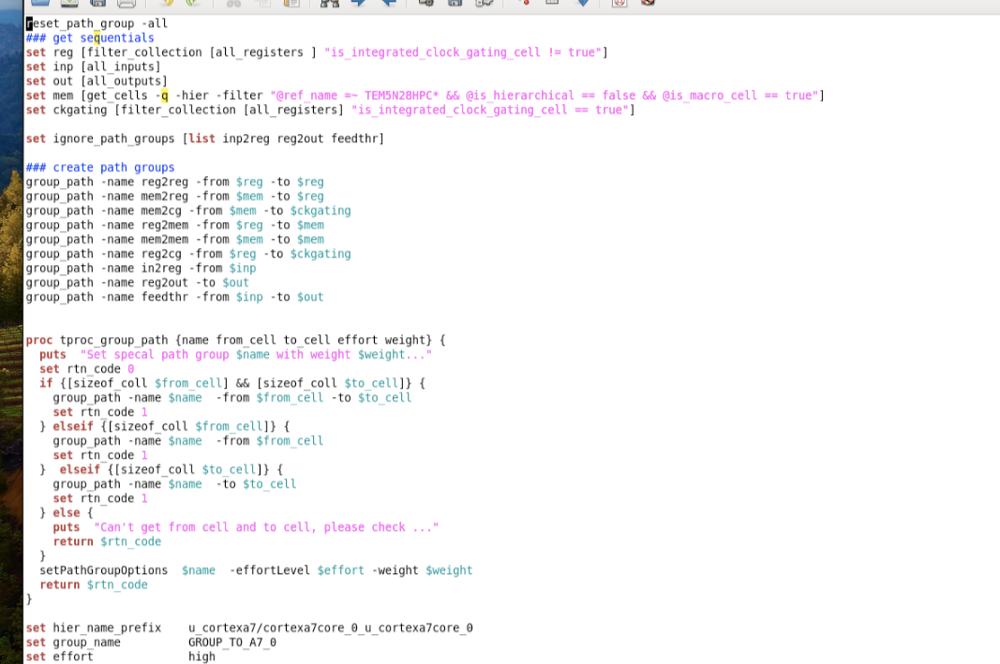
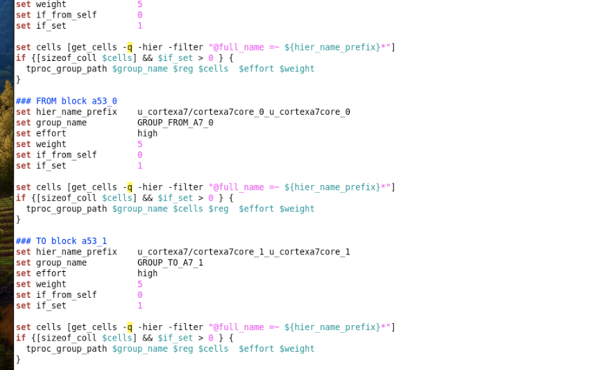
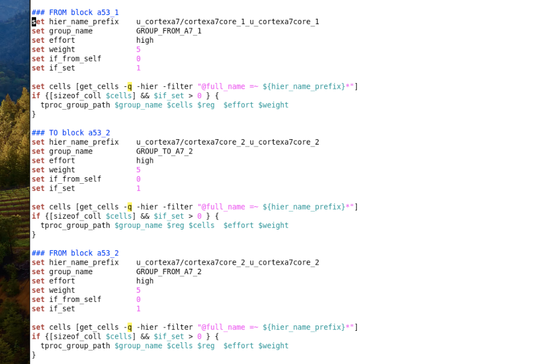
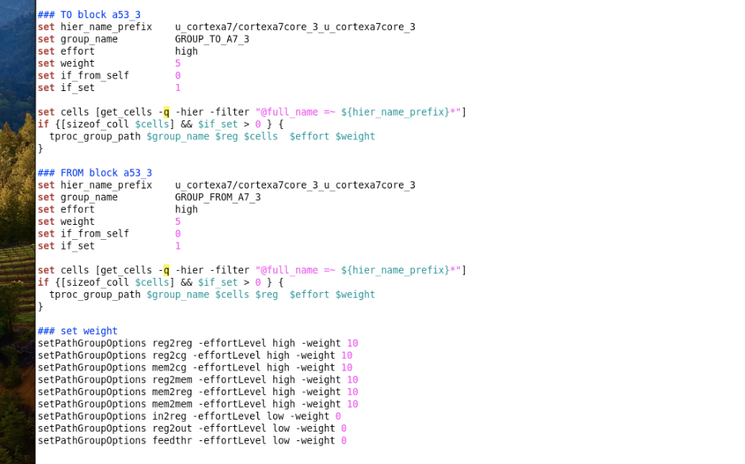
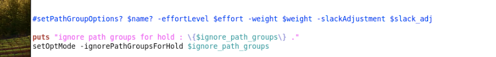

# Path Group 分组与权重（group_path / setPathGroupOptions）

> 日期：2026-10-05  
> 工具：Innovus  
> 阶段：place_opt / timing setup（优化前建 path group、配权重）  
> 用途：把路径分组并用 weight 控制优化资源——内部关键路径给高权重，IO 路径不抢资源

## 流程一览

1. 收集合：寄存器 `$reg`（剔除 ICG）、输入 `$inp`、输出 `$out`、memory `$mem`、ICG `$ckgating`；
2. `group_path` 建 9 个标准组：reg2reg / mem2reg / mem2cg / reg2mem / mem2mem / reg2cg / in2reg / reg2out / feedthr；
3. `tproc_group_path`（脚本内 proc）：from/to 谁非空就 `group_path -from … -to …`，再 `setPathGroupOptions -effortLevel -weight`；
4. A7 四个核各建 **TO / FROM 两组**（`GROUP_TO_A7_x` / `GROUP_FROM_A7_x`，weight 5）——CPU 核单独成组，优化时单独照顾；
5. `set_weight`：内部组 weight 10 + effort high，IO 三组（in2reg / reg2out / feedthr）weight 0 + effort low；
6. `setOptMode -ignorePathGroupsForHold` 忽略 IO 组的 hold 优化。

## 完整脚本

五张截图按内容顺序（开头 → A7_0 → A7_1/2 → A7_3 + set_weight → 收尾）首尾相接、重叠段去重后的可 `source` 版本：

```tcl
#set path group -all
### get seq[uentials
set reg      [filter_collection [all_registers] "is_integrated_clock_gating_cell != true"]
set inp      [all_inputs]
set out      [all_outputs]
set mem      [get_cells -hier -filter "@ref_name =~ TEM5N20HPC* && @is_hierarchical == false && @is_macro_cell == true"]
set ckgating [filter_collection [all_registers] "is_integrated_clock_gating_cell == true"]

set ignore_path_groups [list inp2reg reg2out feedthr]

group_path -name reg2reg -from $reg -to $reg
group_path -name mem2reg -from $mem -to $reg
group_path -name mem2cg  -from $mem -to $ckgating
group_path -name reg2mem -from $reg -to $mem
group_path -name mem2mem -from $mem -to $mem
group_path -name reg2cg  -from $reg -to $ckgating
group_path -name in2reg  -from $inp -to $reg
group_path -name reg2out -from $reg -to $out
group_path -name feedthr -from $inp -to $out

proc tproc_group_path {name from_cell to_cell effort weight} {
    puts   "Set special path group $name with weight $weight..."
    set rtn_code 0
    if {[sizeof_coll $from_cell] && [sizeof_coll $to_cell]} {
        group_path -name $name -from $from_cell -to $to_cell
        set rtn_code 1
    } elseif {[sizeof_coll $from_cell]} {
        group_path -name $name -from $from_cell
        set rtn_code 1
    } elseif {[sizeof_coll $to_cell]} {
        group_path -name $name -to $to_cell
        set rtn_code 1
    } else {
        puts   "Can't get from cell and to cell, please check ..."
        return $rtn_code
    }
    setPathGroupOptions $name -effortLevel $effort -weight $weight
    return $rtn_code
}

### TO block a53_0
set hier_name_prefix      u_cortexa7/cortexa7core_0_u_cortexa7core_0
set group_name            GROUP_TO_A7_0
set effort                high
set weight                5
set if_from_self          0
set if_set                1

set cells [get_cells -q -hier -filter "@full_name =~ ${hier_name_prefix}*"]
if {[sizeof_coll $cells] && $if_set > 0} {
    tproc_group_path $group_name $reg $cells $effort $weight
}

### FROM block a53_0
set hier_name_prefix      u_cortexa7/cortexa7core_0_u_cortexa7core_0
set group_name            GROUP_FROM_A7_0
set effort                high
set weight                5
set if_from_self          0
set if_set                1

set cells [get_cells -q -hier -filter "@full_name =~ ${hier_name_prefix}*"]
if {[sizeof_coll $cells] && $if_set > 0} {
    tproc_group_path $group_name $cells $reg $effort $weight
}

### TO block a53_1
set hier_name_prefix      u_cortexa7/cortexa7core_1_u_cortexa7core_1
set group_name            GROUP_TO_A7_1
set effort                high
set weight                5
set if_from_self          0
set if_set                1

set cells [get_cells -q -hier -filter "@full_name =~ ${hier_name_prefix}*"]
if {[sizeof_coll $cells] && $if_set > 0} {
    tproc_group_path $group_name $reg $cells $effort $weight
}

### FROM block a53_1
set hier_name_prefix      u_cortexa7/cortexa7core_1_u_cortexa7core_1
set group_name            GROUP_FROM_A7_1
set effort                high
set weight                5
set if_from_self          0
set if_set                1

set cells [get_cells -q -hier -filter "@full_name =~ ${hier_name_prefix}*"]
if {[sizeof_coll $cells] && $if_set > 0} {
    tproc_group_path $group_name $cells $reg $effort $weight
}

### TO block a53_2
set hier_name_prefix      u_cortexa7/cortexa7core_2_u_cortexa7core_2
set group_name            GROUP_TO_A7_2
set effort                high
set weight                5
set if_from_self          0
set if_set                1

set cells [get_cells -q -hier -filter "@full_name =~ ${hier_name_prefix}*"]
if {[sizeof_coll $cells] && $if_set > 0} {
    tproc_group_path $group_name $reg $cells $effort $weight
}

### FROM block a53_2
set hier_name_prefix      u_cortexa7/cortexa7core_2_u_cortexa7core_2
set group_name            GROUP_FROM_A7_2
set effort                high
set weight                5
set if_from_self          0
set if_set                1

set cells [get_cells -q -hier -filter "@full_name =~ ${hier_name_prefix}*"]
if {[sizeof_coll $cells] && $if_set > 0} {
    tproc_group_path $group_name $cells $reg $effort $weight
}

### TO block a53_3
set hier_name_prefix      u_cortexa7/cortexa7core_3_u_cortexa7core_3
set group_name            GROUP_TO_A7_3
set effort                high
set weight                5
set if_from_self          0
set if_set                1

set cells [get_cells -q -hier -filter "@full_name =~ ${hier_name_prefix}*"]
if {[sizeof_coll $cells] && $if_set > 0} {
    tproc_group_path $group_name $reg $cells $effort $weight
}

### FROM block a53_3
set hier_name_prefix      u_cortexa7/cortexa7core_3_u_cortexa7core_3
set group_name            GROUP_FROM_A7_3
set effort                high
set weight                5
set if_from_self          0
set if_set                1

set cells [get_cells -q -hier -filter "@full_name =~ ${hier_name_prefix}*"]
if {[sizeof_coll $cells] && $if_set > 0} {
    tproc_group_path $group_name $cells $reg $effort $weight
}

### set_weight
setPathGroupOptions reg2reg -effortLevel high -weight 10
setPathGroupOptions reg2cg  -effortLevel high -weight 10
setPathGroupOptions mem2cg  -effortLevel high -weight 10
setPathGroupOptions reg2mem -effortLevel high -weight 10
setPathGroupOptions mem2reg -effortLevel high -weight 10
setPathGroupOptions mem2mem -effortLevel high -weight 10
setPathGroupOptions in2reg  -effortLevel low  -weight 0
setPathGroupOptions reg2out -effortLevel low  -weight 0
setPathGroupOptions feedthr -effortLevel low  -weight 0

#setPathGroupOptions $name -effortLevel $effort -weight $weight -slackAdjustment $slack_adj

puts "ignore path groups for hold : {$ignore_path_groups} ."
setOptMode -ignorePathGroupsForHold $ignore_path_groups
```

## 转录注记

1. 五张截图按内容排序：图 1（收集集合 + 9 个 group_path + proc 定义 + GROUP_TO_A7_0 开头）→ 图 2（GROUP_TO_A7_0 收尾 + FROM a53_0 + TO a53_1）→ 图 3（FROM a53_1 + TO/FROM a53_2）→ 图 4（TO/FROM a53_3 + set_weight）→ 图 5（收尾 setOptMode）；重叠段已去重，缩进归一。
2. proc 名图 1 读作 `tpproc_group_path`、参数被拆成 `{name from cell to cell effort weight}`——按 8 处调用点和上一张单图（更清晰）统一为 `tproc_group_path {name from_cell to_cell effort weight}`；`set ck gating` 中间的空格同理按后文 `$ckgating` 合并。
3. 各核调用里 `if {[sizeof_coll $cells] && $if_set > 0 ) {` 的 `)` 是识别伪影，按 Tcl 语法写作 `}`。
4. `hier_name_prefix` 图 1 读作 `cortexa7core_0/u_cortexa7core_0`（斜杠），与图 2–4 四个核一致的 `cortexa7core_X_u_cortexa7core_X`（下划线）不符，统一按后者；注释里的 `a53_x` 照录（层级名实际是 cortexa7，注释沿用了 a53 的叫法）。
5. TO 组传参是 `$reg $cells`（from = 全部寄存器、to = 该核 cells），FROM 组反过来 `$cells $reg`——上一张单图转写时猜过 `{}`，五张图连起来确认就是脚本开头定义的全量 `$reg`，不是空集合。
6. `ignore_path_groups` 读作 `inp2reg`，但建组和 set_weight 都写的 `in2reg`——原脚本笔误或识别误差二选一，使用前对一眼原图（若真是 `inp2reg`，这条 ignore 不生效）。
7. `### get seq[uentials` 一行注释看不清（疑似 get sequentials / registers），照录；`if_from_self` 在可见代码里没被用到，可能是别的分支开关。

## 原图

图 1（收集 reg/mem/ICG、9 个 group_path、proc 定义）：



图 2（GROUP_TO_A7_0 收尾、FROM a53_0、TO a53_1）：



图 3（FROM a53_1、TO/FROM a53_2）：



图 4（TO/FROM a53_3、set_weight）：



图 5（hold 忽略组收尾）：



## 相关笔记

- [TCL 脚本](./index.md)
- [报告 Path 逻辑深度](./timing_report/report-logic-depth.md) —— 同属 timing 分析套路
- [Innovus CCOpt CTS 脚本](./innovus-ccopt-cts.md)
- [T12nm · ICG enable setup 违例](../experience/t12nm/icg-enable-setup.md) —— `$ckgating` 集合 / reg2cg 组对应的 ICG 问题
