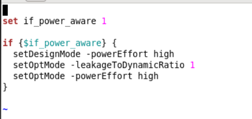

# PowerAware Opt（setDesignMode / setOptMode）

> 日期：2026-10-17  
> 来源：截图识别整理  
> 工具：Innovus  
> 阶段：Opt / Leakage · Dynamic Power  
> 优化 corner：**tt_25**（tt25）

用开关变量打开 **PowerAware** 功耗优化力度（design + opt 两侧 `powerEffort high`）。

## 截图



## 脚本

```tcl
set if_power_aware 1

if {$if_power_aware} {
  setDesignMode -powerEffort high
  setOptMode -leakageToDynamicRatio 1
  setOptMode -powerEffort high
}
```

| 项 | 说明 |
|------|------|
| `if_power_aware` | `1` 打开 PowerAware 设置；改 `0` 可关掉整段 |
| `setDesignMode -powerEffort high` | 设计模式侧提高功耗优化力度 |
| `setOptMode -leakageToDynamicRatio 1` | leakage / dynamic 权重比（此处 1:1） |
| `setOptMode -powerEffort high` | opt 引擎侧 high effort 压功耗 |
| **Corner** | 项目口径：在 **tt_25** 上做这类 power opt（tt85 leakage 更大，见经验笔记） |

## 相关笔记

- [T12nm · Power Optimization 手段](../experience/t12nm/power-optimization.md)
- [T12nm · Leakage 优化](../experience/t12nm/leakage-optimization.md)
- [high_opt.tcl（High Effort Opt + LVT）](./high-opt.md)
