# Power Switch Stapling Stripe（power_stape_pso）

> 日期：2026-09-22  
> 来源：截图识别整理（picture-tcl，15 张连续截图）  
> 阶段：Powerplan —— [Innovus 03 Powerplan](./innovus-03-powerplan.md) 开头 `source -echo -verbose ../script/power_stape_pso.tcl` 所加载的脚本  
> 用途：在 power switch cell（HDR20XSICWD1BWP16P90CPD）上打 **stapling stripe / via pillar**

15 张图是同一段脚本的连续截图，按 图 1 → 图 15 即脚本顺序，整合为一份完整脚本如下（`# ===== 图 N =====` 为整理时加入的分图标记）：

## 段落总览

| 段（图） | 内容 |
|----|------|
| 图 1 | `editDelete` + `globalNetConnect` ×4 + `add_tracks` + route blockage（core / PSO core2die） |
| 图 2 | `sroute` M1 rail ×2 + M2 dual rail（editDuplicate 流程）+ source proc_myron 脚本 + M1/M2 R0 stapling |
| 图 3 | M3 R0（16 条）+ M4 R0 stapling |
| 图 4 | M5 R0（13 条）+ M6 R0 + M7 R0（9 条）stapling |
| 图 5 | M8 R0 + M1/M2 MX stapling |
| 图 6 | M3 MX（16 条）+ M4 MX stapling |
| 图 7 | M5 MX（13 条）+ M6 MX + M7 MX（9 条）stapling |
| 图 8 | M8 MX + `set pso_llx_list` + M3 VSS / M3 VDD LOCAL addStripe |
| 图 9 | M4 VSS + M4 VDD LOCAL addStripe |
| 图 10 | M5 VSS + M5 VDD LOCAL addStripe |
| 图 11 | M6 VSS / VDD_LOCAL / VDD_CORE + M7 VSS addStripe |
| 图 12 | M9 channel3 pillar + 全局 M9 VSS / VDD_CORE stripe |
| 图 13 | M9 core_box pillar + `deleteRouteBlk` channel ×3 |
| 图 14 | M7 VDD + M8 VSS/VDD addStripe + channel_1/2/3 定义 + core_box_new |
| 图 15 | M9 channel1 / channel2 pillar |

## 完整脚本

```tcl
# ===== 图 1 =====
editDelete -type Special

globalNetConnect VDD_LOCAL -type pgpin -pin {VPP} -inst * -powerDomain PD_PSO
globalNetConnect VDD_CORE -type pgpin -pin {VPP} -inst * -powerDomain PD_AW_ON
globalNetConnect VSS -type pgpin -pin {VBB} -inst * -powerDomain PD_PSO
globalNetConnect VSS -type pgpin -pin {VBB} -inst * -powerDomain PD_AW_ON

###Draw tracks
add_tracks \
        -offset {m1 vert 0.0 m2 vert 0.0 m3 horiz 0.0 m4 vert 0.0 m5 horiz 0.0 m6 vert 0.0 m7 horiz 0.0 m8 vert 0.0}

set tmps [dbShape [dbShape -output rect [dbGet [dbGet top.Fplan.pBlkgs.type hard -p ].boxes] SIZEX 0.2 ]

foreach tmp $tmps {
createRouteBlk -box $tmp -layer "M3 M4 M5 M6 M7 M8" -name rblk_for_core -spacing 0
}

set PSO_box [dbget [dbget top.pds.name PD_PSO -p].group.boxes]
set PSO_box_new [dbShape $PSO_box SIZEX 2.34 SIZEY 2.304]
set PSO_core2die_tmp [dbShape $PSO_box_new ANDNOT $PSO_box]
set PSO_core2die_box [dbShape $PSO_core2die_tmp AND [dbget top.fplan.box]]

foreach tmp $PSO_core2die_box {
createRouteBlk -box $tmp -layer "M2 M3 M4 M5 M6 M7 M8 M9" -name rblk_for_pso_core2die -spacing 0
}

set PSO_box [dbget [dbget top.pds.name PD_PSO -p].group.boxes]
set PSO_box_new [dbShape $PSO_box SIZEX 2.34 SIZEY 2.304]
set PSO_core2die_tmp [dbShape $PSO_box_new ANDNOT $PSO_box]
set PSO_core2die_box [dbShape $PSO_core2die_tmp AND [dbget top.fplan.box]]
set PSO_core2die_box [dbShape $PSO_core2die_box SIZEY -0.016]

foreach tmp $PSO_core2die_box {
createRouteBlk -box $tmp -layer "M1" -name rblk_for_pso_core2die -spacing 0
}


set core2die_bottom [dbget top.fplan.core2bot]
set core2die_left [dbget top.fplan.core2left]

# ===== 图 2 =====
sroute -connect { corePin } -blockPinTarget { nearestTarget } -corePinTarget { none } -nets { VDD_LOCAL VSS } -uda m1_power_rail_pso -corePinWidth 0.032 -powerDomains PD_PSO
sroute -connect { corePin } -blockPinTarget { nearestTarget } -corePinTarget { none } -nets { VDD_CORE VSS } -uda m1_power_rail_aw_on -corePinWidth 0.032 -powerDomains PD_AW_ON

setAddStripeMode -ignore_DRC true -stacked_via_top_layer M2 -stacked_via_bottom_layer M2
#addStripe -layer M2 -direction horizontal -nets {VSS VDD_LOCAL} -width 0.064 -set_to_set_distance 1.152 -snap_wire_center_to_grid Grid -spacing 0.512 -start_offset -0.032 -uda m2_power_stripe_pso  -power_domains PD_PSO
#addStripe -layer M2 -direction horizontal -nets {VSS VDD_CORE} -width 0.064 -set_to_set_distance 1.152 -snap_wire_center_to_grid Grid -spacing 0.512 -start_offset -0.032 -uda m2_power_stripe_aw_on  -power_domains PD_AW_ON
setEditMode -layer_minimum M2
setEditMode -layer_maximum M2
editSelect -shape FOLLOWPIN
editDuplicate
editChangeLayer -layer_horizontal M2
editChangeWidth -width_horizontal 0.064
deselectAll

#set box [dbGet top.fPlan.box]
#set via1_list [dbQuery -layers 1 -objType sViaInst -areas $box]
#dbDeleteObj $via1_list

source ../script/proc_myron.pg.tcl
source ../script/proc_myron_invs.tcl
# M1 space = 0.512; width = 0.064
proc_myron_add_stapling_stripe_according_to_cell -cell HDR20XSICWD1BWP16P90CPD -orientation R0 \
                -configLst [list \
                [list VDD_CORE {0.5 0.256 2.668 0.32   } M1 FIXED STRIPE pso_vddg] \
                [list VDD_CORE {0.5 0.832 2.668 0.896  } M1 FIXED STRIPE pso_vddg] \
                ]
# M2 space = 0.512; width = 0.064
proc_myron_add_stapling_stripe_according_to_cell -cell HDR20XSICWD1BWP16P90CPD -orientation R0 \
                -configLst [list \
                [list VDD_CORE {0.5 0.256 2.668 0.32   } M2 FIXED STRIPE pso_vddg] \
                [list VDD_CORE {0.5 0.832 2.668 0.896  } M2 FIXED STRIPE pso_vddg] \
                ]

# ===== 图 3 =====
# M3 space = 0.088; width = 0.038
proc_myron_add_stapling_stripe_according_to_cell -cell HDR20XSICWD1BWP16P90CPD  -orientation R0 \
                                          -configLst [list \
                                          [list VDD_CORE {0.6 0.2 0.638 0.952 } M3 FIXED STRIPE pso_vddg] \
                                          [list VDD_CORE {0.726 0.2 0.764 0.952 } M3 FIXED STRIPE pso_vddg] \
                                          [list VDD_CORE {0.852 0.2 0.89 0.952 } M3 FIXED STRIPE pso_vddg] \
                                          [list VDD_CORE {0.978 0.2 1.016 0.952 } M3 FIXED STRIPE pso_vddg] \
                                          [list VDD_CORE {1.104 0.2 1.142 0.952 } M3 FIXED STRIPE pso_vddg] \
                                          [list VDD_CORE {1.23 0.2 1.268 0.952 } M3 FIXED STRIPE pso_vddg] \
                                          [list VDD_CORE {1.356 0.2 1.394 0.952 } M3 FIXED STRIPE pso_vddg] \
                                          [list VDD_CORE {1.482 0.2 1.52 0.952 } M3 FIXED STRIPE pso_vddg] \
                                          [list VDD_CORE {1.608 0.2 1.646 0.952 } M3 FIXED STRIPE pso_vddg] \
                                          [list VDD_CORE {1.734 0.2 1.772 0.952 } M3 FIXED STRIPE pso_vddg] \
                                          [list VDD_CORE {1.86 0.2 1.898 0.952 } M3 FIXED STRIPE pso_vddg] \
                                          [list VDD_CORE {1.986 0.2 2.024 0.952 } M3 FIXED STRIPE pso_vddg] \
                                          [list VDD_CORE {2.112 0.2 2.15 0.952 } M3 FIXED STRIPE pso_vddg] \
                                          [list VDD_CORE {2.238 0.2 2.276 0.952 } M3 FIXED STRIPE pso_vddg] \
                                          [list VDD_CORE {2.364 0.2 2.402 0.952 } M3 FIXED STRIPE pso_vddg] \
                                          [list VDD_CORE {2.49 0.2 2.528 0.952 } M3 FIXED STRIPE pso_vddg] \
                                          ]

# M4 space = 0.536; width = 0.04
proc_myron_add_stapling_stripe_according_to_cell -cell HDR20XSICWD1BWP16P90CPD  -orientation R0 \
                                          -configLst [list \
                                          [list VDD_CORE {0.5 0.268 2.668 0.308 } M4 FIXED STRIPE pso_vddg] \
                                          [list VDD_CORE {0.5 0.844 2.668 0.884 } M4 FIXED STRIPE pso_vddg] \
                                          ]

# ===== 图 4 =====
# M5 space = 0.12; width = 0.04
proc_myron_add_stapling_stripe_according_to_cell -cell HDR20XSICWD1BWP16P90CPD  -orientation R0 \
                                         -configLst [list \
                                         [list VDD_CORE {0.6 0.2 0.64 0.952 } M5 FIXED STRIPE pso_vddg] \
                                         [list VDD_CORE {0.76 0.2 0.8 0.952 } M5 FIXED STRIPE pso_vddg] \
                                         [list VDD_CORE {0.92 0.2 0.96 0.952 } M5 FIXED STRIPE pso_vddg] \
                                         [list VDD_CORE {1.08 0.2 1.12 0.952 } M5 FIXED STRIPE pso_vddg] \
                                         [list VDD_CORE {1.24 0.2 1.28 0.952 } M5 FIXED STRIPE pso_vddg] \
                                         [list VDD_CORE {1.4 0.2 1.44 0.952 } M5 FIXED STRIPE pso_vddg] \
                                         [list VDD_CORE {1.56 0.2 1.6 0.952 } M5 FIXED STRIPE pso_vddg] \
                                         [list VDD_CORE {1.72 0.2 1.76 0.952 } M5 FIXED STRIPE pso_vddg] \
                                         [list VDD_CORE {1.88 0.2 1.92 0.952 } M5 FIXED STRIPE pso_vddg] \
                                         [list VDD_CORE {2.04 0.2 2.08 0.952 } M5 FIXED STRIPE pso_vddg] \
                                         [list VDD_CORE {2.2 0.2 2.24 0.952 } M5 FIXED STRIPE pso_vddg] \
                                         [list VDD_CORE {2.36 0.2 2.4 0.952 } M5 FIXED STRIPE pso_vddg] \
                                         [list VDD_CORE {2.52 0.2 2.56 0.952 } M5 FIXED STRIPE pso_vddg] \
                                         ]

# M6 space = 0.536; width = 0.04
proc_myron_add_stapling_stripe_according_to_cell -cell HDR20XSICWD1BWP16P90CPD  -orientation R0 \
                                         -configLst [list \
                                         [list VDD_CORE {0.5 0.268 2.668 0.308  } M6 FIXED STRIPE pso_vddg] \
                                         [list VDD_CORE {0.5 0.844 2.668 0.884  } M6 FIXED STRIPE pso_vddg] \
                                         ]

# M7 space = 0.12; width = 0.12
proc_myron_add_stapling_stripe_according_to_cell -cell HDR20XSICWD1BWP16P90CPD  -orientation R0 \
                                         -configLst [list \
                                         [list VDD_CORE {0.6 0.2 0.72 0.952 } M7 FIXED STRIPE pso_vddg] \
                                         [list VDD_CORE {0.84 0.2 0.96 0.952 } M7 FIXED STRIPE pso_vddg] \
                                         [list VDD_CORE {1.08 0.2 1.2 0.952 } M7 FIXED STRIPE pso_vddg] \
                                         [list VDD_CORE {1.32 0.2 1.44 0.952 } M7 FIXED STRIPE pso_vddg] \
                                         [list VDD_CORE {1.56 0.2 1.68 0.952 } M7 FIXED STRIPE pso_vddg] \
                                         [list VDD_CORE {1.8 0.2 1.92 0.952 } M7 FIXED STRIPE pso_vddg] \
                                         [list VDD_CORE {2.04 0.2 2.16 0.952 } M7 FIXED STRIPE pso_vddg] \
                                         [list VDD_CORE {2.28 0.2 2.4 0.952 } M7 FIXED STRIPE pso_vddg] \
                                         [list VDD_CORE {2.52 0.2 2.64 0.952 } M7 FIXED STRIPE pso_vddg] \
                                         ]

# ===== 图 5 =====
# （图 5 顶部原有一个孤立的 `]`，为上图 M7 块收尾在窗口边界的重复，合并时不再重复）
# M8 space = 0.536; width = 0.12
proc_myron_add_stapling_stripe_according_to_cell -cell HDR20XSICWD1BWP16P90CPD -orientation R0 \
                                                -configLst [list \
                                                [list VDD_CORE {0.5 0.228 2.668 0.348  } M8 FIXED STRIPE pso_vddg] \
                                                [list VDD_CORE {0.5 0.804 2.668 0.924  } M8 FIXED STRIPE pso_vddg] \
                                                ]


# M1 space = 0.512; width = 0.064
proc_myron_add_stapling_stripe_according_to_cell -cell HDR20XSICWD1BWP16P90CPD -orientation MX \
                                                -configLst [list \
                                                [list VDD_CORE {0.5 0.256 2.668 0.32    } M1 FIXED STRIPE pso_vddg] \
                                                [list VDD_CORE {0.5 0.832 2.668 0.896  } M1 FIXED STRIPE pso_vddg] \
                                                ]

# M2 space = 0.512; width = 0.064
proc_myron_add_stapling_stripe_according_to_cell -cell HDR20XSICWD1BWP16P90CPD -orientation MX \
                                                -configLst [list \
                                                [list VDD_CORE {0.5 0.256 2.668 0.32    } M2 FIXED STRIPE pso_vddg] \
                                                [list VDD_CORE {0.5 0.832 2.668 0.896  } M2 FIXED STRIPE pso_vddg] \
                                                ]

# ===== 图 6 =====
# M3 space = 0.088; width = 0.038
proc_myron_add_stapling_stripe_according_to_cell -cell HDR20XSICWD1BWP16P90CPD  -orientation MX \
                                                -configLst [list \
        [list VDD_CORE {0.6 0.2 0.638 0.952 } M3 FIXED STRIPE pso_vddg] \
        [list VDD_CORE {0.726 0.2 0.764 0.952 } M3 FIXED STRIPE pso_vddg] \
        [list VDD_CORE {0.852 0.2 0.89 0.952 } M3 FIXED STRIPE pso_vddg] \
        [list VDD_CORE {0.978 0.2 1.016 0.952 } M3 FIXED STRIPE pso_vddg] \
        [list VDD_CORE {1.104 0.2 1.142 0.952 } M3 FIXED STRIPE pso_vddg] \
        [list VDD_CORE {1.23 0.2 1.268 0.952 } M3 FIXED STRIPE pso_vddg] \
        [list VDD_CORE {1.356 0.2 1.394 0.952 } M3 FIXED STRIPE pso_vddg] \
        [list VDD_CORE {1.482 0.2 1.52 0.952 } M3 FIXED STRIPE pso_vddg] \
        [list VDD_CORE {1.608 0.2 1.646 0.952 } M3 FIXED STRIPE pso_vddg] \
        [list VDD_CORE {1.734 0.2 1.772 0.952 } M3 FIXED STRIPE pso_vddg] \
        [list VDD_CORE {1.86 0.2 1.898 0.952 } M3 FIXED STRIPE pso_vddg] \
        [list VDD_CORE {1.986 0.2 2.024 0.952 } M3 FIXED STRIPE pso_vddg] \
        [list VDD_CORE {2.112 0.2 2.15 0.952 } M3 FIXED STRIPE pso_vddg] \
        [list VDD_CORE {2.238 0.2 2.276 0.952 } M3 FIXED STRIPE pso_vddg] \
        [list VDD_CORE {2.364 0.2 2.402 0.952 } M3 FIXED STRIPE pso_vddg] \
        [list VDD_CORE {2.49 0.2 2.528 0.952 } M3 FIXED STRIPE pso_vddg] \
        ]

# M4 space = 0.536; width = 0.04
proc_myron_add_stapling_stripe_according_to_cell -cell HDR20XSICWD1BWP16P90CPD  -orientation MX \
                                                -configLst [list \
        [list VDD_CORE {0.5 0.268 2.668 0.308  } M4 FIXED STRIPE pso_vddg] \
        [list VDD_CORE {0.5 0.844 2.668 0.884  } M4 FIXED STRIPE pso_vddg] \
        ]

# ===== 图 7 =====
# M5 space = 0.12; width = 0.04
proc_myron_add_stapling_stripe_according_to_cell -cell HDR20XSICWD1BWP16P90CPD  -orientation MX \
                                                -configLst [list \
                                                [list VDD_CORE {0.6 0.2 0.64 0.952 } M5 FIXED STRIPE pso_vddg] \
                                                [list VDD_CORE {0.76 0.2 0.8 0.952 } M5 FIXED STRIPE pso_vddg] \
                                                [list VDD_CORE {0.92 0.2 0.96 0.952 } M5 FIXED STRIPE pso_vddg] \
                                                [list VDD_CORE {1.08 0.2 1.12 0.952 } M5 FIXED STRIPE pso_vddg] \
                                                [list VDD_CORE {1.24 0.2 1.28 0.952 } M5 FIXED STRIPE pso_vddg] \
                                                [list VDD_CORE {1.4 0.2 1.44 0.952 } M5 FIXED STRIPE pso_vddg] \
                                                [list VDD_CORE {1.56 0.2 1.6 0.952 } M5 FIXED STRIPE pso_vddg] \
                                                [list VDD_CORE {1.72 0.2 1.76 0.952 } M5 FIXED STRIPE pso_vddg] \
                                                [list VDD_CORE {1.88 0.2 1.92 0.952 } M5 FIXED STRIPE pso_vddg] \
                                                [list VDD_CORE {2.04 0.2 2.08 0.952 } M5 FIXED STRIPE pso_vddg] \
                                                [list VDD_CORE {2.2 0.2 2.24 0.952 } M5 FIXED STRIPE pso_vddg] \
                                                [list VDD_CORE {2.36 0.2 2.4 0.952 } M5 FIXED STRIPE pso_vddg] \
                                                [list VDD_CORE {2.52 0.2 2.56 0.952 } M5 FIXED STRIPE pso_vddg] \
                                                ]

# M6 space = 0.536; width = 0.04
proc_myron_add_stapling_stripe_according_to_cell -cell HDR20XSICWD1BWP16P90CPD  -orientation MX \
                                                -configLst [list \
                                                [list VDD_CORE {0.5 0.268 2.668 0.308   } M6 FIXED STRIPE pso_vddg] \
                                                [list VDD_CORE {0.5 0.844 2.668 0.884   } M6 FIXED STRIPE pso_vddg] \
                                                ]

# M7 space = 0.12; width = 0.12
proc_myron_add_stapling_stripe_according_to_cell -cell HDR20XSICWD1BWP16P90CPD  -orientation MX \
                                                -configLst [list \
                                                [list VDD_CORE {0.6 0.2 0.72 0.952 } M7 FIXED STRIPE pso_vddg] \
                                                [list VDD_CORE {0.84 0.2 0.96 0.952 } M7 FIXED STRIPE pso_vddg] \
                                                [list VDD_CORE {1.08 0.2 1.2 0.952 } M7 FIXED STRIPE pso_vddg] \
                                                [list VDD_CORE {1.32 0.2 1.44 0.952 } M7 FIXED STRIPE pso_vddg] \
                                                [list VDD_CORE {1.56 0.2 1.68 0.952 } M7 FIXED STRIPE pso_vddg] \
                                                [list VDD_CORE {1.8 0.2 1.92 0.952 } M7 FIXED STRIPE pso_vddg] \
                                                [list VDD_CORE {2.04 0.2 2.16 0.952 } M7 FIXED STRIPE pso_vddg] \
                                                [list VDD_CORE {2.28 0.2 2.4 0.952 } M7 FIXED STRIPE pso_vddg] \
                                                [list VDD_CORE {2.52 0.2 2.64 0.952 } M7 FIXED STRIPE pso_vddg] \
                                                ]

# ===== 图 8 =====
# M8 space = 0.536; width = 0.12
proc_myron_add_stapling_stripe_according_to_cell -cell HDR20XSICWD1BWP16P90CPD -orientation MX \
                          -configLst [list \
                          [list VDD_CORE {0.5 0.228 2.668 0.348  } M8 FIXED STRIPE pso_vddg] \
                          [list VDD_CORE {0.5 0.804 2.668 0.924  } M8 FIXED STRIPE pso_vddg] \
                          ]


set pso_llx_list [dbget [dbget top.insts.cell.name HDR20XSICWD1BWP16P90CPD -p2].box -u -e]

setAddStripeMode -ignore_DRC true -stacked_via_top_layer M3 -stacked_via_bottom_layer M3

# M3 VSS
set length  "3.708"
set stapling_offset [expr $core2die_bottom + $length / 2 - 0.252 / 2]
set stapling "3.708 ${stapling_offset} 0.576:8"
addStripe -nets VSS -direction vertical -start_offset 0.268  -layer M3 -width 0.038 -set_to_set_distance 2.304 -stapling $stapling -uda m3_power_stripe_pso -area_blockage $pso_llx_list -snap_wire_center_to_grid Grid -power_domains PD_PSO
addStripe -nets VSS -direction vertical -start_offset 0.268  -layer M3 -width 0.038 -set_to_set_distance 2.304 -stapling $stapling -uda m3_power_stripe_aw_on -area_blockage $pso_llx_list -snap_wire_center_to_grid Grid -power_domains PD_AW_ON

# M3 VDD LOCAL
set stapling_offset [expr $core2die_bottom + $length / 2 - 0.252 / 2 - 0.576]
set stapling "3.708 ${stapling_offset} 0.576:8"
addStripe -nets VDD_LOCAL -direction vertical -start_offset 1.42  -layer M3 -width 0.038 -set_to_set_distance 2.304 -stapling $stapling -uda m3_power_stripe_pso -area_blockage $pso_llx_list -snap_wire_center_to_grid Grid -power_domains PD_PSO
addStripe -nets VDD_CORE -direction vertical -start_offset 1.42  -layer M3 -width 0.038 -set_to_set_distance 2.304 -stapling $stapling -uda m3_power_stripe_aw_on -area_blockage $pso_llx_list -snap_wire_c


setAddStripeMode -ignore_DRC true -stacked_via_top_layer M4 -stacked_via_bottom_layer M4

# ===== 图 9 =====
# M4 VSS
# 1.536 = 0.384 *4
set   length   "0.4"
set stapling_offset [expr $core2die_left + 0.28]
set   stapling  "0.4 ${stapling_offset} 2.304:1"
addStripe -nets VSS -direction horizontal -start_offset 0.3  -layer M4 -width 0.04 -set_to_set_distance 2.304 -stapling $stapling -uda m4_power_stripe_pso -area_blockage $pso_llx_list -snap_wire_center_to_grid Grid -power_domains PD_PSO
addStripe -nets VSS -direction horizontal -start_offset 0.46  -layer M4 -width 0.04 -set_to_set_distance 2.304 -stapling $stapling -uda m4_power_stripe_pso -area_blockage $pso_llx_list -snap_wire_center_to_grid Grid -power_domains PD_PSO

addStripe -nets VSS -direction horizontal -start_offset 0.3  -layer M4 -width 0.04 -set_to_set_distance 2.304 -stapling $stapling -uda m4_power_stripe_aw_on -area_blockage $pso_llx_list -snap_wire_center_to_grid Grid -power_domains PD_AW_ON
addStripe -nets VSS -direction horizontal -start_offset 0.46  -layer M4 -width 0.04 -set_to_set_distance 2.304 -stapling $stapling -uda m4_power_stripe_aw_on -area_blockage $pso_llx_list -snap_wire_center_to_grid Grid -power_domains PD_AW_ON


#M4 VDD LOCAL
set stapling_offset [expr $core2die_left + 1.432]
set   stapling  "0.4 ${stapling_offset} 2.304:1"
addStripe -nets VDD_LOCAL -direction horizontal -start_offset -0.1  -layer M4 -width 0.04 -set_to_set_distance 2.304 -stapling $stapling -uda m4_power_stripe_VDD_LOCAL_pso -area_blockage $pso_llx_list -snap_wire_center_to_grid Grid -power_domains PD_PSO
addStripe -nets VDD_LOCAL -direction horizontal -start_offset 0.06  -layer M4 -width 0.04 -set_to_set_distance 2.304 -stapling $stapling -uda m4_power_stripe_VDD_LOCAL_pso -area_blockage $pso_llx_list -snap_wire_center_to_grid Grid -power_domains PD_PSO

addStripe -nets VDD_CORE -direction horizontal -start_offset -0.1  -layer M4 -width 0.04 -set_to_set_distance 2.304 -stapling $stapling -uda m4_power_stripe_VDD_CORE_aw_on -area_blockage $pso_llx_list -snap_wire_center_to_grid Grid -power_domains PD_AW_ON
addStripe -nets VDD_CORE -direction horizontal -start_offset 0.06  -layer M4 -width 0.04 -set_to_set_distance 2.304 -stapling $stapling -uda m4_power_stripe_VDD_CORE_aw_on -area_blockage $pso_llx_list -snap_wire_center_to_grid Grid -power_domains PD_AW_ON


setAddStripeMode -ignore_DRC true -stacked_via_top_layer M5 -stacked_via_bottom_layer M5

# ===== 图 10 =====
# M5 VSS
# 1.536 = 0.384 *4
set stapling_offset [expr $core2die_bottom + 0.38]
set stapling "0.4 ${stapling_offset} 2.304:1"
addStripe -nets VSS -direction vertical -start_offset 0.16 -layer M5 -width 0.04 -set_to_set_distance 2.304 -stapling $stapling -uda m5_power_stripe_pso -area_blockage $pso_llx_list -snap_wire_center_to_grid Grid -power_domains PD_PSO
addStripe -nets VSS -direction vertical -start_offset 0.32 -layer M5 -width 0.04 -set_to_set_distance 2.304 -stapling $stapling -uda m5_power_stripe_pso -area_blockage $pso_llx_list -snap_wire_center_to_grid Grid -power_domains PD_PSO

addStripe -nets VSS -direction vertical -start_offset 0.16 -layer M5 -width 0.04 -set_to_set_distance 2.304 -stapling $stapling -uda m5_power_stripe_aw_on -area_blockage $pso_llx_list -snap_wire_center_to_grid Grid -power_domains PD_AW_ON
addStripe -nets VSS -direction vertical -start_offset 0.32 -layer M5 -width 0.04 -set_to_set_distance 2.304 -stapling $stapling -uda m5_power_stripe_aw_on -area_blockage $pso_llx_list -snap_wire_center_to_grid Grid -power_domains PD_AW_ON


#M5 VDD LOCAL
set stapling_offset [expr $core2die_bottom -0.004]
set stapling "0.4 ${stapling_offset} 2.304:1"
addStripe -nets VDD_LOCAL -direction vertical -start_offset 1.312 -layer M5 -width 0.04 -set_to_set_distance 2.304 -stapling $stapling -uda m5_power_stripe_VDD_LOCAL_pso -area_blockage $pso_llx_list -snap_wire_center_to_grid Grid -power_domains PD_PSO
addStripe -nets VDD_LOCAL -direction vertical -start_offset 1.472 -layer M5 -width 0.04 -set_to_set_distance 2.304 -stapling $stapling -uda m5_power_stripe_VDD_LOCAL_pso -area_blockage $pso_llx_list -snap_wire_center_to_grid Grid -power_domains PD_PSO

addStripe -nets VDD_CORE -direction vertical -start_offset 1.312 -layer M5 -width 0.04 -set_to_set_distance 2.304 -stapling $stapling -uda m5_power_stripe_VDD_CORE_aw_on -area_blockage $pso_llx_list -snap_wire_center_to_grid Grid -power_domains PD_AW_ON
addStripe -nets VDD_CORE -direction vertical -start_offset 1.472 -layer M5 -width 0.04 -set_to_set_distance 2.304 -stapling $stapling -uda m5_power_stripe_VDD_CORE_aw_on -area_blockage $pso_llx_list -snap_wire_center_to_grid Grid -power_domains PD_AW_ON

setAddStripeMode -ignore_DRC true -stacked_via_top_layer M6 -stacked_via_bottom_layer M6

# ===== 图 11 =====
# M6 VSS
# 1.536 = 0.384 *4
set stapling_offset [expr $core2die_left + 0.28]
set stapling "0.4 ${stapling_offset} 2.304:1"
addStripe -nets VSS -direction horizontal -start_offset 0.3  -layer M6 -width 0.04 -set_to_set_distance 2.304 -stapling $stapling -uda m6_power_stripe_pso -area_blockage $pso_llx_list -snap_wire_center_to_grid Grid -power_domains PD_PSO
addStripe -nets VSS -direction horizontal -start_offset 0.46  -layer M6 -width 0.04 -set_to_set_distance 2.304 -stapling $stapling -uda m6_power_stripe_pso -area_blockage $pso_llx_list -snap_wire_center_to_grid Grid -power_domains PD_PSO

addStripe -nets VSS -direction horizontal -start_offset 0.3  -layer M6 -width 0.04 -set_to_set_distance 2.304 -stapling $stapling -uda m6_power_stripe_pso_aw_on -area_blockage $pso_llx_list -snap_wire_center_to_grid Grid -power_domains PD_AW_ON
addStripe -nets VSS -direction horizontal -start_offset 0.46  -layer M6 -width 0.04 -set_to_set_distance 2.304 -stapling $stapling -uda m6_power_stripe_pso_aw_on -area_blockage $pso_llx_list -snap_wire_center_to_grid Grid -power_domains PD_AW_ON


deleteRouteBlk -name rblk_for_core -layer M6

#M6 VDD_LOCAL
addStripe -nets VDD_LOCAL -direction horizontal -start_offset -0.1  -layer M6 -width 0.04 -set_to_set_distance 2.304  -uda m6_power_stripe_VDD_LOCAL_pso -area_blockage $pso_llx_list -snap_wire_center_to_grid Grid -power_domains PD_PSO
addStripe -nets VDD_LOCAL -direction horizontal -start_offset 0.06  -layer M6 -width 0.04 -set_to_set_distance 2.304  -uda m6_power_stripe_VDD_LOCAL_pso -area_blockage $pso_llx_list -snap_wire_center_to_grid Grid -power_domains PD_PSO

set stapling_offset [expr $core2die_left + 1.432]
set stapling "0.4 ${stapling_offset} 2.304:1"
addStripe -nets VDD_CORE -direction horizontal -start_offset -0.1  -layer M6 -width 0.04 -set_to_set_distance 2.304 -stapling $stapling -uda m6_power_stripe_VDD_CORE_aw_on -snap_wire_center_to_grid Grid -power_domains PD_AW_ON
addStripe -nets VDD_CORE -direction horizontal -start_offset 0.06  -layer M6 -width 0.04 -set_to_set_distance 2.304 -stapling $stapling -uda m6_power_stripe_VDD_CORE_aw_on -snap_wire_center_to_grid Grid -power_domains PD_AW_ON


setAddStripeMode -ignore_DRC true -stacked_via_top_layer M7 -stacked_via_bottom_layer M7
# M7 VSS
set stapling_offset [expr $core2die_bottom + 0.38]
set stapling "0.52 ${stapling_offset} 2.304:1"
addStripe -nets VSS -direction vertical -start_offset 0.214  -layer M7 -width 0.12 -set_to_set_distance 2.304 -stapling $stapling -uda m7_power_stripe_pso -area_blockage $pso_llx_list -snap_wire_center_to_grid Grid -power_domains PD_PSO
addStripe -nets VSS -direction vertical -start_offset 0.214  -layer M7 -width 0.12 -set_to_set_distance 2.304 -stapling $stapling -uda m7_power_stripe_aw_on -area_blockage $pso_llx_list -snap_wire_center_to_grid Grid -power_domains PD_AW_ON

# ===== 图 12 =====
# M9_channel3_pso VDD
set pso_llx_list [dbget [dbget [dbQuery -areas $channel_3].cell.name HDR20XSICWD1BWP16P90CPD -p2].pt_x -u -e]
set die_llx [dbget top.fPlan.corebox_llx]
set die_lly [dbget top.fPlan.corebox_lly]
set die_urx [dbget top.fPlan.corebox_urx]
set die_ury [dbget top.fPlan.corebox_ury]
foreach llx $pso_llx_list {
        set new_llx [expr $llx + 0.432]
        set new_lly $die_lly
    set new_urx [expr $llx + 0.432 + 2.304]
        set new_ury $die_ury
        set new_box "$new_llx $new_lly $new_urx $new_ury"

    set new_box_new [dbShape $new_box AND $channel_3]

    addStripe -area $new_box_new \
        -layer M9 -direction vertical -nets {VDD_CORE} \
        -width 2.304 -number_of_sets 1 -start_from left \
        -uda m9_power_stripe_VDD_channel3_pso -create_pins 1
}


addStripe \
    -layer M9 -direction vertical -nets {VSS} \
    -width 0.54 -set_to_set_distance 2.304 \
    -start_offset 0.01 -uda m9_power_stripe_pso -power_domains PD_PSO

addStripe \
    -layer M9 -direction vertical -nets {VSS} \
    -width 0.54 -set_to_set_distance 2.304 \
    -start_offset 0.01 -uda m9_power_stripe_aw_on -extend_to_design_boundary -power_domains PD_AW_ON

addStripe \
    -layer M9 -direction vertical -nets {VDD_CORE} \
    -width 0.54 -set_to_set_distance 2.304 \
    -start_offset 1.162 -uda m9_power_stripe_VDD_CORE_aw_on -extend_to_design_boundary -power_domains PD_AW_ON

# ===== 图 13 =====
set pso_llx_list [dbget [dbget [dbQuery -areas $core_box_new].cell.name HDR20XSICWD1BWP16P90CPD -p2].pt_x -u -e]
set die_llx [dbget top.fPlan.corebox_llx]
set die_lly [dbget top.fPlan.corebox_lly]
set die_urx [dbget top.fPlan.corebox_urx]
set die_ury [dbget top.fPlan.corebox_ury]
foreach llx $pso_llx_list {
        set new_llx [expr $llx + 0.432]
        set new_lly $die_lly
	set new_urx [expr $llx + 0.432 + 2.304]
        set new_ury $die_ury
        set new_box "$new_llx $new_lly $new_urx $new_ury"

	set new_box [dbShape $new_box ANDNOT "497.7 392.784 652.95 652.608"]

	addStripe -area $new_box \
		-layer M9 -direction vertical -nets {VDD_CORE} \
		-width 2.304 -number_of_sets 1 -start_from left \
		-uda m9_power_stripe_VDD_CORE_pso -create_pins 1
}

deleteRouteBlk -name channel_1_RBlk
deleteRouteBlk -name channel_2_RBlk
deleteRouteBlk -name channel_3_RBlk

# ===== 图 14 =====
# M7 VDD
set stapling_offset [expr $core2die_bottom -0.02]
set stapling "0.52 ${stapling_offset} 2.304:1"
addStripe -nets VDD_CORE -direction vertical -start_offset 1.39 -layer M7 -width 0.12 -set_to_set_distance 2.304 -stapling $stapling -uda m7_power_stripe_VDD_CORE_aw_on -snap_wire_center_to_grid Grid -power_domains PD_AW_ON

setAddStripeMode -ignore_DRC true -stacked_via_top_layer M8 -stacked_via_bottom_layer M8
# M8 VSS
set stapling_offset [expr $core2die_left + 0.28]
set stapling "0.4 ${stapling_offset} 2.304:1"
addStripe -nets VSS -direction horizontal -start_offset 0.287 -layer M8 -width 0.186 -set_to_set_distance 2.304 -stapling $stapling -uda m8_power_stripe_pso -area_blockage $pso_llx_list -snap_wire_center_to_grid Grid -power_domains PD_PSO
addStripe -nets VSS -direction horizontal -start_offset 0.287 -layer M8 -width 0.186 -set_to_set_distance 2.304 -stapling $stapling -uda m8_power_stripe_aw_on -area_blockage $pso_llx_list -snap_wire_center_to_grid Grid -power_domains PD_AW_ON


# M8 VDD
set stapling_offset [expr $core2die_left + 1.432]
set stapling "0.4 ${stapling_offset} 2.304:1"
addStripe -nets VDD_CORE -direction horizontal -start_offset -0.113 -layer M8 -width 0.186 -set_to_set_distance 2.304 -stapling $stapling -uda m8_power_stripe_VDD_CORE_aw_on -snap_wire_center_to_grid Grid -power_domains PD_AW_ON

setAddStripeMode -ignore_DRC true -stacked_via_top_layer M9 -stacked_via_bottom_layer M9

set channel_1 {491.31 2.88 501.48 107.136}
set channel_2 {584.91 2.88 595.08 197.568}
set channel_3 {77.58 549.504 87.75 649.728}


set channel_list "$channel_1 $channel_2 $channel_3"
createRouteBlk -layer M9 -name channel_1_RBlk -box $channel_1 -spacing 0
createRouteBlk -layer M9 -name channel_2_RBlk -box $channel_2 -spacing 0
createRouteBlk -layer M9 -name channel_3_RBlk -box $channel_3 -spacing 0

set core_box [dbShape [dbShape [dbShape [dbget top.fplan.box] ANDNOT $channel_1] ANDNOT $channel_2] ANDNOT $channel_3]

# pso marge in box boundry
set core_box_new [dbShape $core_box SIZEX -0.01 SIZEY -0.01]

# ===== 图 15 =====
# M9 channel1 pso VDD
set pso_llx_list [dbget [dbget [dbQuery -areas $channel_1].cell.name HDR20XSICWD1BWP16P90CPD -p2].pt_x -u -e]
set die_llx [dbget top.fPlan.corebox.llx]
set die_lly [dbget top.fPlan.corebox.lly]
set die_urx [dbget top.fPlan.corebox.urx]
set die_ury [dbget top.fPlan.corebox.ury]
foreach llx $pso_llx_list {
        set new_llx [expr $llx + 0.432]
        set new_lly $die_lly
    set new_urx [expr $llx + 0.432 + 2.304]
        set new_ury $die_ury
        set new_box "$new_llx $new_lly $new_urx $new_ury"

    set new_box_new [dbShape $new_box AND $channel_1]

    addStripe -area $new_box_new \
        -layer M9 -direction vertical -nets {VDD CORE} \
        -width 2.304 -number_of_sets 1 -start_from left \
        -uda m9_power_stripe_VDD_channel1_pso -create_pins 1
}

# M9 channel2 pso VDD
set pso_llx_list [dbget [dbget [dbQuery -areas $channel_2].cell.name HDR20XSICWD1BWP16P90CPD -p2].pt_x -u -e]
set die_llx [dbget top.fPlan.corebox.llx]
set die_lly [dbget top.fPlan.corebox.lly]
set die_urx [dbget top.fPlan.corebox.urx]
set die_ury [dbget top.fPlan.corebox.ury]
foreach llx $pso_llx_list {
        set new_llx [expr $llx + 0.432]
        set new_lly $die_lly
    set new_urx [expr $llx + 0.432 + 2.304]
        set new_ury $die_ury
        set new_box "$new_llx $new_lly $new_urx $new_ury"

    set new_box_new [dbShape $new_box AND $channel_2]

    addStripe -area $new_box_new \
        -layer M9 -direction vertical -nets {VDD CORE} \
        -width 2.304 -number_of_sets 1 -start_from left \
        -uda m9_power_stripe_VDD_channel2_pso -create_pins 1
}
```

同目录可直接 source 的版本：[power-stape-pso.tcl](/tcl/power-stape-pso.tcl)

**转录注记（存疑处均照录未改）：**

1. 15 张图中均无提示符与回显，全部为脚本内容，按原图顺序逐行转录；行首缩进照识别结果录入，同一图多次识别的空格数略有出入，取其中一份。
2. 图 1–10 均有两次以上独立识别并交叉核对（数值序列一致）；图 11–15 仅一次识别。
3. 图 1 `set tmps [dbShape ... SIZEX 0.2 ]` 一行方括号未闭合（原图即如此或截图裁切），照录。
4. 图 4 末尾 M7 块与图 5 顶部各有一个收尾 `]`，为窗口边界重复，合并只保留一个。
5. 图 8 最后一条 `addStripe` 被截图右缘截断于 `-snap_wire_c`，其后内容未能转录，未补全。
6. 图 12/13/15 使用 `$channel_1/2/3`、`$core_box_new`，而这些变量在图 14 中段/末尾才 `set`；按图序拼接存在「先用后定义」，疑截图截取顺序有跳转或变量更早已有定义，**存疑**。
7. 图 15 `corebox.llx`（点）与图 12/13 `corebox_llx`（下划线）写法不一致，1/l 形近易混；图 15 `-nets {VDD CORE}`（空格分隔）疑为 `{VDD_CORE}`，照录。
8. 图 14 注释 `# pso marge in box boundry` 中 `marge` 疑为 `merge`、`boundry` 疑为 `boundary`，照录。
9. 图 2 注释掉的 `addStripe` 中 `-power_domains`（下划线）与 `sroute` 的 `-powerDomains` 拼写混用，照录；`power_stape_pso.tcl` 文件名 `stape` 疑为 `stripe`。

## 原图

图 1（editDelete、globalNetConnect、tracks 与 route blockage）：

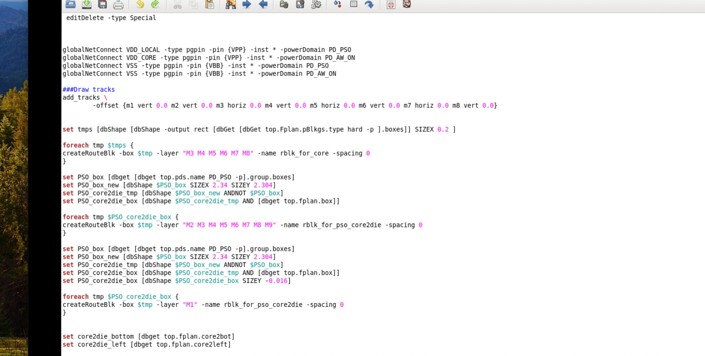

图 2（sroute M1 rail、M2 dual rail 与 M1/M2 R0 stapling）：

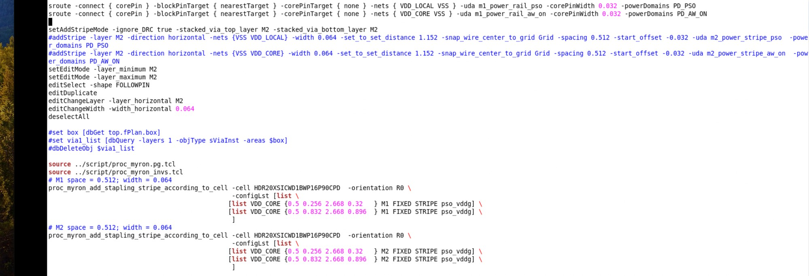

图 3（M3 / M4 R0 stapling）：

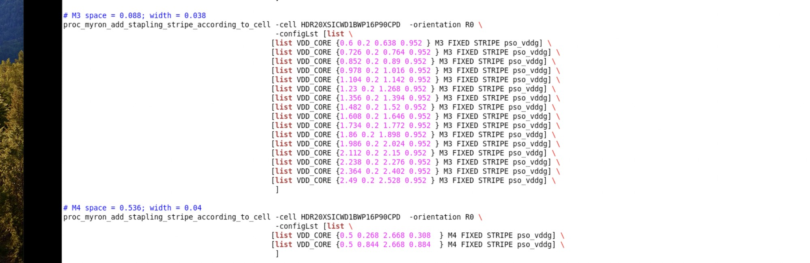

图 4（M5 / M6 / M7 R0 stapling）：

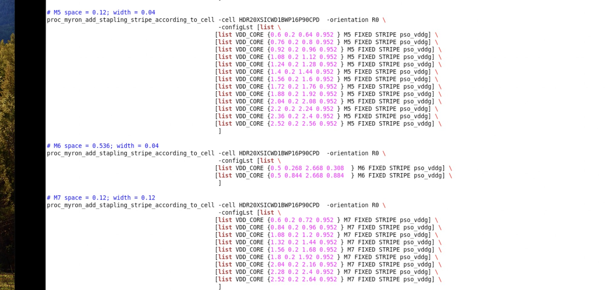

图 5（M8 R0 与 M1 / M2 MX stapling）：

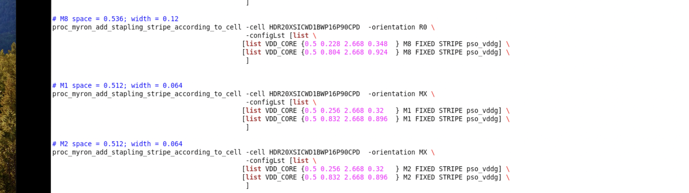

图 6（M3 / M4 MX stapling）：

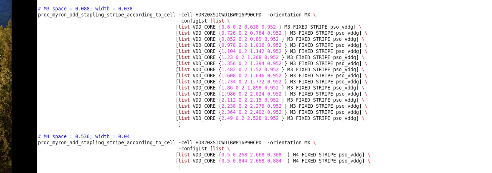

图 7（M5 / M6 / M7 MX stapling）：

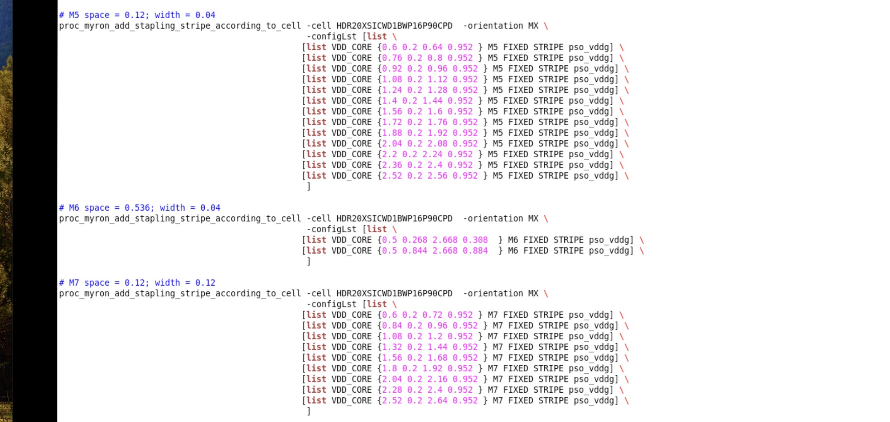

图 8（M8 MX、pso_llx_list 与 M3 VSS / VDD LOCAL addStripe）：

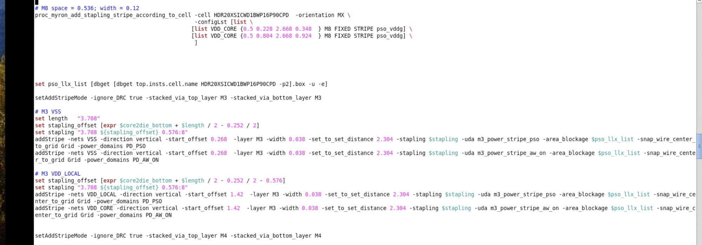

图 9（M4 VSS / VDD LOCAL addStripe）：

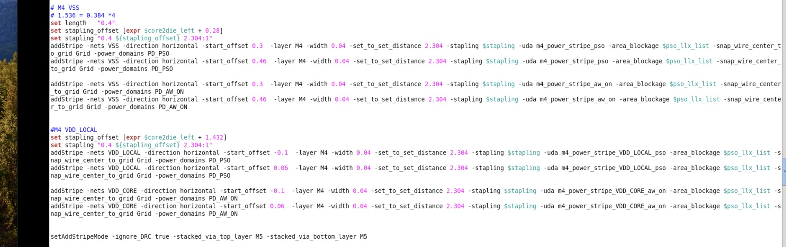

图 10（M5 VSS / VDD LOCAL addStripe）：

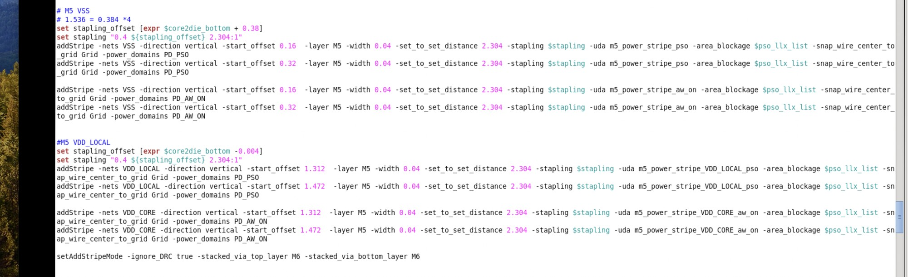

图 11（M6 VSS / VDD 与 M7 VSS addStripe）：

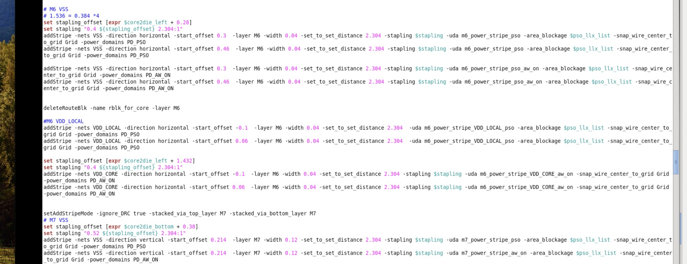

图 12（M9 channel3 pillar 与全局 M9 stripe）：

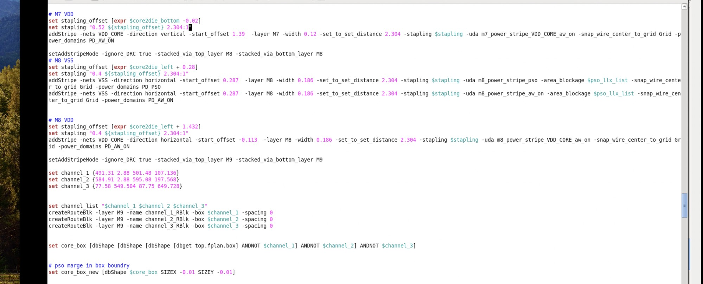

图 13（M9 core_box pillar 与 deleteRouteBlk）：

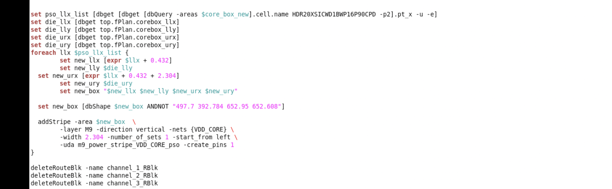

图 14（M7 VDD、M8 VSS/VDD、channel 定义与 core_box_new）：

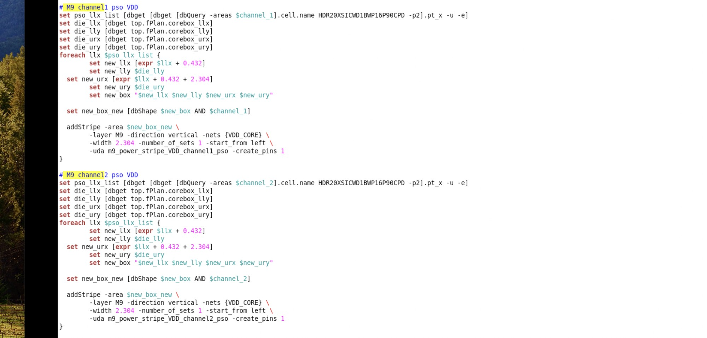

图 15（M9 channel1 / channel2 pillar）：

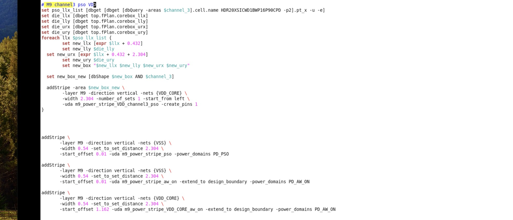

## 相关笔记

- [TCL 脚本](./index.md)
- [Innovus 03 Powerplan](./innovus-03-powerplan.md)
- [T12nm · Powerplan 做什么](../experience/t12nm/powerplan.md)
- [T12nm · Power Switch：Core / Channel 分区与边界](../experience/t12nm/power-switch-core-channel.md)
- [Via Pillar 下方不摆放特殊 cell](./via-pillar-pg-keepout.md)
