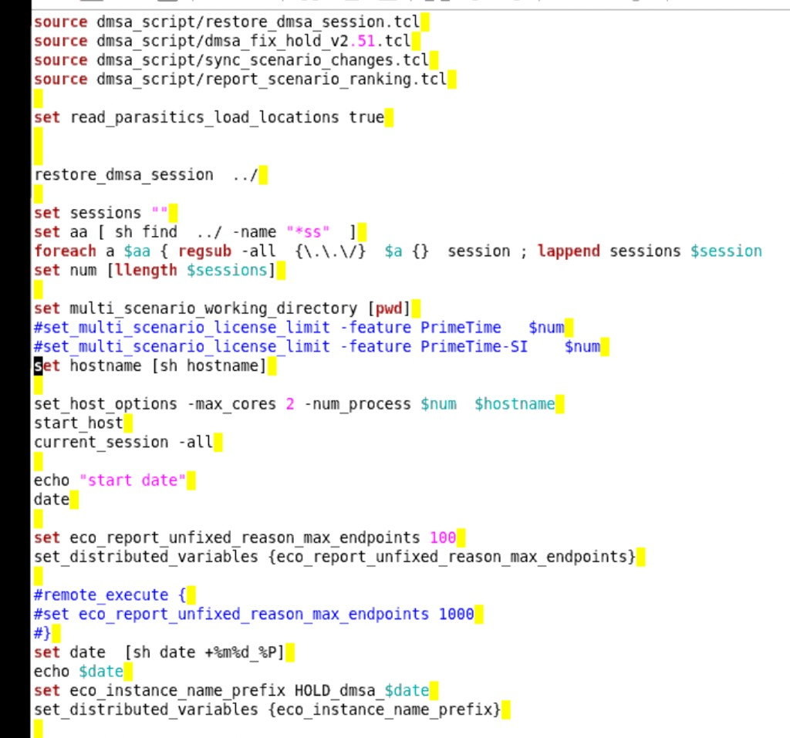
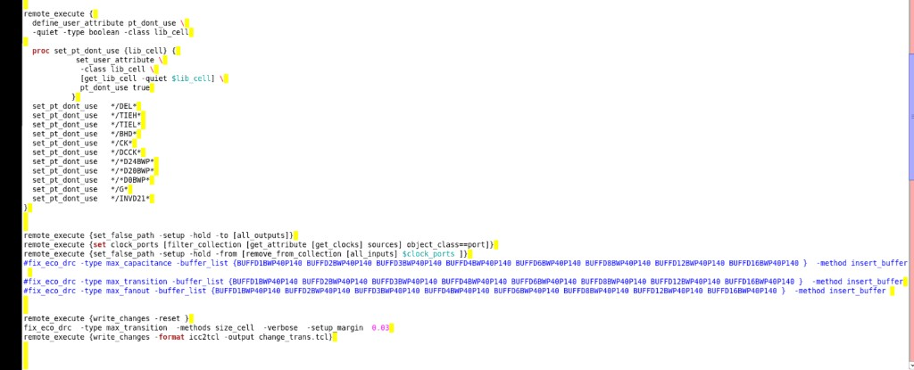
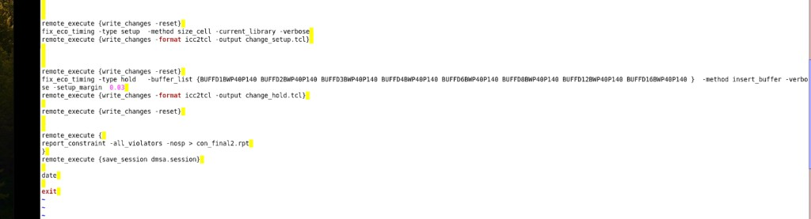

# PT DMSA Hold ECO 脚本

> 日期：2026-09-17  
> 来源：截图识别整理（picture-tcl）  
> 阶段：PrimeTime DMSA hold ECO

三张截图为同一流程的连续片段：恢复 DMSA session → dont_use / false_path / max_transition → setup/hold ECO 与收尾。

## 图 1：Session 恢复与分布式主机



```tcl
source dmsa_script/restore_dmsa_session.tcl
source dmsa_script/dmsa_fix_hold_v2.51.tcl
source dmsa_script/sync_scenario_changes.tcl
source dmsa_script/report_scenario_ranking.tcl

set read_parasitics_load_locations true

restore_dmsa_session ../

set sessions ""
set aa [ sh find ../ -name "*ss" ]
foreach a $aa { regsub -all {\.\.\/} $a {} session ; lappend sessions $session }
set num [llength $sessions]

set multi_scenario_working_directory [pwd]
#set multi_scenario_license_limit -feature PrimeTime $num
#set multi_scenario_license_limit -feature PrimeTime-SI $num
set hostname [sh hostname]

set_host_options -max_cores 2 -num_process $num $hostname
start_host
current_session -all

echo "start date"
date

set eco_report_unfixed_reason_max_endpoints 100
set_distributed_variables {eco_report_unfixed_reason_max_endpoints}

#remote_execute {
#set eco_report_unfixed_reason_max_endpoints 1000
#}
set date [sh date +%m%d_%P]
echo $date
set eco_instance_name_prefix HOLD_dmsa_$date
set_distributed_variables {eco_instance_name_prefix}
```

**转录注记：** 图中黄色高亮为编辑器选区/搜索痕迹，已忽略；`find` 匹配名为 `*ss`（小写）。

## 图 2：dont_use、false_path 与 max_transition ECO



```tcl
remote_execute {
  define_user_attribute pt_dont_use \
    -quiet -type boolean -class lib_cell

  proc set_pt_dont_use {lib_cell} {
    set_user_attribute \
      -class lib_cell \
      [get_lib_cells -quiet $lib_cell] \
      pt_dont_use true
  }

  set_pt_dont_use "*/DEL*"
  set_pt_dont_use "*/TIEH*"
  set_pt_dont_use "*/TIEL*"
  set_pt_dont_use "*/BHD*"
  set_pt_dont_use "*/CK*"
  set_pt_dont_use "*/DCCK*"
  set_pt_dont_use "*/D24BWP*"
  set_pt_dont_use "*/D20BWP*"
  set_pt_dont_use "*/D0BWP*"
  set_pt_dont_use "*/G*"
  set_pt_dont_use "*/INVD21*"
}

remote_execute {set_false_path -setup -hold -to [all_outputs]}
remote_execute {set clock_ports [filter_collection [get_attribute [get_clocks] sources] object_class==port]}
remote_execute {set_false_path -setup -hold -from [remove_from_collection [all_inputs] $clock_ports ]}

#fix_eco_drc -type max_capacitance -buffer_list {BUFFD1BWP40P140 BUFFD2BWP40P140 BUFFD3BWP40P140 BUFFD4BWP40P140 BUFFD6BWP40P140 BUFFD8BWP40P140 BUFFD12BWP40P140 BUFFD16BWP40P140 } -method insert_buffer
#fix_eco_drc -type max_transition  -buffer_list {BUFFD1BWP40P140 BUFFD2BWP40P140 BUFFD3BWP40P140 BUFFD4BWP40P140 BUFFD6BWP40P140 BUFFD8BWP40P140 BUFFD12BWP40P140 BUFFD16BWP40P140 } -method insert_buffer
#fix_eco_drc -type max_fanout      -buffer_list {BUFFD1BWP40P140 BUFFD2BWP40P140 BUFFD3BWP40P140 BUFFD4BWP40P140 BUFFD6BWP40P140 BUFFD8BWP40P140 BUFFD12BWP40P140 BUFFD16BWP40P140 } -method insert_buffer

remote_execute {write_changes -reset }
fix_eco_drc -type max_transition -methods size_cell -verbose -setup_margin 0.03
remote_execute {write_changes -format icc2tcl -output change_trans.tcl}
```

**转录注记：**

- `define_user_attribute` / `set_user_attribute` 行续行符 `\` 已按原图保留。
- 注释掉的三条 `#fix_eco_drc` 为单行长命令；buffer 名按图中 `BWP40P140` 系列转录。
- 活跃的 `fix_eco_drc` 使用 `-methods size_cell`（复数），与注释行里的 `-method` 不同，照实保留。
- `get_lib_cells` 存疑：截图分辨率下也可能是 `get_lib_cell`，当前按复数形式转录。

## 图 3：Setup / Hold ECO 与收尾



```tcl
remote_execute {write_changes -reset}
fix_eco_timing -type setup -method size_cell -current_library -verbose
remote_execute {write_changes -format icc2tcl -output change_setup.tcl}

remote_execute {write_changes -reset}
fix_eco_timing -type hold -buffer_list {BUFFD1BWP40P140 BUFFD2BWP40P140 BUFFD3BWP40P140 BUFFD4BWP40P140 BUFFD6BWP40P140 BUFFD8BWP40P140 BUFFD12BWP40P140 BUFFD16BWP40P140 } -method insert_buffer -verbose -setup_margin 0.03
remote_execute {write_changes -format icc2tcl -output change_hold.tcl}

remote_execute {write_changes -reset}

remote_execute {
report_constraint -all_violators -nosp > con_final2.rpt
}
remote_execute {save_session dmsa.session}

date

exit
```

**转录注记：** 原图中 `fix_eco_timing ... -method insert_buffer -verbose` 因窗口宽度在 `-verbose` 处折行（显示为 `-verbo` / 下一行 `se -setup_margin 0.03`），已拼回单行。

## 相关笔记

- [TCL 脚本](./index.md)
- [脚本页模板](./template.md)
