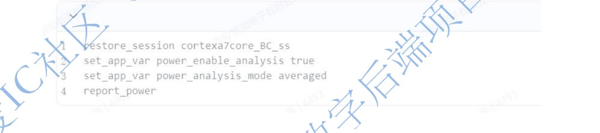

# PT 查看功耗

> 日期：2026-09-18  
> 来源：截图识别整理（picture-tcl）  
> 阶段：PrimeTime 功耗报告

## 完整脚本

```tcl
restore_session cortexa7core_BC_ss
set_app_var power_enable_analysis true
set_app_var power_analysis_mode averaged
report_power
```

## 原图



## 相关笔记

- [TCL 脚本](./index.md)
- [PT DMSA Hold ECO 脚本](./pt-dmsa-hold-eco.md)
