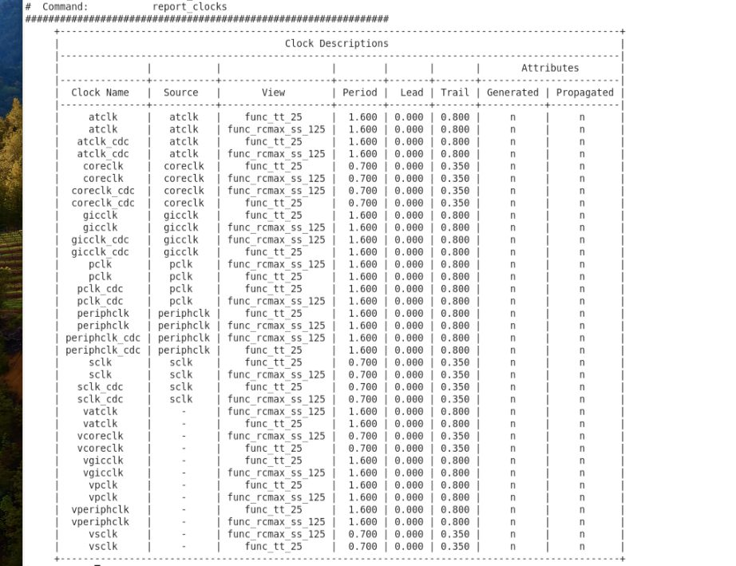

# report_clocks 查看 Design 频率

> 日期：2026-10-07  
> 来源：截图识别整理（picture-tcl）  
> 阶段：Timing / Clock

用 `report_clocks` 查看 design 里已定义 clock 的 **Period**（再换算频率：\(f = 1 / T\)）。图中可见 `coreclk` / `sclk` 等 Period `0.700`（约 1.43 GHz），`atclk` / `pclk` 等 Period `1.600`（625 MHz）。

## 命令

```tcl
report_clocks
```

## 输出示意



【回显】要点（节选）：

| Clock | Period | Lead / Trail | 约合频率 |
|-------|--------|--------------|----------|
| atclk / atclk_cdc | 1.600 | 0.000 / 0.800 | 625 MHz |
| coreclk / coreclk_cdc | 0.700 | 0.000 / 0.350 | ~1.43 GHz |
| gicclk / gicclk_cdc | 1.600 | 0.000 / 0.800 | 625 MHz |
| pclk / pclk_cdc | 1.600 | 0.000 / 0.800 | 625 MHz |
| periphclk / periphclk_cdc | 1.600 | 0.000 / 0.800 | 625 MHz |
| sclk / sclk_cdc | 0.700 | 0.000 / 0.350 | ~1.43 GHz |
| vatclk 等 virtual（Source `-`） | 同对应物理 clock | — | 同上 |

图中 View 含 `func_tt_25`、`func_rcmax_ss_125`；Generated / Propagated 均为 `n`（理想 clock，未 propagate）。

## 相关笔记

- [报告 Path 逻辑深度](./report-logic-depth.md)
