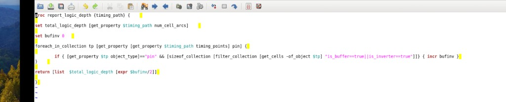

# 报告 Path 逻辑深度

> 日期：2026-09-18  
> 来源：截图识别整理（picture-tcl）  
> 阶段：Timing path 逻辑深度报告

## 完整脚本

```tcl
proc report_logic_depth {timing_path} {

set total_logic_depth [get_property $timing_path num_cell_arcs]

set bufinv 0

foreach_in_collection tp [get_property [get_property $timing_path timing_points] pin] {

    if { [get_property $tp object_type]=="pin" && [sizeof_collection [filter_collection [get_cells -of_object $tp] "is_buffer==true||is_inverter==true"]]} { incr bufinv }
}

return [list $total_logic_depth [expr $bufinv/2]]

}
```

**转录注记：** `if` 条件整段为原图单行；返回值为 `[总 cell arcs, buf/inv 个数]`，其中 buf/inv 由 pin 计数再 `/2`。


## 前后执行流程

```
# 报告路径的 startPoint -> endPoint
report_timing -from u_cortexa7noram/u_ca7biu/u_write_arbiter/wbuf_slot_bls_reg_3_6/Q \
    -to u_cortexa7noram/u_ca7biu/u_write_arbiter/wbuf_drain_256bit_reg/D -machine_readable > 072

# 加载
load_timing_debug_report 0728

# 高亮
highlight_timing_report -path 1

# source 脚本
source report_logic_depth.tcl

# 执行结果 -> 输出 
report_logic_depth [report_timing -from <launch_ff>/Q -to <capture_ff>/D -collection]
```


## 原图



## 相关笔记

- [TCL 脚本](../index.md)
- [脚本页模板](../template.md)
- [Place 后检查 Input Floating](../check/input-floating.md)
