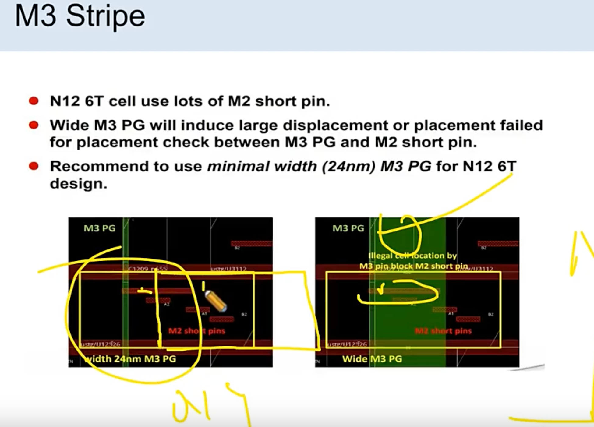
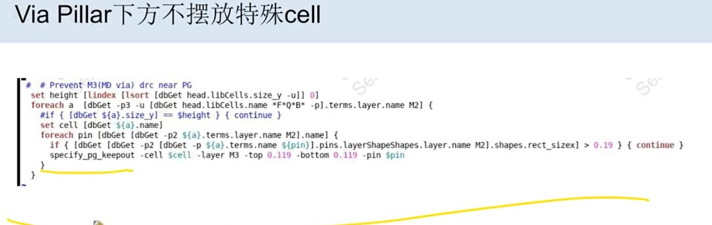

# Via Pillar 下方不摆放特殊 cell

> 日期：2026-09-21  
> 来源：截图识别整理（picture-tcl）  
> 阶段：Powerplan / PG keepout



## 完整脚本

```tcl
# # Prevent M3(MD via) drc near PG
set height [lindex [lsort [dbGet head.libCells.size_y -u]] 0]
foreach a [dbGet -p3 -u [dbGet head.libCells.name *F*Q*B* -p].terms.layer.name M2] {
  #if { [dbGet ${a}.size_y] == $height } { continue }
  set cell [dbGet ${a}.name]
  foreach pin [dbGet [dbGet -p2 ${a}.terms.layer.name M2].name] {
    if { [dbGet [dbGet -p2 [dbGet -p ${a}.terms.name ${pin}].pins.layerShapeShapes.layer.name M2].shapes.rect_sizex] > 0.19 } { continue }
    specify_pg_keepout -cell $cell -layer M3 -top 0.119 -bottom 0.119 -pin $pin
  }
}
```

**转录注记：** 图题为「Via Pillar下方不摆放特殊cell」。首行注释为 `# # Prevent ...`（两个 `#`）照录；`#if` 行为注释，未启用。

## 原图



## 相关笔记

- [TCL 脚本](./index.md)
- [T12nm · Powerplan 做什么](../experience/t12nm/powerplan.md)
- [Innovus PG Special（Memory M5）](./innovus-pg-special.md)
