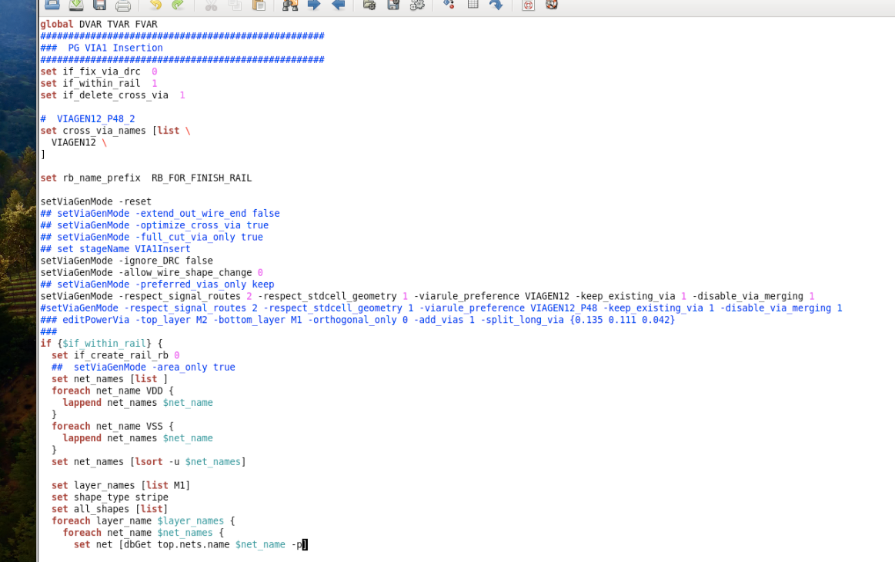
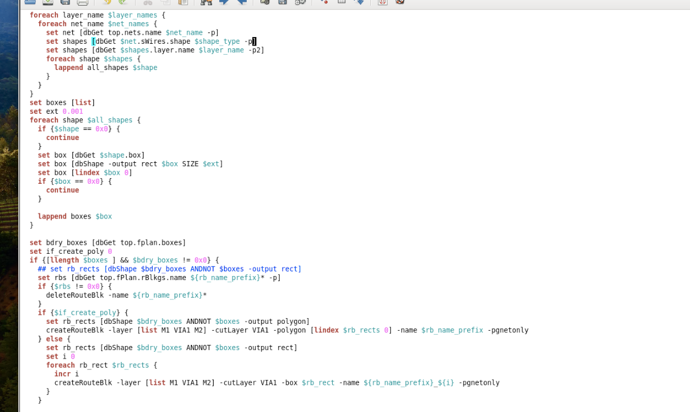
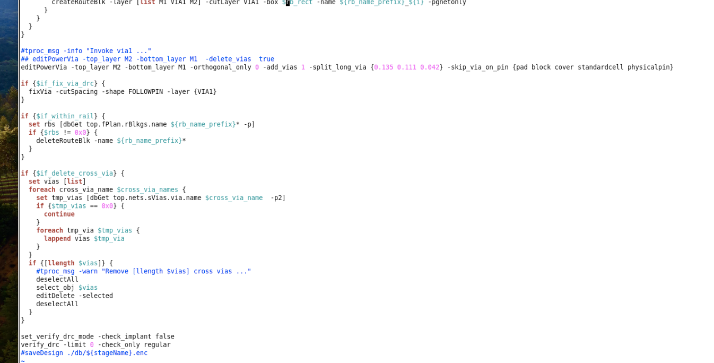

# VIA1 插入（PG VIA1 Insertion）

> 日期：2026-10-01（初版 2026-09-24，用 3 张更清晰的截图重拼）  
> 阶段：Powerplan（M1/M2 dual-rail 之间打 VIA1）  
> 用途：给 M1 和 M2 之间打上 VIA1

## 流程一览

1. `setViaGenMode` 配置 via 生成规则（VIAGEN12）；
2. 收集 VDD/VSS 在 M1 的 rail shape，在 rail 范围**外**建 route block（`RB_FOR_FINISH_RAIL`，M1/VIA1/M2）；
3. `editPowerVia` 在 M2–M1 之间插 VIA1——route block 挡着，via 只落在 rail 范围内；
4. 删 route block，删 VIAGEN12 这类 cross via；
5. `verify_drc`。

## 完整脚本

三张截图首尾相接、重叠段去重后的可 `source` 版本：

```tcl
global DVAR TVAR FVAR
#################################################
###   PG VIA1 Insertion
#################################################
set if_fix_via_drc      0
set if_within_rail      1
set if_delete_cross_via 1

#  VIAGEN12_P48_2
set cross_via_names [list \
   VIAGEN12 \
]

set rb_name_prefix RB_FOR_FINISH_RAIL

setViaGenMode -reset
## setViaGenMode -extend_out_wire_end false
## setViaGenMode -optimize_cross_via true
## setViaGenMode -full_cut_only_via true
## set stageName VIA1Insert
setViaGenMode -ignore_DRC false
setViaGenMode -allow_wire_shape_change 0
## setViaGenMode -preferred_vias_only keep
setViaGenMode -respect_signal_routes 2 -respect_stdcell_geometry 1 -viarule_preference VIAGEN12 -keep_existing_via 1 -disable_via_merging 1
#setViaGenMode -respect_signal_routes 2 -respect_stdcell_geometry 1 -viarule_preference VIAGEN12_P48 -keep_existing_via 1 -disable_via_merging 1
### editPowerVia -top_layer M2 -bottom_layer M1 -orthogonal_only 0 -add_vias 1 -split_long_via {0.135 0.111 0.042}
###

if {$if_within_rail} {
    set if_create_rail_rb 0
    ## setViaGenMode -area_only true
    set net_names [list ]
    foreach net_name VDD {
        lappend net_names $net_name
    }
    foreach net_name VSS {
        lappend net_names $net_name
    }
    set net_names [lsort -u $net_names]

    set layer_names [list M1]
    set shape_type stripe
    set all_shapes [list]
    foreach layer_name $layer_names {
        foreach net_name $net_names {
            set net [dbGet top.nets.name $net_name -p]
            set shapes [dbGet $net.sWires.shape $shape_type -p]
            set shapes [dbGet $shapes.layer.name $layer_name -p2]
            foreach shape $shapes {
                lappend all_shapes $shape
            }
        }
    }

    set boxes [list]
    set ext 0.001
    foreach shape $all_shapes {
        if {$shape == 0x0} {
            continue
        }
        set box [dbGet $shape.box]
        set box [dbShape -output rect $box SIZE $ext]
        set box [lindex $box 0]
        if {$box == 0x0} {
            continue
        }
        lappend boxes $box
    }

    set bdry_boxes [dbGet top.fplan.boxes]
    set if_create_poly 0
    if {[llength $boxes] && $bdry_boxes != 0x0} {
        ## set rb_rects [dbShape $bdry_boxes ANDNOT $boxes -output rect]
        set rbs [dbGet top.fplan.rBlkgs.name ${rb_name_prefix}* -p]
        if {$rbs != 0x0} {
            deleteRouteBlk -name ${rb_name_prefix}*
        }
        if {$if_create_poly} {
            set rb_rects [dbShape $bdry_boxes ANDNOT $boxes -output polygon]
            createRouteBlk -layer [list M1 VIA1 M2] -cutLayer VIA1 -polygon [lindex $rb_rects 0] -name $rb_name_prefix -pgnetonly
        } else {
            set rb_rects [dbShape $bdry_boxes ANDNOT $boxes -output rect]
            set i 0
            foreach rb_rect $rb_rects {
                incr i
                createRouteBlk -layer [list M1 VIA1 M2] -cutLayer VIA1 -box $rb_rect -name ${rb_name_prefix}_${i} -pgnetonly
            }
        }
    }
}

#tproc_msg -info "Invoke via1 ..."
## editPowerVia -top_layer M2 -bottom_layer M1 -delete_vias true
editPowerVia -top_layer M2 -bottom_layer M1 -orthogonal_only 0 -add_vias 1 -split_long_via {0.135 0.111 0.042} -skip_via_on_pin {pad block cover standardcell physicalpin}

if {$if_fix_via_drc} {
    fixVia -cutSpacing -shape FOLLOWPIN -layer {VIA1}
}

if {$if_within_rail} {
    set rbs [dbGet top.fplan.rBlkgs.name ${rb_name_prefix}* -p]
    if {$rbs != 0x0} {
        deleteRouteBlk -name ${rb_name_prefix}*
    }
}

if {$if_delete_cross_via} {
    set vias [list]
    foreach cross_via_name $cross_via_names {
        set tmp_vias [dbGet top.nets.sVias.via.name $cross_via_name -p2]
        if {$tmp_vias == 0x0} {
            continue
        }
        foreach tmp_via $tmp_vias {
            lappend vias $tmp_via
        }
    }
    if {[llength $vias]} {
        #tproc_msg -warn "Remove [llength $vias] cross vias ..."
        deselectAll
        select_obj $vias
        editDelete -selected
        deselectAll
    }
}

set_verify_drc_mode -check_implant false
verify_drc -limit 0 -check_only regular
#saveDesign ./db/${stageName}.enc
```

## 转录注记

1. 三张截图首尾有重叠（图 1 末尾 `foreach` 三行 = 图 2 开头；图 2 末尾 `createRouteBlk` 一段 = 图 3 开头），拼接时已去重；缩进做了归一。
2. 图 3 里 `-box {?_b_rect`、多出来的一个 `[dbGet` 是识别伪影，按图 2 同一段校正为 `$rb_rect` / 单个 `dbGet`（旧转录该行曾多一个 `-e`，这次按新图不带）。
3. 图 3 读出的 `if {$fix_via_drc}` 按脚本开头 `set if_fix_via_drc 0` 校正为 `$if_fix_via_drc`；`#tproc_msg` 同理（都是注释/变量名笔误，不影响执行，原图备查）。
4. **外层 `if {$if_within_rail}` 建完 route block 就闭合**——`editPowerVia`、删 RB、删 cross via 都在顶层顺序执行（图 3 开头连续 4 个 `}` 可对上；旧版拼接曾把 editPowerVia 包进 if 里，这次修正）。
5. `sWires`：PG stripe 是 special wire（addStripe 建的），dbGet 走 `net.sWires.shape`；`top.fplan` / `top.fPlan` 两处大小写照录。
6. 生效的 `editPowerVia ...` 与 [PowerVia 打上与删除](./power-via-add-delete.md) 图 1 为同款命令——那页截图末尾多 `-uda dual_rail_via1`（命名变体，Calibre 验证后按名删）；本脚本用 route block 限定插入范围，两种用法互补。

## 原图

图 1（开头：开关、setViaGenMode、收集 net）：



图 2（收集 M1 rail shape、建 route block）：



图 3（editPowerVia 插 VIA1、删 RB / cross via、verify_drc）：



## 相关笔记

- [TCL 脚本](./index.md)
- [PowerVia 打上与删除（dual_rail_via1）](./power-via-add-delete.md)
- [Power Switch Stapling Stripe（power_stape_pso）](./power-stape-pso.md)
- [Innovus 03 Powerplan](./innovus-03-powerplan.md)
- [T12nm · Powerplan 做什么](../experience/t12nm/powerplan.md)
